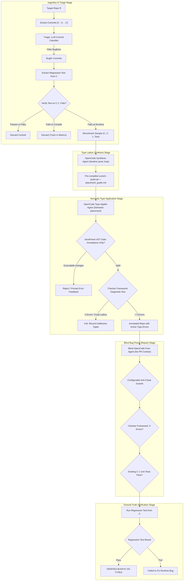

# Pipeline Design Plan: LLM Type Annotation Synthesis & Blind Verification

## 1. Executive Summary & Core Hypothesis

### Core Hypothesis
Can domain-specific static type qualifiers (via the Java Checker Framework) be automatically synthesized by an LLM to prevent real-world bugs, and can those types guide a downstream "fixer" agent—which has never seen the bug or pull request description—to fix the latent bug purely by resolving static type errors?

### High-Level Workflow
1. **Triage & Reproducibility**: Given a Git repository $R$ and commit depth $d$, identify bugfix commits $C$, extract their regression tests, and deterministically verify that the tests compile and fail at runtime on commit $C-1$.
2. **Type Lattice & Qualifier Synthesis**: Given commit $C-1$ and the bug context, an LLM agent synthesizes a custom Checker Framework qualifier hierarchy (or selects a built-in checker) as a pure marker qualifier hierarchy (Level 0; zero executable helper code), packaging it into `custom-quals.jar` alongside a placement guide (`placement_guide.md`).
3. **Semantic Type Placement**: An agent applies the synthesized type annotations across the $C-1$ codebase following semantic cues (parameter names, callgraphs, variable roles) without modifying executable logic, creating active static type errors on the unpatched code.
4. **Blind Repair**: A blind fixer agent—strictly isolated from commit $C$, PR text, and regression tests—is tasked with resolving all Checker Framework errors on $C-1$ without modifying method signatures or adding suppressions.
5. **Ground-Truth Evaluation**: The unpatched regression test from commit $C$ is executed against the fixer's modified codebase to evaluate whether resolving the static type errors cured the actual runtime bug.

---

## 2. Pipeline Execution Paradigms & Stage Contracts

| Stage | Component | Paradigm | Harness / Tooling | Formal Inputs | Formal Outputs (Artifacts & State) |
| :--- | :--- | :--- | :--- | :--- | :--- |
| **Ingestion** | Workspace & Cache Ingestion | **Deterministic** | Git Worktrees, Shared Caches | Target repo URL/path $R$, Commit $C$, Depth $d$ | Clean ephemeral worktree at commit $C-1$, pre-warmed Gradle cache |
| **Triage** | Benchmark Ingestion & Test Verification | **Deterministic Manifest (MVP)** / Simple LLM (Future) | Curated Manifest (`benchmarks.yaml`) / LLM API + Gradle Runner | Curated sample entry ($C, C-1, T_{\text{reg}}$) OR Commit $C$ Git diff, PR metadata, clean $C-1$ worktree | Verified benchmark sample ($C$, $C-1$, $T_{\text{reg}}$, `test_patch.diff`), verification verdict on $C-1$ |
| **Synthesis** | Type Lattice & Guard Synthesis | **Agent** (Iterative `javac` loop) | OpenCode (`opencode run`) + `javac` | Unpatched $C-1$ code, bug context (diff of $C$, commit msg, PR body), stage config | `custom-quals.jar` (qualifier annotations only; zero helpers), `placement_guide.md`, qualifier source files (`custom_quals_src/`), `checker_category` + `selected_processor` (exactly one processor), synthesis agent transcript |
| **Application** | Semantic Type Application | **Agent** (Multi-turn edit loop) + **Deterministic AST Validator** | OpenCode (`opencode run`) + JavaParser (`AstGuard`) | Clean $C-1$ code, `custom-quals.jar`, `placement_guide.md`, AST guardrails | Unified Git patch (`annotations.patch` relative to $C-1$), AST + path audit log, initial Checker compiler log (`initial_checker_errors.log`), non-triviality error count $\ge 1$ |
| **Repair** | Blind Bug Fixing | **Agent** (Iterative compile loop) | OpenCode (`opencode run`) + Gradle | Annotated $C-1$ code ($C-1$ base + `annotations.patch`), initial Checker log, `custom-quals.jar`, anti-cheat config. *(Blind to $C$, PR text, and $T_{\text{reg}}$; existing $C-1$ tests may be visible read-only, but $T_{\text{reg}}$, its test patch, and build/test outputs are absent)* | Repaired codebase unified Git patch (`repair.patch` relative to the annotated baseline, not clean $C-1$), anti-cheat validation log, final Checker log (verifying 0 errors), repair agent transcript. Verification applies `annotations.patch` first, then `repair.patch`. |
| **Verification** | Ground-Truth Verification | **Deterministic** | Gradle Test Runner | $C-1$ base + `annotations.patch` + `repair.patch`, extracted regression test patch (`test_patch.diff` from triage stage) | Test execution report, original unit test suite report, final evaluation verdict (`full_success`, `type_success_runtime_fail`, `regression_introduced`, `fixer_incomplete`, `partial_success_regression_only`), resource metrics |



### Cross-Cutting Execution Architecture: Stage Caching & Lineage (Merkle CAS + SQLite)
Rather than executing the pipeline as a rigid, monolithic script, the orchestrator treats each pipeline stage as an isolated, content-addressable node in a **Merkle Directed Acyclic Graph (DAG)** backed by **Content-Addressable Storage (CAS)** on disk and a **Relational Index** in SQLite (`data/pipeline.db`):

1. **Content-Addressable Stage Invalidation & Seamless Reverts**:
   - Cache keys are derived deterministically:
     $$K_{\text{stage}} = \text{SHA-256}(\text{stage\_name} + H(\text{stage\_input}) + H(\text{upstream\_artifacts}) + H(\text{config\_slice}) + H(\text{prompt\_template}) + H(\text{stage\_code}) + \text{sample\_index})$$
     Here `sample_index` is used as the stochastic seed (and lineage discriminator), not merely a cosmetic label.
   - Modifying a single stage (e.g., editing repair stage prompts or code) generates a new key $K_{\text{repair}}'$, leaving cached outputs for upstream stages intact.
   - Reverting edits to the repair stage restores the exact previous key $K_{\text{repair}}$, yielding an instant cache hit from before the edit without losing intervening experiment branches.
2. **Workspace State Transfer via Unified Git Patches**:
   - The Application stage serializes its modifications as a unified Git diff (`annotations.patch`) relative to immutable base commit $C-1$; the Repair stage serializes its modifications as `repair.patch` relative to the annotated baseline ($C-1$ + `annotations.patch`).
   - Downstream stages reconstruct the exact workspace state by applying `annotations.patch` onto a freshly checked-out $C-1$ worktree and then applying `repair.patch` (`git apply`), eliminating duplicated multi-hundred-megabyte directory snapshots.
3. **Multi-Sample Stochastic Retries**:
   - To study nondeterministic LLM behavior under identical configurations, the pipeline supports an integer `sample_index` parameter (`sample_index: 0, 1, 2, ...`) that also seeds the stochastic run. Running `--sample 1` records an independent sample while preserving all previous sample history in CAS.
   - The MVP executes samples sequentially. Concurrent batch execution / multi-sample parallelism is deferred to Section 7 (Future Developments, §7.14).
   - Each sample is persisted as its own per-run CAS bundle and SQLite `evaluation_runs` row; retries within a stage carry an `attempt_number` so they remain distinguishable.
4. **Two-Tier Failure Policy**:
   - **Deterministic Outcomes Cached**: Triage discards (non-bugfix, non-compiling tests) and verification test verdicts are cached permanently in CAS and SQLite to prevent redundant re-runs.
   - **Transient Agent Failures Retried**: Agent timeouts, network glitches, or API crashes are logged to SQLite for telemetry, but leave CAS empty so subsequent invocations automatically re-attempt the failed stage.
5. **Configurable Append-Only Storage**:
   - Artifact bundles reside in a configurable directory (`project_config.yaml`: `cache.stages_dir`, defaulting to `.cache/stages/`), gitignored, and retained append-only to support long experiment histories.

---

## 3. Stage-by-Stage Specification

### Stage: Workspace Ingestion & Build Cache Pre-Warming
- **Execution Paradigm**: Deterministic Runner.
- **Formal Inputs**:
  - `repo_url` / `local_path`: Target repository location.
  - `commit_hash` ($C$): Target historical bugfix commit.
  - `commit_depth` ($d$): Depth scan parameter.
- **Formal Outputs (Artifacts & State)**:
  - Ephemeral Git worktree checked out at clean parent commit $C-1$.
  - Pre-warmed Gradle cache (`~/.gradle/caches` containing project dependencies and wrapper distributions).
  - Recorded ingestion metadata in SQLite.
- **Isolation via Git Worktrees**:
  Each commit evaluation runs in an ephemeral `git worktree` branched off a local mirror clone. This provides instantaneous workspace setup and teardown without network cloning or disk bloat.
- **Cache Sharing**:
  A centralized Gradle user home (`~/.gradle/caches` and `~/.gradle/wrapper`) is mounted read-write or with shared lock semantics across runs. When a repository is first registered, a pre-warm pass (`./gradlew build -x test`) downloads all project dependencies and Gradle wrapper distributions once.
- **Build Incompatibilities**:
  If a historical commit fails to compile due to an incompatible JDK version, outdated plugins, or broken dependencies, the commit is skipped and recorded in the database metrics.

### Stage: Benchmark Ingestion & Ground-Truth Test Verification
- **Execution Paradigm**: Deterministic Manifest Ingestion (MVP) / Simple LLM Classifier + Deterministic Verification (Future).
- **Formal Inputs**:
  - *MVP Mode (`manifest`)*: Benchmark specification entry from `benchmarks.yaml` (`benchmark_id`: `BenchmarkId`, `repo_url`: String, `commit_hash` / `parent_hash`: `CommitHash`, `regression_test`: `TestCoordinate`, and optional path to regression test patch).
  - *Future Automated Mode (`crawler`)*: Git diff of commit $C$ (`git diff C~1..C`), commit metadata (commit message, PR title, PR description), stage configuration (`model.triage`, prompt template `triage.md`).
  - Target repository worktree at clean commit $C-1$.
- **Formal Outputs (Artifacts & State - Identical Typed Contract across Modes)**:
  - `triage_status`: Triage lifecycle status (`pending`, `verified`, `discarded_*`, `non_bugfix`); when a sample is discarded, `discard_reason` carries the typed `DiscardReason`.
  - `classification`: Binary bugfix classification only (`bugfix` vs `non_bugfix`); no multi-way category taxonomy is used in the MVP or the crawler contract.
  - `regression_test`: Fully qualified test coordinate (`TestCoordinate` holding `testClass: Fqcn` and `testMethod: String`).
  - `test_patch.diff`: Extracted test patch containing the regression test from $C$.
  - `triage_metadata.json`: Execution log on $C-1$/$C$ and source provenance.
- **Deterministic Verification Invariant ($T_{\text{reg}}$ must fail on $C-1$ and pass on $C$)**:
  1. Retrieve the test patch from $C$ (`src/test/**`). Audit every touched path; the patch may only modify or add test sources and must not change production or build files. An invalid patch is discarded with `discard_reason: invalid_test_patch`.
  2. Verify that the unpatched $C-1$ project builds. A broken baseline is discarded with `discard_reason: build_broken_unpatched`, distinct from a failure to compile the test patch.
  3. Apply the test patch onto clean commit $C-1$.
  4. Run the regression test via Gradle:
     - **Compilation Failure**: Discard commit and record `discard_reason: test_compilation_failure` in metrics.
     - **Passes on $C-1$**: Discard commit and record `discard_reason: test_passes_unpatched`.
     - **Compiles & Fails at Runtime**: The $C-1$ side reproduces the bug. Proceed to fixed-side confirmation.
  5. Materialize $C$ in a disposable sandbox (`git worktree add --detach <sandbox_c> <commit_hash>`) and run $T_{\text{reg}}$ there. It must **pass**. If it fails or errors, discard with `discard_reason: regression_does_not_pass_on_fixed_commit`; if $C$ cannot be materialized, discard with `discard_reason: fixed_commit_unavailable`.
  6. Triage runs in disposable sandboxes. It must not leave the applied regression test, compiled test classes, JUnit XML, or Gradle reports in a worktree that downstream stages can read.
- **MVP Decoupling Design**: In the initial implementation, the triage stage reads directly from a curated `benchmarks.yaml` manifest containing verified $(C, C-1, T_{\text{reg}})$ pairs (e.g., `synthetic-id-swap` and curated `cmsx` commits). It executes the deterministic verification invariant on $C-1$, confirms $T_{\text{reg}}$ passes on the fixed state $C$ materialized via Git worktree, and emits the exact same `VerifiedSample` artifact contract as the future automated crawler. Automated commit depth scanning and LLM triage are deferred to Section 7 (Future Developments, §7.4).

### Stage: Type Lattice Synthesis & Implementer Freedom
- **Execution Paradigm**: Agent (Multi-turn iterative loop using OpenCode).
- **Formal Inputs**:
  - Target repository source tree at clean commit $C-1$.
  - Bug context: Diff of commit $C$ (filtered to production paths; test-file hunks removed), commit message, PR title and description.
  - Stage configuration: `synthesis.freedom_level` (MVP: `"level0"`), `synthesis.allowed_checkers`, `model.synthesis`, turn budget, prompt template (`synthesis.md`).
  - Stochastic sample seed: `sample_index`.
  - The regression test coordinate, test patch, and test file contents are not synthesis inputs.
- **Formal Outputs (Artifacts & State)**:
  - `custom-quals.jar`: Compiled JAR packaging synthesized qualifier annotations only (Level 0; zero executable helpers or contract classes).
  - `placement_guide.md`: Structured markdown specifications establishing high-level, declarative typing policies across four standardized categories (Defaulting Invariants, Source Rules / Introducers, Sink Rules / Consumers, Sanitizers & Coercions) without naming codebase-specific symbols.
  - `custom_quals_src/`: Raw Java source files for qualifiers and contracts.
  - `checker_category`: Exactly one of `custom_qualifier_hierarchy` or `builtin_checker`, recording the selected strategy for this sample.
  - `selected_processor`: The single Checker Framework processor the pipeline will invoke (e.g., `SubtypingChecker` for a custom hierarchy, or exactly one built-in checker such as `NullnessChecker`).
  - `synthesis_transcript.json`: Full OpenCode agent multi-turn interaction log.
  - `synthesis_metrics.json`: Compiler iteration count, turn count, duration, token usage.
- **Declarative Placement Guide Policy**:
  To prevent the synthesis stage from leaking bug locations or acting as an ad-hoc line-by-line patcher, `placement_guide.md` is strictly constrained to be a high-level declarative typing policy rather than a codebase-specific punch-list. The guide must specify rules across four categories:
  1. *Defaulting Invariants*: Baseline assumptions across unannotated types (e.g., all unannotated reference types are assumed `@NonNull`).
  2. *Source Rules (Introducers)*: Boundary patterns where alternate qualifiers originate (e.g., return values from map lookups, deserializers, external HTTP inputs, or `null` literals).
  3. *Sink Rules (Enforcers)*: Operations or APIs requiring verified qualifiers (e.g., dereferences, SQL query arguments, map keys).
  4. *Sanitizer/Coercion Invariants*: Transformation boundaries that validate or cast qualifiers.
  Prompt instructions in `prompts/synthesis.md` explicitly forbid naming concrete class names, method names, variable names, or file paths from the target repository.
- **Checker Selection Invariant**:
  Exactly one checker family/processor is selected per sample: either the custom qualifier hierarchy run through the built-in `SubtypingChecker`, or exactly one built-in checker (e.g., Nullness, Index, Regex, or FormatString). All built-in checkers are never run simultaneously. `synthesis.allowed_checkers` only constrains which of these single-processor choices are legal; the pipeline executes only the selected processor during application, repair, and verification.
- **Levels of Freedom for Implementer**:
  - *Level 0 (Monomorphic Marker Lattice - Active in MVP)*: Declarative subtyping hierarchies (`@SubtypeOf`) via built-in `SubtypingChecker` for the custom-quals arm, or exactly one selected built-in checker, plus local variable defaulting via `@DefaultQualifier`. Zero executable helper code in `custom-quals.jar` (`synthesis.helpers_count == 0`).
  - *Level 1 (Flow-Sensitive Contracts on Existing Code - Deferred to Future)*: Level 0 plus method preconditions (`@RequiresQualifier`) and conditional/unconditional postconditions (`@EnsuresQualifierIf`, `@EnsuresQualifier`).
  - *Level 2 (Dependent & Value-Parameterized Qualifiers - Deferred to Future)*: Level 1 plus value/expression-dependent qualifiers (`@Range(from, to)`, `@Pattern(regex)`, `@MinLen(n)`, `@KeyFor(map)`).
  - **Selected MVP Policy**: **Level 0 (Active Standard)**. The configuration exposes `synthesis.freedom_level: "level0"`. Zero executable helper code is synthesized (`synthesis.helpers_count == 0`), ensuring `custom-quals.jar` strictly contains type qualifier annotations. This eliminates fix leakage by ensuring the synthesizer cannot inject bug-specific repair logic into helper methods. Higher tiers (Levels 1–6) are deferred to Section 7 (Future Developments, §7.2).

### Stage: Semantic Type Application
- **Execution Paradigm**: **Agentic Type Applier (OpenCode Agent)** with Deterministic AST Validation.
- **Formal Inputs**:
  - Clean target codebase at commit $C-1$.
  - Upstream synthesis stage artifacts: `custom-quals.jar` and `placement_guide.md`.
  - Stage configuration: `model.application`, turn budget, AST guardrails, prompt template (`application.md`).
  - Stochastic sample seed: `sample_index`.
  - No regression test patch is provided: $T_{\text{reg}}$ and `test_patch.diff` are withheld.
- **Formal Outputs (Artifacts & State)**:
  - `annotations.patch`: Unified Git diff containing all applied type annotations relative to clean commit $C-1$, produced from a staged diff that captures both tracked and untracked files.
  - `ast_audit.json`: JavaParser AST verification report confirming zero executable statements/signatures modified, plus the filesystem/path audit result.
  - `initial_checker_errors.log`: Diagnostic compiler output under the Checker Framework on $C-1$.
  - `checker_error_count`: Integer count of active type errors ($\ge 1$ required; 0 halts as trivial).
  - `application_transcript.json`: OpenCode agent interaction log and token consumption.
- **Semantic Policy Interpretation**:
  The application stage Applier agent receives the declarative `placement_guide.md` and acts as a semantic policy interpreter. Rather than mechanically executing a pre-baked symbol punch-list, the Applier autonomously inspects the target codebase at $C-1$, identifies syntactic and semantic program points matching the high-level policy (e.g. locating map lookups, null checks, or untrusted boundary inputs across callgraphs), and applies the synthesized qualifiers systematically.
- **Enforcing Non-Executable Changes (Deterministic JavaParser AST Gate)**:
  Although an agent writes the changes, its patch is deterministically validated before acceptance using JavaParser (`AstGuard`):
  $$\text{strip\_annotations\_and\_imports}(AST_{\text{original}}) == \text{strip\_annotations\_and\_imports}(AST_{\text{modified}})$$
  JavaParser's `ModifierVisitor` strips type annotations and import declarations from both ASTs, normalizes whitespace/formatting, and asserts structural AST equivalence. Import-only changes are non-executable and permitted where needed for compilation; if the agent modified even a single executable statement, branch, literal, or method/class signature, the edit is rejected and feedback is provided to retry. The sole declaration-annotation exception is a permitted `package-info.java` carrying only the explicit Checker defaulting annotations above.
- **Filesystem/Path Audit & Test Source Policy**:
  - A path audit runs alongside the AST gate and checks the changed-file set against the allowed application scope; `annotations.patch` must be derivable from the staged diff (tracked plus untracked files), with no path escapes.
  - Files under `src/test/**` may be edited only with annotation/import-only changes required for compilation. Import-only test edits permitted by the path audit are not treated as executable edits; all statement/expression/signature changes remain rejected. Executable test logic is immutable. Suppression annotations remain banned everywhere.
  - A new `src/main/**/package-info.java` may be added in application only when it contains `package`/`import` declarations and the explicit Checker defaulting annotations (`@DefaultQualifier`, `@DefaultQualifierInHierarchy`, `@QualifierDefaults`); it may not contain executable code or other declarations. This is the one permitted file addition. Package metadata is frozen in repair.
- **Non-Triviality Check**:
  - The codebase must compile under standard `javac` and pass existing $C-1$ unit tests.
  - The codebase must trigger $\ge 1$ Checker Framework error. If 0 errors are emitted, the types are ineffective (halt and record failure).

### Stage: Blind Bug Fixing & Guardrails
- **Execution Paradigm**: Agent (Multi-turn repair loop using OpenCode).
- **Formal Inputs**:
  - Annotated codebase at $C-1$ (reconstructed by applying `annotations.patch` onto clean $C-1$).
  - Upstream application stage diagnostics: `initial_checker_errors.log`.
  - Upstream synthesis stage artifact: `custom-quals.jar`.
  - Anti-cheat configuration (guardrail mode, banned constructs, checker invocation limit).
  - Stage configuration: `guardrails.mode`, `model.repair`, turn budget, prompt template (`repair.md`).
  - Stochastic sample seed: `sample_index`.
  - No `placement_guide.md` and no $T_{\text{reg}}$/`test_patch.diff` are provided.
  - **Strict Information Isolation**: Fixer NEVER receives commit $C$, PR text, bug descriptions, or the regression test code. Existing $C-1$ tests may be visible read-only; $T_{\text{reg}}$, the test patch, `.git` history, and triage build/test outputs must be absent.
- **Formal Outputs (Artifacts & State)**:
  - `repair.patch`: Unified Git diff containing repaired method bodies relative to the annotated baseline (i.e., after `annotations.patch`), not clean $C-1$.
  - `final_checker_errors.log`: Diagnostic compiler output confirming 0 Checker Framework errors remain.
  - `anti_cheat_audit.json`: JavaParser report verifying no suppressions, signature alterations, or backdoors.
  - `fixer_transcript.json`: OpenCode agent interaction log.
  - `fixer_metrics.json`: Turn count, compiler invocations, repair latency, token usage.
- **Permitted Actions & Anti-Cheat**:
  - The fixer may edit statements, expressions, and control flow inside method bodies to satisfy type invariants.
  - Method signatures remain strictly locked.
  - Test files (`src/test/**`) are immutable and read-only.
  - Suppressions (`@SuppressWarnings`, `@AssumeAssertion`, utility casts) are blocked by JavaParser AST guardrails.

### Stage: Ground-Truth Verification
- **Execution Paradigm**: Deterministic Runner.
- **Formal Inputs**:
  - $C-1$ base + `annotations.patch` + `repair.patch` (apply annotations first, then repair).
  - Extracted regression test patch from the triage stage: `test_patch.diff`.
  - Original target test suite at $C-1$.
  - A final Checker Framework run is required so the verdict has a post-repair error count.
- **Formal Outputs (Artifacts & State)**:
  - `test_results.xml`: JUnit test report for regression test $T_{\text{reg}}$.
  - `suite_results.xml`: JUnit test report for pre-existing unit test suite on $C-1$ (absent under `verification.scope = "regression_only"`).
  - `eval_verdict`: Primary outcome classification:
    1. `full_success`: Regression test passes AND all original unit tests pass AND Checker Framework reports 0 errors. (`full_success` requires 0 Checker errors.)
    2. `type_success_runtime_fail`: Checker Framework reports 0 errors, but regression test fails (types did not model the true runtime invariant).
    3. `regression_introduced`: Checker Framework passed, but existing unit tests broke.
    4. `fixer_incomplete`: Fixer failed to eliminate all type errors within turn/invocation budget.
    5. `partial_success_regression_only`: Defined for `verification.scope = "regression_only"` when $T_{\text{reg}}$ passes and Checker reports 0 errors; the full suite was not run, so success is partial.
    The verdict view additionally surfaces `verification_missing` when required final artifacts are absent; missing unit-suite rows surface as `unit_tests_passed = NULL` (unknown) rather than as a regression. These are diagnostic states, not additional primary outcomes.
  - `verification_summary.json`: End-to-end evaluation report, token totals, and wall-clock timings.

---

## 4. Threat Model & Configurable Anti-Cheat Guardrails

### Configurable Guardrail Modes
To support empirical evaluation of whether strict guardrails are necessary versus prompt steering alone, the pipeline exposes `guardrails.mode`:

1. **Mode A: `"disabled"` (Cheating Allowed / Prompt Steering Only)**:
   Disables repair-stage AST guards and compiler restriction flags. The agent is only asked in the prompt not to cheat (no suppressions, no casting bypasses). This allows measuring how frequently LLMs naturally attempt to cheat when not constrained. The application-stage annotation-only AST gate and path audit remain enforced as structural invariants.
2. **Mode B: `"lenient"` (Active MVP Standard: Core Load-Bearing Defense)**:
   Enforces the essential invariants that prevent explicit evasion without breaking legacy Java builds:
   - **Signature & Header Lock**: Method, constructor, and field headers are immutable (validated via JavaParser AST equality on declarations).
   - **Suppression Bans**: Blocks added `@SuppressWarnings` and `@AssumeAssertion`.
   - **Utility Cast Bans**: Blocks `NullnessUtil.castNonNull` and known escape hatches.
   - **Test & Build Immutability**: All files in `src/test/**` and `build.gradle` are read-only.
3. **Mode C: `"strict"` (Extended Hardened Defense)**:
   In the MVP, strict = lenient plus the four compiler restriction flags (`-AignoreRawTypeArguments=false`, `-AinvariantArrays`, `-AcheckPurityAnnotations`, `-Alint=cast:unsafe`). Extended AST reflection bans, covariant/bottom checks, and dynamic canary compilation are deferred to Future Developments, §7.13.

Independently of `guardrails.mode`, the application stage always performs a filesystem/path audit and permits only annotation/import edits in test files; executable test logic remains immutable and suppression annotations remain banned.

### Active Defense Matrix (MVP vs Future Extended Vectors)

| Attack Vector | Detection Layer | MVP Action (`lenient`) | Future Extended Action (post-MVP `strict`) | Implementation Mechanism |
| :--- | :--- | :--- | :--- | :--- |
| **`@SuppressWarnings`** | JavaParser AST | Rejection | Rejection | `AstGuard.kt`: flags added `@SuppressWarnings` |
| **`@AssumeAssertion`** | JavaParser AST | Rejection | Rejection | `AstGuard.kt`: flags `@AssumeAssertion` in `assert` |
| **Utility Casts** | JavaParser AST | Rejection | Rejection | `AstGuard.kt`: bans `NullnessUtil.castNonNull` |
| **Signature Drift** | JavaParser AST | Rejection | Rejection | `AstGuard.kt`: locks method/field/constructor headers |
| **Test & Build Tampering** | Filesystem / Diff | Rejection | Rejection | Repair diff audit rejects changes outside `src/main/**`; application uses a separate path audit permitting only annotation/import edits in test files |
| **Raw Types** | Compiler + AST | Ignored (avoids legacy breakages) | `-AignoreRawTypeArguments=false` | Deferred to Future Work (§7.13) |
| **Double / Unsafe Casts** | Compiler + AST | Prompt warning only | Ban nested casts; `-Alint=cast:unsafe` | Deferred to Future Work (§7.13) |
| **Covariant Array Aliasing** | Compiler Flag | Ignored | Pass `-AinvariantArrays` | Deferred to Future Work (§7.13) |
| **Unverified Purity** | Compiler Flag + AST | Signature guard blocks | Pass `-AcheckPurityAnnotations` | Deferred to Future Work (§7.13) |
| **`@Covariant` & Initialization** | JavaParser AST | Ignored | Rejection | Deferred to Future Work (§7.13) |
| **Scoped Defaulting & `@Bottom`** | JavaParser AST | Ignored | Rejection | Deferred to Future Work (§7.13) |
| **Trivial Custom Checkers** | Canary Test | Ignored (L0 marker types) | Canary test required | Deferred to Future Work (§7.13) |
| **Reflection / Unsafe** | JavaParser AST | Ignored | Rejection | Deferred to Future Work (§7.13) |

---

## 5. Configurable Pipeline Parameters (Experimentation Matrix)

| Parameter Key | Possible Values | Default | Research Question / Experimental Purpose |
| :--- | :--- | :--- | :--- |
| `triage.mode` | `"manifest"`, `"crawler"` | `"manifest"` | Benchmark input mode: curated YAML manifest for MVP; automated depth crawler deferred to future (§7.4). |
| `guardrails.mode` | `"disabled"`, `"lenient"`, `"strict"` (`GuardrailsMode`) | `"lenient"` | Do strict guardrails improve fix quality or can prompt steering suffice? |
| `model.default` | `string` | `"nvidia/nemotron-3.5-super-vl-free"` | Default LLM model across all stages. |
| `model.triage` | `string` | `model.default` | Model used for triage commit classification (when crawler mode enabled). |
| `model.synthesis` | `string` | `model.default` | Model used for type lattice synthesis. |
| `model.application` | `string` | `model.default` | Model used for semantic type application. |
| `model.repair` | `string` | `model.default` | Model used for blind bug fixing (repair). |
| `agent.steps.synthesis` | `int` | `25` | Turn/step budget for synthesis loop. |
| `agent.steps.application` | `int` | `20` | Turn/step budget for semantic type application loop. |
| `agent.steps.repair` | `int` | `50` | Turn/step budget for repair loop. |
| `agent.timeout_ms` | `int` | `1800000` | Per-stage wall-clock timeout (30 minutes) preventing runaway agent hangs. |
| `agent.max_checker_invocations` | `int` | `20` | Maximum Checker Framework compiler invocations allowed within repair loop. |
| `prompt.tell_non_triviality_error`| `bool` | `false` | Does informing the LLM that it must trigger an error bias it toward bad types? |
| `repair.local_variable_annotations`| `"frozen"`, `"allowed"` (`LocalAnnotationPolicy`) | `"frozen"` | Does allowing local variable annotation modifications help or permit evasion? |
| `repair.internet_access` | `bool` | `false` | Does internet access enable information leakage vs helping with docs? |
| `synthesis.allowed_checkers` | `"all"`, `"custom_only"`, `"builtin_only"` (`AllowedCheckers`) | `"all"` | Constrains whether synthesis may choose the custom qualifier hierarchy or exactly one built-in checker. The pipeline runs only the selected processor, never all built-ins simultaneously. |
| `synthesis.freedom_level` | `"level0"` (MVP active), `"level1"`, `"level2"` (`FreedomLevel`) | `"level0"` | Type system expressiveness level for synthesis stage (pure lattice marker hierarchy; zero helper code). |
| `checker.processor` | Fully qualified processor class (e.g. `"org.checkerframework.common.subtyping.SubtypingChecker"`) or exactly one built-in checker class | `"org.checkerframework.common.subtyping.SubtypingChecker"` | Default/single Checker Framework processor invoked during application, repair, and verification; the per-run effective processor is derived from `SynthesizedLattice` and validated against this allowlist. |
| `checker.category` | `"custom_qualifier_hierarchy"`, `"builtin_checker"` (`CheckerCategory`) | `"custom_qualifier_hierarchy"` | Default strategy category; the effective per-run value is derived from `SynthesizedLattice` and persisted in `synthesis_runs.checker_category`. |
| `checker.quals` | List of fully qualified qualifier names; empty means derived | `[]` | `-Aquals` values. Per run these are derived from `SynthesizedLattice.qualifierClassNames` (all `TYPE_USE` qualifiers) and persisted in `checker_runs.quals`. |
| `verification.scope` | `"full_suite"` (MVP active), `"regression_only"` (`VerificationScope`) | `"full_suite"` | Test execution scope in verification stage. Under `regression_only`, a passing $T_{\text{reg}}$ with 0 Checker errors yields `partial_success_regression_only`; selective regression scope is detailed in §7.12. |
| `verification.baseline` | `"none"` (MVP), `"clean_c1"` (deferred) | `"none"` | A clean-$C-1$ Checker baseline ("0 new errors" criterion) is deferred; the MVP runs only the selected checker. |

---

## 6. Relational Telemetry Schema & Metrics Aggregations

Instead of computing metrics upfront as isolated scalar variables and discarding the underlying observation data, all pipeline telemetry is captured in a fully normalized relational SQLite database (`data/pipeline.db`). Granular events—such as evaluated commits, synthesized qualifiers and helper methods, compiler passes, agent interaction turns, annotation placements, guardrail interventions, type checker diagnostics, test executions, and LLM API calls—are recorded as individual rows. Metrics are then formulated as explicit aggregate queries over these tables. 

To maximize normalization, pre-computed summary columns (such as run verdicts or step turn counts) are eliminated from base tables in favor of dynamic relational aggregations, while raw text/JSON blobs (`diff_patch`, `compiler_diagnostics`, `agent_transcript`) are retained on trajectories strictly for auditability, forensic provenance, and offline replay.

### 6.1 Underlying Normalized Relational Schema (SQLite DDL)

```sql
-- Evaluated Git Repositories
CREATE TABLE IF NOT EXISTS repositories (
    repo_id TEXT PRIMARY KEY,
    name TEXT NOT NULL,
    git_url TEXT NOT NULL,
    default_branch TEXT NOT NULL,
    config_yaml TEXT NOT NULL,
    created_at TIMESTAMP DEFAULT CURRENT_TIMESTAMP
);

-- Commits Evaluated in Ingestion & Triage (Step 2)
CREATE TABLE IF NOT EXISTS commits (
    commit_hash TEXT PRIMARY KEY,
    repo_id TEXT NOT NULL REFERENCES repositories(repo_id),
    parent_commit TEXT NOT NULL,
    author_date TEXT NOT NULL,
    commit_msg TEXT NOT NULL,
    pr_number INTEGER,
    pr_title TEXT,
    pr_body TEXT,
    classification TEXT, -- 'bugfix', 'non_bugfix'
    bugfix_score REAL,
    regression_tests_found INTEGER NOT NULL DEFAULT 0,
    test_methods_extracted INTEGER NOT NULL DEFAULT 0,
    regression_test_class TEXT,
    regression_test_method TEXT,
    test_patch TEXT,
    triage_status TEXT NOT NULL, -- 'pending', 'verified', 'discarded_non_compiling', 'discarded_passes_unpatched', 'discarded_no_test', 'discarded_build_broken', 'discarded_invalid_test_patch', 'discarded_regression_not_passing_on_fixed_commit', 'discarded_fixed_commit_unavailable', 'non_bugfix'
    discard_reason TEXT,        -- 'no_test_found', 'test_compilation_failure', 'test_passes_unpatched', 'build_broken_unpatched', 'invalid_test_patch', 'regression_does_not_pass_on_fixed_commit', 'fixed_commit_unavailable'
    compiler_error_log TEXT,
    created_at TIMESTAMP DEFAULT CURRENT_TIMESTAMP
);

-- Pipeline Evaluation Runs (Normalized: verdict is dynamically computed via view)
CREATE TABLE IF NOT EXISTS evaluation_runs (
    run_id TEXT PRIMARY KEY,
    benchmark_id TEXT NOT NULL,
    commit_hash TEXT NOT NULL REFERENCES commits(commit_hash),
    sample_index INTEGER NOT NULL DEFAULT 0,
    sample_temperature REAL NOT NULL DEFAULT 0.0,
    cas_cache_key TEXT,
    config_snapshot JSON NOT NULL,
    guardrails_mode TEXT NOT NULL, -- 'disabled', 'lenient', 'strict'
    verification_scope TEXT NOT NULL DEFAULT 'full_suite', -- 'full_suite', 'regression_only'
    status TEXT NOT NULL,          -- 'running', 'success', 'failed', 'timeout'
    started_at TIMESTAMP NOT NULL,
    completed_at TIMESTAMP
);

CREATE INDEX IF NOT EXISTS idx_evaluation_runs_benchmark ON evaluation_runs(benchmark_id);

-- Individual Step Trajectories (Normalized: turns_taken and metrics JSON removed; raw blobs retained for provenance)
CREATE TABLE IF NOT EXISTS step_trajectories (
    step_id TEXT PRIMARY KEY,
    run_id TEXT NOT NULL REFERENCES evaluation_runs(run_id),
    step_number INTEGER NOT NULL,
    attempt_number INTEGER NOT NULL DEFAULT 1, -- 1-indexed retry attempt for this step
    step_name TEXT NOT NULL,      -- 'ingestion', 'triage', 'synthesis', 'application', 'repair', 'verification'
    cas_key TEXT,
    cache_hit BOOLEAN NOT NULL DEFAULT 0,
    success BOOLEAN NOT NULL,
    artifacts_manifest JSON,
    diff_patch TEXT,              -- Raw unified diff blob retained for replay/forensics
    compiler_diagnostics TEXT,    -- Raw compiler stdout/stderr blob retained for replay/forensics
    agent_transcript JSON,        -- Raw agent conversation transcript blob retained for replay/forensics
    started_at TIMESTAMP,
    completed_at TIMESTAMP,
    created_at TIMESTAMP DEFAULT CURRENT_TIMESTAMP,
    UNIQUE (run_id, step_name, attempt_number)
);

-- Synthesis Artifacts & Metrics (Step 3)
CREATE TABLE IF NOT EXISTS synthesis_runs (
    synthesis_run_id TEXT PRIMARY KEY,
    run_id TEXT NOT NULL REFERENCES evaluation_runs(run_id),
    step_id TEXT NOT NULL REFERENCES step_trajectories(step_id),
    attempt_number INTEGER NOT NULL DEFAULT 1, -- 1-indexed synthesis attempt within the step
    custom_quals_jar_path TEXT NOT NULL,
    placement_guide_path TEXT NOT NULL,
    qualifier_count INTEGER NOT NULL,
    helpers_count INTEGER NOT NULL DEFAULT 0,
    policy_rule_count INTEGER NOT NULL DEFAULT 0,
    processor TEXT NOT NULL,           -- selected processor class, e.g. 'SubtypingChecker'
    checker_category TEXT NOT NULL,    -- 'custom_qualifier_hierarchy', 'builtin_checker'
    transcript_path TEXT,
    metrics_path TEXT,
    created_at TIMESTAMP DEFAULT CURRENT_TIMESTAMP
);

-- Checker Invocations (Step 4, 5, 6): one row per completed checker attempt
CREATE TABLE IF NOT EXISTS checker_runs (
    checker_run_id TEXT PRIMARY KEY,
    run_id TEXT NOT NULL REFERENCES evaluation_runs(run_id),
    step_id TEXT NOT NULL REFERENCES step_trajectories(step_id),
    stage TEXT NOT NULL,          -- 'application_initial', 'repair_intermediate', 'repair_final', 'verification_final', 'baseline_clean_c1' (future)
    attempt_number INTEGER NOT NULL DEFAULT 1, -- 1-indexed attempt within the stage
    processor TEXT NOT NULL,
    checker_category TEXT NOT NULL,
    quals TEXT NOT NULL,          -- Comma-separated FQNs passed to -Aquals; empty for built-in checkers
    exit_code INTEGER,            -- NULL when the checker was never invoked (checker_invoked = 0)
    success BOOLEAN NOT NULL DEFAULT 0, -- invocation completed and diagnostics parsed; NOT "0 errors"
    checker_invoked BOOLEAN NOT NULL DEFAULT 0, -- 0 unless the processor actually ran
    error_count INTEGER NOT NULL DEFAULT 0,
    warning_count INTEGER NOT NULL DEFAULT 0,
    diagnostics_log_path TEXT,
    created_at TIMESTAMP DEFAULT CURRENT_TIMESTAMP
);

-- Test Suite Invocations (Step 2, 4, 6): one row per completed test attempt
CREATE TABLE IF NOT EXISTS test_runs (
    test_run_id TEXT PRIMARY KEY,
    run_id TEXT NOT NULL REFERENCES evaluation_runs(run_id),
    step_id TEXT NOT NULL REFERENCES step_trajectories(step_id),
    stage TEXT NOT NULL,          -- 'triage', 'application', 'verification'
    suite_kind TEXT NOT NULL,     -- 'regression_test', 'pre_existing_suite'
    attempt_number INTEGER NOT NULL DEFAULT 1, -- 1-indexed attempt within the stage
    scope TEXT NOT NULL,          -- 'full_suite', 'regression_only'
    exit_code INTEGER NOT NULL,
    compile_failed BOOLEAN NOT NULL DEFAULT 0,
    tests_found INTEGER NOT NULL DEFAULT 0,
    passed_count INTEGER NOT NULL DEFAULT 0,
    failed_count INTEGER NOT NULL DEFAULT 0,
    skipped_count INTEGER NOT NULL DEFAULT 0,
    success BOOLEAN NOT NULL DEFAULT 0, -- report produced; individual tests may have failed
    xml_path TEXT,                -- JUnit XML (test_results.xml / suite_results.xml)
    created_at TIMESTAMP DEFAULT CURRENT_TIMESTAMP
);

-- Synthesized Qualifiers in Type Lattice (Step 3)
CREATE TABLE IF NOT EXISTS synthesized_qualifiers (
    qualifier_id TEXT PRIMARY KEY,
    run_id TEXT NOT NULL REFERENCES evaluation_runs(run_id),
    step_id TEXT NOT NULL REFERENCES step_trajectories(step_id),
    qualifier_name TEXT NOT NULL, -- e.g. '@Positive', '@Sanitized'
    target_type TEXT NOT NULL,    -- e.g. 'java.lang.String', 'int'
    subtypes_of TEXT,             -- Parent qualifier in hierarchy
    is_top BOOLEAN NOT NULL DEFAULT 0,
    is_bottom BOOLEAN NOT NULL DEFAULT 0,
    created_at TIMESTAMP DEFAULT CURRENT_TIMESTAMP
);

-- Synthesized Validator/Coercion Pure Helpers (Step 3; empty at MVP Level 0, populated by future levels)
CREATE TABLE IF NOT EXISTS synthesized_helpers (
    helper_id TEXT PRIMARY KEY,
    run_id TEXT NOT NULL REFERENCES evaluation_runs(run_id),
    step_id TEXT NOT NULL REFERENCES step_trajectories(step_id),
    helper_name TEXT NOT NULL,
    helper_type TEXT NOT NULL,    -- 'validator', 'coercion'
    signature TEXT NOT NULL,
    is_pure BOOLEAN NOT NULL DEFAULT 1,
    call_sites_count INTEGER NOT NULL DEFAULT 0,
    created_at TIMESTAMP DEFAULT CURRENT_TIMESTAMP
);

-- Compiler Feedback Passes (Step 3, 4, 5)
CREATE TABLE IF NOT EXISTS compilation_events (
    event_id TEXT PRIMARY KEY,
    run_id TEXT NOT NULL REFERENCES evaluation_runs(run_id),
    step_id TEXT NOT NULL REFERENCES step_trajectories(step_id),
    checker_run_id TEXT REFERENCES checker_runs(checker_run_id),
    stage TEXT NOT NULL,          -- 'synthesis', 'application', 'repair'
    turn_index INTEGER NOT NULL DEFAULT 1,
    exit_code INTEGER NOT NULL,   -- 0 = success, non-zero = compilation failure
    diagnostics_text TEXT,
    created_at TIMESTAMP DEFAULT CURRENT_TIMESTAMP
);

-- Turn-by-Turn Agent Trajectories (Step 3, 4, 5)
CREATE TABLE IF NOT EXISTS agent_turns (
    turn_id TEXT PRIMARY KEY,
    run_id TEXT NOT NULL REFERENCES evaluation_runs(run_id),
    step_id TEXT NOT NULL REFERENCES step_trajectories(step_id),
    stage TEXT NOT NULL,          -- 'synthesis', 'application', 'repair'
    turn_index INTEGER NOT NULL,  -- 1-indexed turn number within stage
    action_type TEXT NOT NULL,    -- 'tool_call', 'file_edit', 'compiler_run', 'message'
    tool_name TEXT,
    tool_arguments JSON,
    tool_result_summary TEXT,
    created_at TIMESTAMP DEFAULT CURRENT_TIMESTAMP
);

-- Concrete Annotation Placements (Step 4)
CREATE TABLE IF NOT EXISTS annotation_placements (
    placement_id TEXT PRIMARY KEY,
    run_id TEXT NOT NULL REFERENCES evaluation_runs(run_id),
    step_id TEXT NOT NULL REFERENCES step_trajectories(step_id),
    file_path TEXT NOT NULL,
    line_number INTEGER NOT NULL,
    symbol TEXT NOT NULL,         -- AST symbol (parameter, return type, local variable, field)
    qualifier TEXT NOT NULL,      -- e.g. '@Positive'
    target_tier INTEGER DEFAULT NULL, -- 1 = diff hunk, 2 = enclosing method, 3 = class, 4 = external; NULL if unknown
    created_at TIMESTAMP DEFAULT CURRENT_TIMESTAMP
);

-- Anti-Cheat and AST Gate Interventions (Step 4, 5)
CREATE TABLE IF NOT EXISTS guardrail_events (
    event_id TEXT PRIMARY KEY,
    run_id TEXT NOT NULL REFERENCES evaluation_runs(run_id),
    step_id TEXT NOT NULL REFERENCES step_trajectories(step_id),
    stage TEXT NOT NULL,          -- 'application', 'repair'
    turn_index INTEGER NOT NULL,
    guard_type TEXT NOT NULL,     -- 'ast_gate', 'suppression_guard', 'signature_guard', 'cast_guard', 'backdoor_guard', 'filesystem_guard'
    violation_category TEXT NOT NULL, -- 'executable_edit', 'suppression', 'signature_tampering', 'cast', 'backdoor', 'filesystem', 'test_tampering', 'build_tampering', 'path_escape', 'file_addition', 'package_info_change', 'local_annotation'
    action_blocked BOOLEAN NOT NULL DEFAULT 1,
    file_path TEXT,
    diff_snippet TEXT,
    feedback_message TEXT NOT NULL,
    created_at TIMESTAMP DEFAULT CURRENT_TIMESTAMP
);

-- Checker Framework Diagnostics (Step 4, 5, 6)
CREATE TABLE IF NOT EXISTS checker_diagnostics (
    diagnostic_id TEXT PRIMARY KEY,
    run_id TEXT NOT NULL REFERENCES evaluation_runs(run_id),
    step_id TEXT NOT NULL REFERENCES step_trajectories(step_id),
    checker_run_id TEXT NOT NULL REFERENCES checker_runs(checker_run_id),
    stage TEXT NOT NULL,          -- 'application_initial', 'repair_intermediate', 'repair_final', 'verification_final'
    turn_index INTEGER,           -- NULL for stage-final passes
    severity TEXT NOT NULL DEFAULT 'error', -- 'error', 'warning'
    checker_name TEXT NOT NULL,   -- e.g. 'SubtypingChecker', 'NullnessChecker'
    error_category TEXT NOT NULL, -- e.g. 'assignment.type.incompatible', 'argument.type.incompatible'
    file_path TEXT NOT NULL,
    line_number INTEGER NOT NULL,
    enclosing_method TEXT,
    message TEXT NOT NULL,
    localization_tier INTEGER,    -- 1 to 4
    is_baseline_error BOOLEAN NOT NULL DEFAULT 0,
    created_at TIMESTAMP DEFAULT CURRENT_TIMESTAMP
);

-- Granular Test Executions (Step 2, 4, 6)
CREATE TABLE IF NOT EXISTS test_executions (
    execution_id TEXT PRIMARY KEY,
    run_id TEXT NOT NULL REFERENCES evaluation_runs(run_id),
    step_id TEXT NOT NULL REFERENCES step_trajectories(step_id),
    test_run_id TEXT NOT NULL REFERENCES test_runs(test_run_id),
    stage TEXT NOT NULL,          -- 'triage', 'application', 'verification'
    turn_index INTEGER,           -- NULL for final verification pass
    test_suite TEXT NOT NULL,
    test_class TEXT NOT NULL,
    test_method TEXT NOT NULL,
    is_regression_test BOOLEAN NOT NULL DEFAULT 0, -- 1 for T_reg from commit C, 0 for pre-existing suite
    status TEXT NOT NULL,         -- 'PASSED', 'FAILED', 'SKIPPED', 'ERROR'
    duration_ms INTEGER NOT NULL,
    failure_message TEXT,
    created_at TIMESTAMP DEFAULT CURRENT_TIMESTAMP
);

-- Fine-Grained LLM Invocations (All Steps)
CREATE TABLE IF NOT EXISTS llm_invocations (
    call_id TEXT PRIMARY KEY,
    run_id TEXT REFERENCES evaluation_runs(run_id), -- Nullable for pre-run triage scans
    step_id TEXT REFERENCES step_trajectories(step_id), -- Nullable for pre-run triage scans
    repo_id TEXT REFERENCES repositories(repo_id),
    stage TEXT NOT NULL,          -- 'triage', 'synthesis', 'application', 'repair'
    turn_index INTEGER,
    model_name TEXT NOT NULL,
    prompt_tokens INTEGER NOT NULL,
    completion_tokens INTEGER NOT NULL,
    total_tokens INTEGER NOT NULL,
    latency_ms INTEGER NOT NULL,
    created_at TIMESTAMP DEFAULT CURRENT_TIMESTAMP
);
```

### 6.2 Metrics Formulated as Relational Aggregates

Every metric in the pipeline registry is derived through SQL aggregations over the tables defined above.

#### Granular Triage & Benchmark Metrics (Step 2)
- **`triage.total_commits_evaluated`**: Total commits evaluated during the depth scan.
  ```sql
  SELECT COUNT(*) FROM commits WHERE repo_id = :repo_id;
  ```
- **`triage.classification_counts`**: Breakdown of classifications (`bugfix` vs `non_bugfix`).
  ```sql
  SELECT classification, COUNT(*) AS count
  FROM commits
  WHERE repo_id = :repo_id
  GROUP BY classification;
  ```
- **`triage.regression_tests_found_count`**: Commits where the LLM identified $\ge 1$ regression test.
  ```sql
  SELECT COUNT(*)
  FROM commits
  WHERE repo_id = :repo_id AND regression_tests_found > 0;
  ```
- **`triage.test_methods_extracted_count`**: Total individual test methods extracted across all commits.
  ```sql
  SELECT COALESCE(SUM(test_methods_extracted), 0)
  FROM commits
  WHERE repo_id = :repo_id;
  ```
- **`triage.discard_reasons`**: Breakdown of discarded commits across the failure invariants.
  ```sql
  SELECT discard_reason, COUNT(*) AS count
  FROM commits
  WHERE repo_id = :repo_id AND discard_reason IS NOT NULL
  GROUP BY discard_reason;
  ```
- **`triage.yield_rate`**: Verified benchmarks divided by total evaluated commits.
  ```sql
  SELECT CAST(COUNT(*) FILTER (WHERE triage_status = 'verified') AS REAL) / COUNT(*)
  FROM commits
  WHERE repo_id = :repo_id;
  ```
- **`triage.token_usage`**: Prompt, completion, and total tokens used during triage.
  ```sql
  SELECT 
      SUM(prompt_tokens) AS prompt_tokens, 
      SUM(completion_tokens) AS completion_tokens, 
      SUM(total_tokens) AS total_tokens
  FROM llm_invocations
  WHERE stage = 'triage' AND repo_id = :repo_id;
  ```
- **`triage.commit_metadata`**: Directly projected from normalized `commits` columns rather than a monolithic serialized JSON blob.
  ```sql
  SELECT commit_hash, author_date, pr_number, pr_title, pr_body, triage_status, discard_reason
  FROM commits
  WHERE repo_id = :repo_id;
  ```

#### Synthesis Metrics (Step 3)
- **`synthesis.turns_taken`**: Agent turns taken to produce valid qualifiers.
  ```sql
  SELECT COALESCE(MAX(turn_index), 0)
  FROM agent_turns
  WHERE run_id = :run_id AND stage = 'synthesis';
  ```
- **`synthesis.compiler_feedback_rounds`**: Number of `javac` compilation errors corrected during synthesis.
  ```sql
  SELECT COUNT(*)
  FROM compilation_events
  WHERE run_id = :run_id AND stage = 'synthesis' AND exit_code != 0;
  ```
- **`synthesis.qualifiers_count`**: Number of qualifiers defined in the synthesized lattice.
  ```sql
  SELECT COUNT(*)
  FROM synthesized_qualifiers
  WHERE run_id = :run_id;
  ```
- **`synthesis.helpers_count`**: Number of pure validator/coercion functions generated (MVP Level 0 requires `0`).
  ```sql
  SELECT COUNT(*)
  FROM synthesized_helpers
  WHERE run_id = :run_id;
  ```
- **`synthesis.checker_category`**: Selected checker strategy, projected from `synthesis_runs` rather than a free-floating configuration value.
  ```sql
  SELECT checker_category
  FROM synthesis_runs
  WHERE run_id = :run_id
  ORDER BY attempt_number DESC, created_at DESC, synthesis_run_id DESC
  LIMIT 1;
  ```
- **`synthesis.selected_processor`**: Single Checker Framework processor selected for this sample (`synthesis_runs.processor`).
  ```sql
  SELECT processor
  FROM synthesis_runs
  WHERE run_id = :run_id
  ORDER BY attempt_number DESC, created_at DESC, synthesis_run_id DESC
  LIMIT 1;
  ```

#### Annotation Application Metrics (Step 4)
- **`application.turns_taken`**: Agent turns taken to place annotations.
  ```sql
  SELECT COALESCE(MAX(turn_index), 0)
  FROM agent_turns
  WHERE run_id = :run_id AND stage = 'application';
  ```
- **`application.ast_guard_rejections`**: Number of times the agent attempted executable edits and was rejected by the AST gate.
  ```sql
  SELECT COUNT(*)
  FROM guardrail_events
  WHERE run_id = :run_id AND stage = 'application' AND guard_type = 'ast_gate' AND action_blocked = 1;
  ```
- **`application.annotations_added_count`**: Total annotations placed across the codebase.
  ```sql
  SELECT COUNT(*)
  FROM annotation_placements
  WHERE run_id = :run_id;
  ```
- **`application.total_checker_errors`**: Error count from the latest completed initial Checker invocation on $C-1$ after annotation placement. A failed checker launch is not treated as a zero-error (trivial) result.
  ```sql
  SELECT cr.error_count
  FROM checker_runs cr
  WHERE cr.run_id = :run_id
    AND cr.stage = 'application_initial'
    AND cr.success = 1
    AND cr.checker_invoked = 1
  ORDER BY cr.attempt_number DESC, cr.created_at DESC, cr.checker_run_id DESC
  LIMIT 1;
  ```
- **`application.is_trivial`**: Boolean flag indicating that the latest completed initial Checker invocation reported zero errors (a vacuous/trivial lattice). Missing or failed invocations yield `0` (not trivial / unknown), never `1`.
  ```sql
  SELECT COALESCE((
      SELECT CASE WHEN cr.error_count = 0 THEN 1 ELSE 0 END
      FROM checker_runs cr
      WHERE cr.run_id = :run_id
        AND cr.stage = 'application_initial'
        AND cr.success = 1
        AND cr.checker_invoked = 1
      ORDER BY cr.attempt_number DESC, cr.created_at DESC, cr.checker_run_id DESC
      LIMIT 1
  ), 0);
  ```

#### Repair / Blind Fixer Metrics (Step 5)
- **`fixer.turns_taken`**: Total agent turns taken to resolve errors.
  ```sql
  SELECT COALESCE(MAX(turn_index), 0)
  FROM agent_turns
  WHERE run_id = :run_id AND stage = 'repair';
  ```
- **`fixer.guard_rejections`**: Breakdown of blocked attempts across violation categories.
  ```sql
  SELECT violation_category, COUNT(*) AS count
  FROM guardrail_events
  WHERE run_id = :run_id AND stage = 'repair' AND action_blocked = 1
  GROUP BY violation_category;
  ```
- **`fixer.remaining_type_errors`**: Final post-repair Checker Framework error count (0 = static resolution). Reads the latest successful final checker invocation; if `verification_final` is absent, falls back to the latest successful `repair_final` row.
  ```sql
  SELECT cr.error_count
  FROM checker_runs cr
  WHERE cr.run_id = :run_id
    AND cr.stage IN ('verification_final', 'repair_final')
    AND cr.success = 1
    AND cr.checker_invoked = 1
  ORDER BY CASE cr.stage WHEN 'verification_final' THEN 0 ELSE 1 END,
           cr.attempt_number DESC, cr.created_at DESC, cr.checker_run_id DESC
  LIMIT 1;
  ```

#### Overall Evaluation Metrics (Step 6)
- **`eval.regression_test_passed`**: Boolean indicating whether ground-truth regression test $T_{reg}$ passed in the latest successful verification regression-test run. Only executed outcomes (`PASSED`, `FAILED`, `ERROR`) are counted; `SKIPPED` rows are ignored rather than treated as passes or failures. Missing runs or a run with no executed rows yield `NULL` (unknown).
  ```sql
  SELECT CASE
      WHEN COUNT(*) FILTER (WHERE te.status IN ('PASSED', 'FAILED', 'ERROR')) = 0 THEN NULL
      WHEN COUNT(*) FILTER (WHERE te.status IN ('FAILED', 'ERROR')) > 0 THEN 0
      ELSE 1
  END
  FROM test_executions te
  WHERE te.test_run_id = (
      SELECT tr.test_run_id
      FROM test_runs tr
      WHERE tr.run_id = :run_id
        AND tr.stage = 'verification'
        AND tr.success = 1
        AND tr.suite_kind = 'regression_test'
        AND tr.tests_found > 0
      ORDER BY tr.attempt_number DESC, tr.created_at DESC, tr.test_run_id DESC
      LIMIT 1
  )
  AND te.is_regression_test = 1;
  ```
- **`eval.existing_unit_tests_passed`**: Boolean indicating no regressions on the pre-existing test suite, evaluated over the latest successful verification test run with `tests_found > 0`. Only executed outcomes are counted and `SKIPPED` is ignored. Missing unit-suite rows (or no executed unit rows) yield `NULL` (unknown), not failure.
  ```sql
  SELECT CASE
      WHEN COUNT(*) FILTER (WHERE te.status IN ('PASSED', 'FAILED', 'ERROR')) = 0 THEN NULL
      WHEN COUNT(*) FILTER (WHERE te.status IN ('FAILED', 'ERROR')) > 0 THEN 0
      ELSE 1
  END
  FROM test_executions te
  WHERE te.test_run_id = (
      SELECT tr.test_run_id
      FROM test_runs tr
      WHERE tr.run_id = :run_id
        AND tr.stage = 'verification'
        AND tr.success = 1
        AND tr.suite_kind = 'pre_existing_suite'
        AND tr.tests_found > 0
      ORDER BY tr.attempt_number DESC, tr.created_at DESC, tr.test_run_id DESC
      LIMIT 1
  )
  AND te.is_regression_test = 0;
  ```
- **`eval.verdict`**: Selected directly from the canonical view (which owns all precedence and missing-data handling) rather than duplicating a divergent conditional:
  ```sql
  SELECT verdict
  FROM v_evaluation_verdicts
  WHERE run_id = :run_id;
  ```
- **`eval.token_usage`**: Prompt, completion, and total tokens per stage and model.
  ```sql
  SELECT stage, model_name, SUM(prompt_tokens) AS prompt_tokens, SUM(completion_tokens) AS completion_tokens, SUM(total_tokens) AS total_tokens
  FROM llm_invocations
  WHERE run_id = :run_id
  GROUP BY stage, model_name;
  ```

---

### 6.3 Non-Aggregate Metrics & Justifications

A few metrics in the registry are intentionally not represented as aggregations over granular rows:

1. **`triage.avg_latency_ms`**:
   - *Justification*: The MVP evaluates triage commits sequentially: manifest lookup / classification, git extraction, and deterministic Gradle verification run one after another, with no parallel fan-out. Storing microsecond-level clock telemetry for every individual git CLI call or triage regex check introduces excessive SQLite write lock contention on the single-writer WAL dispatcher, while individual latency jitter is noisy and uninformative. What matters is the amortized stage-level latency of triage, which is captured at the `step_trajectories` boundary (`stage_wall_clock_ms / total_commits_evaluated`).
2. **`synthesis.checker_category`**:
   - *Justification*: `synthesis.checker_category` (`custom_qualifier_hierarchy` vs `builtin_checker`) is no longer a free-floating configuration value; it is a direct projection of the selected strategy from `synthesis_runs` (alongside `processor`). It is not an aggregation over granular rows, but it is now persisted per synthesis attempt so retries and selected-processor choices remain queryable.
3. **Retention of Raw Blobs (`diff_patch`, `compiler_diagnostics`, `agent_transcript`)**:
   - *Justification*: Although structured relational tables (`annotation_placements`, `checker_diagnostics`, `agent_turns`) serve as the source of truth for queries and metric aggregations, retaining the raw text diffs, unparsed compiler stdout/stderr, and JSON agent conversation transcripts on `step_trajectories` is critical for third-party reproducibility, forensic inspection of agent reasoning, and post-hoc auditing of prompt leakage.

---

### 6.4 Dynamic Relational Views for Derived Verdicts and Trajectories

To provide instant querying without introducing denormalized caching columns, the following dynamic SQL views are maintained:

```sql
-- Dynamic View for Evaluation Run Verdicts
-- Precedence: verification_missing -> fixer_incomplete -> regression_introduced
--             -> partial_success_regression_only -> full_success -> type_success_runtime_fail
-- Every evaluation_runs row gets a verdict, including empty/incomplete/failed runs.
CREATE VIEW IF NOT EXISTS v_evaluation_verdicts AS
WITH latest_final_checker AS (
    SELECT run_id, checker_run_id, error_count, checker_invoked, success
    FROM (
        SELECT run_id, checker_run_id, error_count, checker_invoked, success, attempt_number,
               ROW_NUMBER() OVER (
                   PARTITION BY run_id
                   ORDER BY attempt_number DESC, created_at DESC, checker_run_id DESC
               ) AS rn
        FROM checker_runs
        WHERE stage = 'verification_final'
    )
    WHERE rn = 1
),
latest_regression_run AS (
    SELECT run_id, test_run_id, success, tests_found
    FROM (
        SELECT run_id, test_run_id, success, tests_found, attempt_number,
               ROW_NUMBER() OVER (
                   PARTITION BY run_id
                   ORDER BY attempt_number DESC, created_at DESC, test_run_id DESC
               ) AS rn
        FROM test_runs
        WHERE stage = 'verification' AND suite_kind = 'regression_test'
    )
    WHERE rn = 1
),
latest_suite_run AS (
    SELECT run_id, test_run_id, success, tests_found
    FROM (
        SELECT run_id, test_run_id, success, tests_found, attempt_number,
               ROW_NUMBER() OVER (
                   PARTITION BY run_id
                   ORDER BY attempt_number DESC, created_at DESC, test_run_id DESC
               ) AS rn
        FROM test_runs
        WHERE stage = 'verification' AND suite_kind = 'pre_existing_suite'
    )
    WHERE rn = 1
),
regression AS (
    -- SKIPPED rows are counted as result rows but never as passes or failures.
    SELECT lr.run_id,
           lr.success AS run_success,
           lr.tests_found AS tests_found,
           COUNT(te.execution_id) AS result_rows,
           CASE
               WHEN COUNT(te.execution_id) = 0 THEN NULL
               WHEN COUNT(*) FILTER (WHERE te.status IN ('FAILED', 'ERROR')) > 0 THEN 0
               WHEN COUNT(*) FILTER (WHERE te.status = 'PASSED') > 0 THEN 1
               ELSE NULL -- only SKIPPED rows: unknown, not a failure
           END AS reg_test_passed
    FROM latest_regression_run lr
    LEFT JOIN test_executions te
      ON te.test_run_id = lr.test_run_id AND te.is_regression_test = 1
    GROUP BY lr.run_id, lr.success, lr.tests_found
),
unit AS (
    -- Executed counts exclude SKIPPED, so a SKIPPED-only suite is not a pass.
    SELECT ls.run_id,
           ls.success AS run_success,
           ls.tests_found AS tests_found,
           COUNT(*) FILTER (WHERE te.status IN ('PASSED', 'FAILED', 'ERROR')) AS executed,
           COUNT(*) FILTER (WHERE te.status IN ('FAILED', 'ERROR')) AS failed,
           COUNT(*) FILTER (WHERE te.status = 'SKIPPED') AS skipped
    FROM latest_suite_run ls
    LEFT JOIN test_executions te
      ON te.test_run_id = ls.test_run_id AND te.is_regression_test = 0
    GROUP BY ls.run_id, ls.success, ls.tests_found
)
SELECT
    r.run_id,
    r.benchmark_id,
    r.commit_hash,
    r.guardrails_mode,
    r.verification_scope,
    r.status,
    fc.error_count AS remaining_type_errors,
    CASE WHEN u.executed > 0 THEN (u.failed = 0) ELSE NULL END AS unit_tests_passed,
    reg.reg_test_passed,
    COALESCE(u.skipped, 0) AS skipped_tests,
    CASE
        -- A run that is still running, never finalized, or ended failed/timeout is never a success.
        WHEN r.status <> 'success' OR r.completed_at IS NULL THEN 'verification_missing'
        -- Missing/failed final checker evidence (including checker never invoked).
        WHEN fc.checker_run_id IS NULL
             OR fc.checker_invoked = 0
             OR fc.success = 0 THEN 'verification_missing'
        -- Missing regression evidence, a failed/unreported run, or SKIPPED-only rows.
        WHEN reg.reg_test_passed IS NULL
             OR reg.run_success = 0
             OR reg.tests_found = 0 THEN 'verification_missing'
        -- In full_suite mode the pre-existing suite must have produced a report.
        WHEN r.verification_scope = 'full_suite'
             AND (u.run_success IS NULL OR u.run_success = 0 OR u.tests_found = 0)
             THEN 'verification_missing'
        -- Fixer incomplete outranks test regressions.
        WHEN fc.error_count > 0 THEN 'fixer_incomplete'
        -- Any failing/erroring pre-existing test is a regression.
        WHEN r.verification_scope = 'full_suite' AND u.failed > 0 THEN 'regression_introduced'
        -- No full suite under regression_only, so success is partial.
        WHEN r.verification_scope = 'regression_only'
             AND reg.reg_test_passed = 1 THEN 'partial_success_regression_only'
        -- Full success requires T_reg, an executed pre-existing suite, and 0 errors.
        WHEN r.verification_scope = 'full_suite'
             AND reg.reg_test_passed = 1
             AND u.executed > 0
             AND u.failed = 0 THEN 'full_success'
        -- Types are clean and no regression, but T_reg still fails at runtime.
        WHEN reg.reg_test_passed = 0
             AND (r.verification_scope = 'regression_only' OR u.failed = 0)
             THEN 'type_success_runtime_fail'
        ELSE 'verification_missing'
    END AS verdict
FROM evaluation_runs r
LEFT JOIN latest_final_checker fc ON r.run_id = fc.run_id
LEFT JOIN regression reg ON r.run_id = reg.run_id
LEFT JOIN unit u ON r.run_id = u.run_id;

-- Dynamic View for Step Trajectory Summaries
CREATE VIEW IF NOT EXISTS v_step_summaries AS
SELECT
    st.step_id,
    st.run_id,
    st.step_number,
    st.attempt_number,
    st.step_name,
    st.success,
    st.cache_hit,
    st.started_at,
    st.completed_at,
    COALESCE(t.turns_taken, 0) AS turns_taken,
    COALESCE(llm.total_prompt_tokens, 0) AS total_prompt_tokens,
    COALESCE(llm.total_completion_tokens, 0) AS total_completion_tokens,
    COALESCE(llm.total_tokens, 0) AS total_tokens,
    COALESCE(c.checker_invocations, 0) AS checker_invocations,
    COALESCE(tr.test_invocations, 0) AS test_invocations,
    COALESCE(cd.diagnostic_count, 0) AS checker_diagnostic_count
FROM step_trajectories st
LEFT JOIN (
    SELECT step_id, MAX(turn_index) AS turns_taken
    FROM agent_turns
    GROUP BY step_id
) t ON st.step_id = t.step_id
LEFT JOIN (
    SELECT step_id, SUM(prompt_tokens) AS total_prompt_tokens,
           SUM(completion_tokens) AS total_completion_tokens,
           SUM(total_tokens) AS total_tokens
    FROM llm_invocations
    WHERE step_id IS NOT NULL
    GROUP BY step_id
) llm ON st.step_id = llm.step_id
LEFT JOIN (
    SELECT step_id, COUNT(*) AS checker_invocations
    FROM checker_runs
    GROUP BY step_id
) c ON st.step_id = c.step_id
LEFT JOIN (
    SELECT step_id, COUNT(*) AS test_invocations
    FROM test_runs
    GROUP BY step_id
) tr ON st.step_id = tr.step_id
LEFT JOIN (
    SELECT step_id, COUNT(*) AS diagnostic_count
    FROM checker_diagnostics
    GROUP BY step_id
) cd ON st.step_id = cd.step_id;
```

---

## 7. Future Developments (Actionable Sketches)

### 1. Adversarial Bug-Preserving Fixer (The Soundness Falsification Game)
- *Concept*: Replace or augment Step 5 with an adversarial agent tasked with: **"Resolve all static type errors, but ensure that the original buggy behavior is PRESERVED."**
- *Research Purpose*: A truly robust, sound type lattice for a bug should make the buggy state *untypeable*. If the adversarial agent succeeds in making the code compile with 0 type errors while the regression test still fails at runtime, then the synthesized type lattice is proved to be incomplete or leaky!
- *Implementation Sketch*:
  - Dispatch an agent with instructions to satisfy Checker Framework while intentionally preserving the bug.
  - Requires all strict anti-cheat guards enabled.
  - Creates a formal **Type Lattice Verification Game** ($\text{Synthesizer} \leftrightarrow \text{Adversarial Fixer}$).

### 2. Step 3 Extended Expressiveness & Code-Gen Tiers (Levels 1–6)
- *Concept*: Extend Step 3 beyond the MVP Level 0 pure marker specification by systematically exploring flow-sensitive contracts, dependent qualifiers, higher-order qualifier polymorphism, external library boundary specifications, constrained guard templates, general pure helpers, and nominal refactoring.
- *Levels Specification*:
  - **Level 1 (Flow-Sensitive Method Contracts)**:
    - *Mechanism*: Preconditions (`@RequiresQualifier`) and conditional/unconditional postconditions (`@EnsuresQualifierIf`, `@EnsuresQualifier`) targeting existing methods and fields.
  - **Level 2 (Dependent & Value-Parameterized Qualifiers)**:
    - *Mechanism*: Value/expression-dependent qualifiers (`@Range(from, to)`, `@Pattern(regex)`, `@MinLen(n)`, `@KeyFor(map)`).
  - **Level 3 (Qualifier Polymorphism & Library Boundary Stubs)**:
    - *Mechanism*: Adds inter-procedural `@PolyQualifier` across method signatures and generic types, accompanied by external `.astub` stub files for third-party library and JDK boundaries.
  - **Level 4 (Certified Guard Templates)**:
    - *Mechanism*: Step 3 may synthesize runtime validation methods, but *strictly* by instantiating pre-certified declarative templates (Regex matchers, Range bounds, Enum membership checks). Formally verified via `PurityChecker` (`@Pure`, `@SideEffectFree`).
  - **Level 5 (Algorithmic Helpers & Coercions)**:
    - *Mechanism*: Step 3 may generate arbitrary pure static methods and coercions (e.g., `CustomerId.of(rawString)`). Requires automated non-vacuity property test fixtures.
  - **Level 6 (Domain Nominal Refactoring & Records)**:
    - *Mechanism*: Step 3 generates distinct Java records/classes (`public record CustomerId(String value)`). Uses a specialized refactoring agent to migrate method signatures across the codebase.

### 3. Error Localization to Buggy Scope & Signal-to-Noise Ratio (SNR)
- *Motivation*: If synthesized types trigger errors in irrelevant classes, the fixer may waste time fixing non-buggy code.
- *Implementation Sketch*:
  - Map git diff hunks of commit $C$ to AST enclosing method scopes.
  - Implement Tiered Localization: Tier 1 (diff hunk $\pm 3$ lines), Tier 2 (enclosing method AST scope), Tier 3 (modified class scope), Tier 4 (unrelated file noise).
  - Compute $\text{SNR} = \frac{\text{Errors in Buggy Method}}{\text{Total Errors Emitted}}$.

### 4. Automated Historical Commit Crawler & Continuous Triage Pipeline
- *Motivation*: Manually curating benchmark commits in `benchmarks.yaml` limits benchmark scale. An automated crawler systematically discovers, classifies, and verifies bugfix commits from commit history.
- *Implementation Sketch*:
  - Ingest git history across depth $d$ commits.
  - A single-shot LLM performs binary classification (`bugfix` vs `non_bugfix`) with a confidence score `[0.0, 1.0]`; no multi-way category taxonomy is used.
  - Automatically extract regression test method patches from `src/test/**`.
  - Expose a configurable threshold parameter `triage.bugfix_threshold` (e.g., accept commits with score $\le 0.25$).
  - Maintain the deterministic verification invariant: automated test patch must compile on $C-1$ and fail at runtime on $C-1$.

### 5. LLM-Assisted Regression Test Adaptation
- *Motivation*: In Step 2, regression tests from $C$ often call new helper methods or constructor overloads introduced in $C$, causing compilation failures on $C-1$.
- *Implementation Sketch*:
  - An adaptation LLM receives the test code from $C$, compiler errors on $C-1$, and the diff of $C$.
  - It rewrites the test using existing $C-1$ APIs or inlines helper logic while preserving the exact input-output assertions.
  - Verification: Adapted test must compile on $C-1$, fail at runtime on $C-1$, and pass on $C$.

### 6. Adversarial Test Synthesis & Falsification Loop
- *Motivation*: Real-world bugfix PRs may lack thorough regression tests.
- *Implementation Sketch*:
  - An adversarial LLM tries to generate a unit test that satisfies the synthesized types but triggers a runtime failure on $C-1$.
  - If it succeeds, the Step 3 agent must refine the type lattice to reject the buggy state. Loop runs for up to $K$ rounds.

### 7. Adversarial Type Applier (Worst-Case Stress Testing)
- *Motivation*: A cooperative type applier might pick annotations that make the fixer's task artificially trivial.
- *Implementation Options*:
  - *Option A (Prompt-based)*: Instruct the agent to assign the most restrictive valid qualifiers.
  - *Option B (AST-based)*: A deterministic pass replaces unannotated parameters with the most specific subtype in the hierarchy.
  - *Option C (Mutation Testing)*: Randomly perturb qualifier placements to identify brittle type specifications.

### 8. Test Suite Annotation vs Stripping in Evaluation
- *Motivation*: If regression tests interact with annotated methods, standard compilation might flag type mismatches in the test itself.
- *Implementation Sketch*:
  - Run a specialized test-annotator agent on the regression test, ensuring the test compiles cleanly under Checker Framework before executing.

### 9. Non-Intrusive Maven Build Support
- *Motivation*: Expand beyond Gradle to support Maven repositories.
- *Implementation Sketch*:
  - Implement compiler wrapper script (`-Dmaven.compiler.fork=true -Dmaven.compiler.executable=<script>`) to intercept `javac` and inject Checker Framework processors across multi-module Maven POMs without editing `pom.xml`.

### 10. Dynamic Multi-JDK Container Management
- *Motivation*: Open-source repos change JDK baselines over time (e.g., JDK 8 to 11 to 17).
- *Implementation Sketch*:
  - Pre-install JDKs 8, 11, 17, and 21 in the execution container.
  - Auto-detect project bytecode target and dynamically configure `JAVA_HOME` per commit.

### 11. Checker Framework Stub File (.astub) Overlay & Injection
- *Motivation*: While `placement_guide.md` provides flexible natural guidance for an agent, Checker Framework stub files (`.astub`) natively encode method signatures and qualifiers in Java syntax.
- *Implementation Sketch*:
  - Step 3 generates `.astub` files representing target method signatures.
  - *Overlay Mode*: Pass `-Astubs=placement.astub` directly to Gradle without altering repository source files.
  - *Injection Mode*: A deterministic JavaParser utility merges `.astub` declarations directly into source code, bypassing agent non-determinism during application.

### 12. Selective Test Execution & Verification Scope Parameter (`verification.scope`)
- *Motivation*: In Step 6, running the entire pre-existing unit test suite (`./gradlew test`) on large multi-module repositories (e.g. CMSX) takes 10–30+ minutes per evaluation trial, creating a significant latency and cost bottleneck.
- *Implementation Sketch*:
  - Expose a configuration parameter: `verification.scope: "full_suite" | "regression_only"` (defaulting to `"full_suite"` for primary benchmark evaluation).
  - Under `"regression_only"`, Step 6 runs strictly the extracted regression test $T_{\text{reg}}$ (and tests in the directly affected submodule):
    `./gradlew test --tests {test_class}.{test_method}`
    Because the full suite is skipped, a passing $T_{\text{reg}}$ with 0 Checker errors yields `partial_success_regression_only` rather than `full_success`.
  - Under `"full_suite"`, Step 6 runs both $T_{\text{reg}}$ and the full project test suite to formally differentiate between `full_success` and `regression_introduced`.
  - Enables rapid developer iteration and ablation sweeps without waiting for multi-module test suites on every intermediate run.

### 13. Extended AST Guardrail Vectors & Dynamic Canary Compilation
- *Motivation*: While the MVP enforces the core load-bearing guard policy (declaration/annotation lock, suppression and utility-cast bans, filesystem/test isolation, and rollback), strict adversarial defense requires blocking subtle type-system evasion vectors and vacuous custom checkers.
- *Implementation Sketch*:
  - *Canary Test Validator*: Compile a synthetic canary class against `custom-quals.jar` to prove that invalid subtyping assignments are actively rejected before approving the synthesized lattice.
  - *Strict Compiler Invariants*: Pass `-AignoreRawTypeArguments=false`, `-AinvariantArrays`, `-AcheckPurityAnnotations`, and `-Alint=cast:unsafe` via Gradle init-script injection.
  - *Advanced AST Scanners*: Reject dynamic reflection (`Method.invoke`, `Field.set`), nested double casts (`(T)(Object) x`), explicit `@Bottom` casts, and `@Covariant` / initialization qualifier leaks.

### 14. Concurrent Batch Execution & Multi-Sample Parallelism
- *Motivation*: The MVP runs stochastic samples sequentially; ablation sweeps over many samples and benchmarks are latency-bound by this serialization.
- *Implementation Sketch*:
  - Fan out independent samples and pipeline stages across a bounded worker pool while preserving per-run CAS keys, `evaluation_runs` rows, and `attempt_number` lineage.
  - Reuse the shared pre-warmed Gradle cache with lock-aware coordination, and batch SQLite writes to avoid single-writer contention.
  - Keep deterministic stages cache-safe so concurrent workers never share a mutable worktree.

### 15. Clean-$C-1$ Checker Baseline & "0 New Errors" Criterion
- *Motivation*: Absolute "0 Checker errors" can conflate pre-existing checker noise with newly introduced annotation errors; a clean-$C-1$ baseline would isolate the effect of the synthesized lattice.
- *Implementation Sketch*:
  - Run the selected processor on clean $C-1$ before application and record baseline diagnostics (`checker_runs.stage = 'baseline_clean_c1'`).
  - Compare final diagnostics against the baseline fingerprint, and treat "0 new errors" (rather than absolute 0) as the success criterion.
  - Deferred from the MVP, where application must introduce $\ge 1$ error and repair must reach 0.
