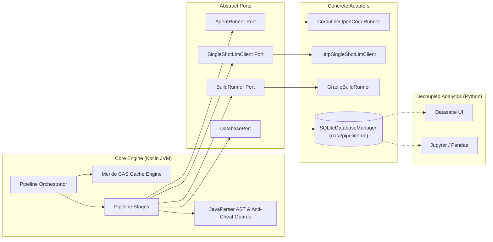

# Pipeline Implementation Plan: Technical Architecture & Concrete Tooling

This document specifies the concrete implementation details, programming language selection, project structure, Merkle Content-Addressable Storage (CAS) stage caching, database schema, build tooling, execution harnesses, and hardened AST guardrails for the LLM Type Annotation Synthesis Pipeline.

---

## 1. Programming Language Selection & System Architecture

### Strategic Decision: Kotlin Primary Pipeline + Python Decoupled Analytics

The pipeline adopts a **Kotlin Primary Engine with Decoupled Python Analytics**, structured around the **Ports and Adapters (Hexagonal)** architectural pattern:

1. **Kotlin (The Core Pipeline Engine)**:
   - **In-Process JavaParser Integration**: Because target repositories, annotations, and the Checker Framework are Java-based, Kotlin executes JavaParser (`com.github.javaparser:javaparser-core:3.26.1`) in-process within the JVM. This eliminates IPC serialization overhead, JNI shared-library friction, and child JVM process-spawning costs when performing AST validations.
   - **Coroutine-Based Subprocess I/O**: Kotlin Coroutines (`kotlinx-coroutines-core:1.8.0`) provide non-blocking subprocess I/O and timeouts. Subprocesses (OpenCode CLI, Gradle builds, Javac) run via JDK 9+ `Process.onExit()` futures without blocking worker threads. The MVP executes **one sample at a time**, sequentially through ingestion → triage → synthesis → application → repair → verification; there is no batch fan-out or bounded-parallelism scheduling (§12.3). Agent output is collected into a terminal transcript and audited after each edit turn, with rejected edits rolled back.
   - **Compile-Time Safety & Domain Modeling**: Strongly typed data classes represent step inputs, outputs, and validation audits. Compiler checks flag nullability or schema mismatches at compile time, eliminating runtime `KeyError` or schema drift bugs.
   - **Persistent JVM Optimization**: The orchestrator runs in a persistent JVM process. JVM startup overhead is amortized across runs, enabling instant AST parsing (~50–150 ms per compilation unit).
2. **Python (Decoupled Offline Analytics & Visualization)**:
   - Python is retained strictly for **offline data analysis, reporting, and visualization**.
   - Storage is backed by **SQLite** (`data/pipeline.db`), which provides a language-agnostic, single-file relational format.
   - Researchers can launch [Datasette](https://datasette.io/) (`datasette data/pipeline.db`) or run Jupyter notebooks using `pandas`, `seaborn`, and `matplotlib` to inspect trajectories, compute confidence intervals, and plot metrics without Python touching the runtime execution loop.
3. **Ports and Adapters (Hexagonal Architecture)**:
   - Pipeline stages interact with external systems exclusively through abstract interface contracts (`ports`):
     - `AgentRunner`: Multi-turn conversational agent harness.
     - `SingleShotLlmClient`: Structured single-turn JSON model client.
     - `BuildRunner`: Build execution, test execution, and Checker Framework injection.
     - `DatabasePort`: Transactional persistence of runs and trajectories.
   - Concrete implementations (`adapters`) can be swapped or mocked in unit tests without invoking real LLM APIs, spawning child processes, or touching disk databases.



---

## 2. Cross-Cutting Execution Architecture: Stage Caching & Lineage (Merkle CAS)

To enable rapid experimentation, parameter ablations, and cost minimization without re-executing expensive upstream stages, the orchestrator implements a **Content-Addressable Storage (CAS) Merkle DAG**:

### 1. Deterministic Cache Key Formula
Each pipeline stage is an immutable node in a directed acyclic graph. Cache keys are computed deterministically via SHA-256:

$$K_{\text{stage}} = \text{SHA-256}(\text{stage\_name} + H(\text{stage\_input}) + H(\text{upstream\_artifacts}) + H(\text{config\_slice}) + H(\text{prompt\_template}) + H(\text{stage\_code}) + \text{sample\_seed} + \text{sample\_temperature} + H(\text{runtime\_environment}))$$

Where:
- $\text{stage\_name}$: Canonical enum identifier from `StageName` (`"ingestion"`, `"triage"`, `"synthesis"`, `"application"`, `"repair"`, `"verification"`).
- $H(\text{stage\_input})$: Hash of the complete typed stage input (for example `BugContext` or `ApplicationInput`), not merely the upstream artifact hashes. This prevents two semantically different inputs from colliding.
- $H(\text{upstream\_artifacts})$: Cryptographic hash of upstream input artifacts (e.g., for the application stage, hash of the $C-1$ commit, `custom-quals.jar`, and `placement_guide.md`).
- $H(\text{config\_slice})$: Canonical JSON hash of configuration parameters governing this specific stage, including model, seed, temperature, and checker processor/quals/category.
- $H(\text{prompt\_template})$: SHA-256 hash of the markdown prompt template used for agent instructions.
- $H(\text{stage\_code})$: SHA-256 fingerprint of the compiled stage and validator bytecode, or an equivalent versioned source fingerprint (module/class build ID plus source revision). A hand-maintained version string is not sufficient.
- $\text{sample\_seed}$ / $\text{sample\_temperature}$: Deterministic sampling parameters for the run.
- $H(\text{runtime\_environment})$: Hash of the runtime inputs that can change behavior (JDK version, Checker Framework version, Gradle wrapper version, relevant environment variables), with secrets excluded.

All $H(\cdot)$ inputs are serialized with a **canonical, length-prefixed JSON encoding** (UTF-8, lexicographically sorted keys, explicit type tags, and a length prefix per field) before hashing. Plain string concatenation is not used, because it permits ambiguous collisions such as `("ab", "c")` and `("a", "bc")`. File-valued fields are represented by content hashes; filesystem paths inside stage inputs are normalized to commit-relative paths (or content hashes), and absolute worktree paths must never enter a cache key.

### 2. CAS Filesystem Hierarchy
Artifact bundles reside under a configurable root (`cache.stages_dir`, defaulting to `.cache/stages/`):

```
.cache/stages/
├── ingestion/
│   └── <K_stage_hash>/
│       ├── manifest.json
│       └── worktree_info.json
├── triage/
│   └── <K_stage_hash>/
│       ├── manifest.json
│       ├── test_patch.diff
│       └── triage_metadata.json
├── synthesis/
│   └── <K_stage_hash>/
│       ├── manifest.json
│       ├── custom-quals.jar
│       ├── placement_guide.md
│       ├── custom_quals_src/
│       ├── synthesis_transcript.json
│       └── synthesis_metrics.json
├── application/
│   └── <K_stage_hash>/
│       ├── manifest.json
│       ├── annotations.patch
│       ├── ast_audit.json
│       ├── initial_checker_errors.log
│       └── application_transcript.json
├── repair/
│   └── <K_stage_hash>/
│       ├── manifest.json
│       ├── repair.patch
│       ├── final_checker_errors.log
│       ├── anti_cheat_audit.json
│       ├── guardrail_events.json
│       ├── fixer_transcript.json
│       └── fixer_metrics.json
└── verification/
    └── <K_stage_hash>/
        ├── manifest.json
        ├── test_results.xml
        ├── suite_results.xml
        └── verification_summary.json
```

Each stage directory contains a `manifest.json` recording:
```json
{
  "stage_name": "application",
  "cache_key": "a1b2c3d4e5f6...",
  "upstream_keys": ["f9e8d7c6b5a4..."],
  "sample_index": 0,
  "sample_temperature": 0.0,
  "created_at": "2026-10-19T17:00:00Z",
  "success": true,
  "artifacts": [
    { "path": "annotations.patch", "sha256": "e3b0c442...", "size_bytes": 1024 },
    { "path": "application_transcript.json", "sha256": "4b227777...", "size_bytes": 4512 }
  ]
}
```

**Artifact models and writers.** Artifact basenames are centralized in `ArtifactNames` (for example `synthesis_transcript.json`, `synthesis_metrics.json`, `application_transcript.json`, `fixer_transcript.json`, `fixer_metrics.json`, `test_results.xml`, `suite_results.xml`, `triage_metadata.json`). Each stage emits typed artifact descriptors, and a single `StageArtifactWriter` writes the files, computes their SHA-256 digests, and registers them in the manifest. Stages do not invent ad-hoc filenames or write directly to the CAS root.

### 3. Workspace State Transfer via Unified Git Patches
Rather than storing full filesystem snapshots of target repositories for application, repair, and verification stages:
- **`annotations.patch`**: The application stage emits a unified diff recording only applied annotations relative to clean $C-1$.
- **`repair.patch`**: The repair stage emits a unified diff recording only repaired method bodies **relative to the annotated baseline** (that is, $C-1$ with `annotations.patch` already applied), not relative to clean $C-1$.
  - *Fixture note*: the checked-in `eval-fixtures/synthetic-id-swap/repair.patch` is generated against the annotated baseline (`annotations.patch` applied first). Verification must still apply `annotations.patch` before it; the fixture is not a standalone clean-$C-1$ patch.
- **Downstream Reconstruction**: The verification stage checks out clean $C-1$ in an ephemeral worktree, applies `annotations.patch`, then applies `repair.patch`, in that order. The repair stage itself reconstructs the same annotated baseline before the fixer starts. A patch that does not apply cleanly to its declared baseline is a hard failure, never silently rebased.
- **Staged Diffs**: Both stages extract patches from an explicit Git index (`git add -N` followed by `git diff --cached`) so that newly created files are included and audited. File additions, deletions, and renames are rejected unless a stage explicitly permits them; neither application nor repair permits them in the MVP.

### 4. Atomic Publication & Cache Telemetry
- A stage writes its bundle to a temporary sibling directory and publishes it with an atomic rename only after validation succeeds. A partial bundle must never become visible under a cache key.
- Every lookup records `cache_hit` / `cache_miss` in `step_trajectories` and logs it; hit responses are re-validated against their manifest hashes before use.
- Transient failures never publish a manifest, so a retry starts from the same deterministic key.

### 5. Two-Tier Failure & Re-Run Policy
- **Deterministic Outcomes Cached**: Triage discards (`discarded_build_broken`, `discarded_non_compiling`, `discarded_passes_unpatched`, `invalid_test_patch`, `regression_does_not_pass_on_fixed_commit`, `fixed_commit_unavailable`) and verification test executions are permanently cached in CAS. They are never wastefully re-executed.
- **Transient Failures Retried**: Agent timeouts, network socket errors, or subshell crashes leave CAS unpopulated while recording error telemetry in SQLite. Re-running the pipeline immediately retries from the failed stage.

---

## 3. Stage Contracts & Typed Domain Model

Each pipeline stage implements the generic `PipelineStage<TIn, TOut>` interface. All telemetry and observation events are persisted through the `DatabasePort` (backed by `DatabaseManager` and `TelemetryProjector`) during stage execution:

```kotlin
package pipeline.stages

import java.io.File
import kotlinx.serialization.SerialName
import kotlinx.serialization.Serializable
import kotlinx.serialization.json.JsonElement
import pipeline.config.ProjectConfig
import pipeline.ports.DatabasePort

// --- Strongly-Typed Domain Primitives & Value Classes ---

@JvmInline
@Serializable
value class Sha256(val hex: String) {
    init {
        require(hex.length == 64 && hex.all { it in '0'..'9' || it in 'a'..'f' || it in 'A'..'F' }) {
            "Invalid SHA-256 digest: $hex"
        }
    }
    override fun toString(): String = hex.lowercase()
}

@JvmInline
@Serializable
value class CasKey(val hash: Sha256) {
    constructor(hex: String) : this(Sha256(hex))
    override fun toString(): String = hash.toString()
}

@JvmInline
@Serializable
value class CommitHash(val hash: String) {
    init {
        require(hash.length in listOf(40, 64) && hash.all { it.isLetterOrDigit() }) {
            "Invalid Git commit hash: $hash"
        }
    }
    val abbreviated: String get() = hash.take(8)
    override fun toString(): String = hash
}

@JvmInline
@Serializable
value class RunId(val value: String) {
    override fun toString(): String = value
}

@Serializable
data class BenchmarkId(
    val repoName: String,
    val shortCommit: String,
    val alias: String? = null // Optional explicit manifest alias (e.g. "synthetic-id-swap")
) {
    val canonical: String get() = alias ?: "$repoName-$shortCommit"
    override fun toString(): String = canonical

    companion object {
        fun of(repoName: String, commit: CommitHash, alias: String? = null): BenchmarkId =
            BenchmarkId(repoName, commit.abbreviated, alias)

        fun parse(raw: String): BenchmarkId {
            val parts = raw.split("-")
            if (parts.size < 2) return BenchmarkId(raw, "head", alias = raw)
            return BenchmarkId(parts.dropLast(1).joinToString("-"), parts.last(), alias = raw)
        }
    }
}

@JvmInline
@Serializable
value class Fqcn(val value: String) {
    init {
        require(value.isNotBlank() && !value.endsWith('.')) { "Invalid fully qualified class name: $value" }
    }
    val simpleName: String get() = value.substringAfterLast('.')
    val packageName: String get() = value.substringBeforeLast('.', "")
    override fun toString(): String = value
}

@Serializable
data class TestCoordinate(
    val testClass: Fqcn,
    val testMethod: String
) {
    val gradleFilter: String get() = "${testClass.value}.$testMethod"
    override fun toString(): String = gradleFilter
}

// --- Closed Domain Enums ---

@Serializable
enum class StageName {
    @SerialName("ingestion") INGESTION,
    @SerialName("triage") TRIAGE,
    @SerialName("synthesis") SYNTHESIS,
    @SerialName("application") APPLICATION,
    @SerialName("repair") REPAIR,
    @SerialName("verification") VERIFICATION;

    val identifier: String get() = name.lowercase()
}

@Serializable
enum class VerificationScope {
    @SerialName("full_suite") FULL_SUITE,
    @SerialName("regression_only") REGRESSION_ONLY
}

@Serializable
enum class GuardrailsMode {
    @SerialName("disabled") DISABLED,
    @SerialName("lenient") LENIENT,
    @SerialName("strict") STRICT
}

@Serializable
enum class CommitClassification {
    @SerialName("bugfix") BUGFIX,
    @SerialName("non_bugfix") NON_BUGFIX
}

@Serializable
enum class AgentEventType {
    @SerialName("step_start") STEP_START,
    @SerialName("tool_call") TOOL_CALL,
    @SerialName("tool_result") TOOL_RESULT,
    @SerialName("message") MESSAGE,
    @SerialName("step_finish") STEP_FINISH
}

@Serializable
enum class DiscardReason {
    @SerialName("no_test_found") NO_TEST_FOUND,
    @SerialName("test_compilation_failure") TEST_COMPILATION_FAILURE,
    @SerialName("test_passes_unpatched") TEST_PASSES_UNPATCHED,
    @SerialName("build_broken_unpatched") BUILD_BROKEN_UNPATCHED,
    @SerialName("invalid_test_patch") INVALID_TEST_PATCH,
    @SerialName("regression_does_not_pass_on_fixed_commit") REGRESSION_DOES_NOT_PASS_ON_FIXED_COMMIT,
    @SerialName("fixed_commit_unavailable") FIXED_COMMIT_UNAVAILABLE
}

@Serializable
enum class LocalizationTier(val tierNumber: Int) {
    DIFF_HUNK(1),
    ENCLOSING_METHOD(2),
    ENCLOSING_CLASS(3),
    EXTERNAL_NOISE(4)
}

@Serializable
enum class RuleCategory {
    @SerialName("default") DEFAULT,
    @SerialName("source") SOURCE,
    @SerialName("sink") SINK,
    @SerialName("sanitizer") SANITIZER
}

@Serializable
enum class FreedomLevel {
    @SerialName("level0") LEVEL_0,
    @SerialName("level1") LEVEL_1,
    @SerialName("level2") LEVEL_2
}

@Serializable
enum class AllowedCheckers {
    @SerialName("all") ALL,
    @SerialName("custom_only") CUSTOM_ONLY,
    @SerialName("builtin_only") BUILTIN_ONLY
}

@Serializable
enum class LocalAnnotationPolicy {
    @SerialName("frozen") FROZEN,
    @SerialName("allowed") ALLOWED
}

@Serializable
enum class GuardrailViolationCategory {
    @SerialName("executable_edit") EXECUTABLE_EDIT,
    @SerialName("suppression") SUPPRESSION,
    @SerialName("signature_tampering") SIGNATURE_TAMPERING,
    @SerialName("cast") CAST,
    @SerialName("backdoor") BACKDOOR,
    @SerialName("filesystem") FILESYSTEM,
    @SerialName("test_tampering") TEST_TAMPERING,
    @SerialName("build_tampering") BUILD_TAMPERING,
    @SerialName("path_escape") PATH_ESCAPE,
    @SerialName("file_addition") FILE_ADDITION,
    @SerialName("package_info_change") PACKAGE_INFO_CHANGE,
    @SerialName("local_annotation") LOCAL_ANNOTATION
}

// --- Strongly-Typed Artifact & Manifest Models ---

@Serializable
data class ArtifactFile(
    val path: String,
    val sha256: Sha256,
    @SerialName("size_bytes") val sizeBytes: Long
)

@Serializable
data class ArtifactsManifest(
    @SerialName("stage_name") val stageName: StageName,
    @SerialName("cache_key") val cacheKey: CasKey,
    @SerialName("upstream_keys") val upstreamKeys: List<CasKey> = emptyList(),
    @SerialName("sample_index") val sampleIndex: Int = 0,
    @SerialName("sample_temperature") val sampleTemperature: Double = 0.0,
    @SerialName("created_at") val createdAt: String, // ISO-8601 formatted instant string
    val success: Boolean = true,
    val artifacts: List<ArtifactFile> = emptyList()
)

// --- Strongly-Typed Agent Transcript & Event Models ---

@Serializable
data class TokenUsage(
    @SerialName("prompt_tokens") val promptTokens: Int = 0,
    @SerialName("completion_tokens") val completionTokens: Int = 0,
    @SerialName("total_tokens") val totalTokens: Int = 0
)

@Serializable
data class AgentTranscriptEvent(
    val timestamp: String,                                       // ISO-8601 timestamp string
    @SerialName("event_type") val eventType: AgentEventType,
    @SerialName("turn_index") val turnIndex: Int,                // 1-indexed agent turn number
    @SerialName("tool_name") val toolName: String? = null,
    @SerialName("tool_arguments") val toolArguments: Map<String, JsonElement>? = null,
    @SerialName("tool_result") val toolResult: String? = null,
    val content: String? = null,                                 // Reasoning chain or model response text
    @SerialName("token_usage") val tokenUsage: TokenUsage? = null
)

data class RunContext(
    val config: ProjectConfig,
    val runId: RunId,
    val sampleIndex: Int,                 // Deterministic seed index for this run
    val sampleTemperature: Double,
    val repoDir: File,                    // Orchestrator-only; never passed to agents
    val casDir: File,                     // Orchestrator-only; never passed to agents
    val worktreeDir: File,
    val agentWorkspaceDir: File,          // Sanitized per-run workspace exposed to agents
    val database: DatabasePort
)

// Stage implementations pass only agentWorkspaceDir (or a dedicated subdirectory)
// to AgentRunner. repoDir, casDir, worktreeDir, and database are orchestrator-only
// and must never be exposed to an agent process, prompt, or transcript.

sealed class StageResult<out T> {
    data class Success<T>(
        val data: T,
        val casKey: CasKey,
        val artifactsManifest: ArtifactsManifest
    ) : StageResult<T>()

    data class Discard(
        val reason: DiscardReason,
        val details: String,
        val artifactsManifest: ArtifactsManifest? = null
    ) : StageResult<Nothing>()

    data class TransientFailure(
        val error: Throwable,
        val stageTurnsTaken: Int,
        val transcript: List<AgentTranscriptEvent>
    ) : StageResult<Nothing>()
}

interface PipelineStage<in TIn, TOut> {
    val stageName: StageName
    fun computeCacheKey(ctx: RunContext, input: TIn): CasKey
    suspend fun execute(ctx: RunContext, input: TIn): StageResult<TOut>
}
```

### Deterministic Benchmark Identifier (`benchmark_id`)
To maintain consistency between curated manifests and future automated commit crawlers, `benchmark_id` is defined as a deterministic function of the repository name and commit hash:
$$\text{benchmark\_id} = f(\text{repo\_name}, \text{commit\_hash}) = \text{repo\_name} + \text{"-"} + \text{commit\_hash}[0..7]$$
For example, evaluating commit `a1b2c3d4e5f6...` on `cmsx` yields benchmark ID `cmsx-a1b2c3d4`. This identifier is encapsulated in the typed `BenchmarkId` model, recorded in `evaluation_runs.benchmark_id`, and used consistently in CLI invocations, CAS logging, and Datasette analytics. Curated benchmark entries may also declare an explicit manifest alias (such as `synthetic-id-swap`), which `BenchmarkId` preserves for CLI ergonomics.

### Typed Stage Inputs and Outputs

```kotlin
package pipeline.stages

import java.io.File
import kotlinx.serialization.Serializable

// Ingestion Stage
data class IngestionInput(val repoUrl: String, val commitHash: CommitHash, val parentHash: CommitHash)
data class IngestionWorktree(val commitHash: CommitHash, val parentHash: CommitHash, val worktreeDir: File)

// Typed benchmarks.yaml row. Every benchmark is a Git-backed repository; the
// regression test coordinate stays in the manifest/triage domain.
data class BenchmarkEntry(
    val benchmarkId: BenchmarkId,
    val repoUrl: String,
    val commitHash: CommitHash,
    val parentHash: CommitHash,
    val regressionTest: TestCoordinate,
    val testPatchFile: File? = null,
    val description: String
) {
    // `commitDiff` must already be filtered to production paths; test-file hunks,
    // the test patch, and test coordinates are intentionally not part of BugContext.
    fun toBugContext(commitDiff: String = ""): BugContext =
        BugContext(benchmarkId, commitHash, parentHash, commitDiff, description)
}

// Benchmark Verification & Triage Stage
// In Manifest Mode (MVP), the orchestrator provisions IngestionWorktree first, then executes triage:
data class ManifestTriageInput(
    val benchmarkId: BenchmarkId,
    val worktree: IngestionWorktree,
    val regressionTest: TestCoordinate,
    val testPatchFile: File? = null
)

// Universal Output Contract for Triage (Identical for Manifest and Crawler):
// VerifiedSample is a triage output and a verification input ONLY. It is never
// passed to synthesis, application, or repair; those stages receive the blind
// targets below, which omit the regression test coordinate and test patch.
data class VerifiedSample(
    val benchmarkId: BenchmarkId,
    val commitHash: CommitHash,
    val parentHash: CommitHash,
    val regressionTest: TestCoordinate,
    val testPatchFile: File
)

// Type Lattice Synthesis Stage (MVP Level 0: Pure Marker Hierarchy, 0 Helpers)
data class BugContext(
    val benchmarkId: BenchmarkId,
    val commitHash: CommitHash,
    val parentHash: CommitHash,
    val commitDiff: String,
    val bugDescription: String
)
data class SynthesisInput(val bugContext: BugContext)

@Serializable
data class PlacementRule(
    val category: RuleCategory,
    val ruleText: String,
    val targetQualifier: Fqcn? = null
)

@Serializable
data class DeclarativePlacementGuide(
    val rules: List<PlacementRule>
) {
    val totalRules: Int get() = rules.size
    val countsByCategory: Map<RuleCategory, Int>
        get() = RuleCategory.entries.associateWith { cat -> rules.count { it.category == cat } }
}

@Serializable
enum class CheckerCategory {
    @SerialName("custom_qualifier_hierarchy") CUSTOM_QUALIFIER_HIERARCHY,
    @SerialName("builtin_checker") BUILTIN_CHECKER
}

data class SynthesizedLattice(
    val customQualsJar: File,
    val placementGuideFile: File,
    val customQualsSrcDir: File,
    val qualifierClassNames: List<Fqcn>, // ALL @Target(TYPE_USE) qualifier FQNs (including root/default), for -Aquals
    val qualifiersCount: Int,
    val processor: String,               // Selected checker processor class; no "auto" discovery
    val checkerCategory: CheckerCategory, // Derived during synthesis and used by checker.init.gradle
    val helpersCount: Int = 0, // Strictly 0 in Level 0
    val policyRuleCount: Int = 0,
    val ruleCountsByCategory: Map<RuleCategory, Int> = emptyMap()
)

// Semantic Type Application Stage
data class ApplicationTarget(
    val parentHash: CommitHash,
    val worktreeDir: File
)
data class ApplicationInput(val target: ApplicationTarget, val lattice: SynthesizedLattice)
data class AnnotatedRepo(
    val annotationsPatch: File,
    val astAuditFile: File,
    val initialCheckerErrorsLog: File,
    val checkerErrorCount: Int,
    val isTrivial: Boolean
)

// Blind Bug Fixing / Repair Stage
// The repair input deliberately contains no triage sample, test coordinate,
// test patch, or placement guide.
data class BlindRepairTarget(
    val parentHash: CommitHash,
    val worktreeDir: File // Annotated baseline: clean C-1 + annotations.patch
)
data class CheckerConfig(
    val customQualsJar: File,
    val processor: String,
    val checkerCategory: CheckerCategory,
    val qualifierClassNames: List<Fqcn>
)
fun SynthesizedLattice.toCheckerConfig(): CheckerConfig =
    CheckerConfig(customQualsJar, processor, checkerCategory, qualifierClassNames)
data class RepairInput(
    val target: BlindRepairTarget,
    val checker: CheckerConfig, // No placementGuideFile field at all
    val initialCheckerErrorsLog: File
)
data class RepairResult(
    val repairPatch: File,               // Relative to the annotated baseline, NOT clean C-1
    val finalCheckerErrorsLog: File,
    val antiCheatAuditFile: File,
    val guardrailEventsFile: File,
    val remainingTypeErrors: Int
)

// Ground-Truth Verification Stage
data class VerificationInput(
    val sample: VerifiedSample,
    val repair: RepairResult,
    val lattice: SynthesizedLattice,
    val annotationsPatch: File,           // Applied before repair.patch
    val verificationScope: VerificationScope = VerificationScope.FULL_SUITE
)
enum class EvalVerdict {
    FULL_SUCCESS,                        // T_reg passes + all pre-existing tests pass + 0 selected-checker errors
    TYPE_SUCCESS_RUNTIME_FAIL,           // 0 selected-checker errors, but T_reg still fails at runtime
    PARTIAL_SUCCESS_REGRESSION_ONLY,     // T_reg passes + 0 selected-checker errors, pre-existing suite not run
    REGRESSION_INTRODUCED,               // Unit tests fail (T_reg may pass)
    FIXER_INCOMPLETE,                    // Final checker ran and still reports errors > 0
    VERIFICATION_MISSING                 // Incomplete run: no final checker result could be obtained
}
data class VerificationResult(
    val verdict: EvalVerdict,
    val regressionTestPassed: Boolean,
    val originalTestsPassed: Boolean?,
    val remainingCheckerErrors: Int?,
    val testResultsXml: File?,
    val suiteResultsXml: File?,
    val verificationSummaryFile: File
)
```

---

### Stage-by-Stage Execution Procedures

The orchestrator executes the pipeline stages as an isolated, content-addressable DAG. Rather than scattering procedural details across ad-hoc scripts, each stage follows a standardized execution lifecycle:

#### Stage: Workspace Ingestion & Cache Pre-Warming (`IngestionStage`)
1. **Repository Mirror Check**: The runner inspects `eval-repos/<repo_name>.git`. If absent, it performs a bare mirror clone (`git clone --mirror`) to cache the entire remote git object store locally.
2. **Ephemeral Worktree Allocation**: Allocates an isolated working directory (`.worktrees/run_<run_id>/`) outside the agent-visible scratch area.
3. **Clean Checkout of $C-1$**: Executes `git worktree add --detach <worktree_dir> <parent_hash>`, creating an instantaneous local checkout at parent commit $C-1$ without copying repository files.
4. **Sanitized Agent Workspace Export (Isolation Boundary)**: The orchestrator never exposes the Git worktree or its `.git` file to an agent. It builds `.scratch/<stage>_<run_id>/` from a sanitized copy/export containing only the stage-relevant sources (and, for repair, read-only test sources), build scripts, and wrapper files. The export excludes `.git`, `eval-repos/`, `eval-fixtures/` (including any test patches or fixture artifacts), the project root, `.cache/stages/`, `data/pipeline.db`, `logs/`, all earlier patches, and every triage/application/verification build or report output. Scrubbing Git environment variables is defense-in-depth only; it is **not** the isolation boundary. Per-turn patch staging (`git add -N` / `git diff --cached`) runs in the orchestrator-owned worktree, never in the agent workspace.
5. **Ingestion Metadata Write**: Confirms/updates the `repositories` and `commits` rows created by `recordRunStart` (which upserts them before the FK-bound `evaluation_runs` row) and writes the ingestion `step_trajectories` row. This records the real commit, parent, author date (from `git log -1 --format=%cI`), and commit message. Missing PR metadata remains `NULL`.
6. **Gradle Pre-Warming**: Points the worktree to the centralized `GRADLE_USER_HOME` and executes `./gradlew compileJava` once. This downloads the Gradle wrapper distribution and compile classpath upfront, shielding downstream timed agent turns from network latency. `--dry-run` is not sufficient (it does not materialize dependencies), and tests are not run here.
   - *Transient pre-warm failure* (network, wrapper download, repository outage): returns `TransientFailure`; no CAS bundle is published and the `commits` row remains `pending` for retry.
   - *Deterministic source/build failure* (the unpatched $C-1$ project does not compile): returns `Discard(BUILD_BROKEN_UNPATCHED)` and writes `commits.triage_status = 'discarded_build_broken'`, `commits.discard_reason = 'build_broken_unpatched'`, and the captured `compiler_error_log`.
7. **Output Generation**: Emits `IngestionWorktree` recording the verified local worktree directory and the written ingestion metadata.

#### Stage: Curated Benchmark Verification & Triage (`ManifestTriageStage`)
1. **Manifest Ingestion**: Reads `benchmarks.yaml` to resolve the benchmark entry matching the target `benchmark_id` (`BenchmarkId`). The manifest entry carries `repo_url`, `commit_hash`, `parent_hash`, `regression_test_class`, `regression_test_method`, and `description`. Ingestion and triage operate directly on the Git repository. The typed `TestCoordinate` is assembled from the class and method fields.
2. **DAG Handoff from Ingestion**: The ingestion stage provisions the clean $C-1$ worktree using the benchmark's repository and `parent_hash`. Triage never mutates the ingestion worktree; it works only in disposable sandboxes.
3. **Disposable Triage Sandbox**: Materializes $C-1$ in `.worktrees/triage_<run_id>/c1/` via `git worktree add --detach`. Triage is the only stage allowed to apply `test_patch.diff`, and the sandbox is deleted after triage. This guarantees that $T_{\text{reg}}$ compiled classes, JUnit XML, and Gradle reports cannot survive into synthesis, application, or repair. If a reusable worktree is unavoidable, run `git clean -fdx` and explicitly remove `build/`, `.gradle/`, and test-report directories before handoff; a clean without `-x` leaves ignored build outputs in place and is insufficient.
4. **Test Patch Path Audit**: Parses every file header in `test_patch.diff` (`diff --git`, `---`, `+++`, `rename from`/`rename to`, `new file`, `deleted file`) and requires every touched path to match `(^|/)src/test/`; `/dev/null` sentinels are ignored and the actual `diff --git`/`+++ b/` path is audited. Rejects absolute paths, `..` traversal, symlink escapes, production sources, and build files. Test-file additions are permitted in triage because the regression test is extracted from $C$; they remain rejected in application and repair. An invalid patch is a deterministic discard (`invalid_test_patch`).
5. **Unpatched $C-1$ Build Check**: Runs `./gradlew compileJava` on the unpatched $C-1$ sandbox **before** applying the test patch. If $C-1$ itself does not build, records `discarded_build_broken` / `build_broken_unpatched`. This is distinct from a test-patch compilation failure and prevents misclassifying a broken baseline as a bad regression test.
6. **Deterministic Failure Verification ($C-1$)**: Applies the audited test patch, then invokes `BuildRunner` to execute the regression test:
   `./gradlew test --tests <regression_test.gradleFilter>`
   - *Test Patch Compilation Failure*: Discards the sample and records `discarded_non_compiling` / `test_compilation_failure` (the test references symbols not present on $C-1$).
   - *Test Passes Unpatched*: Discards the sample and records `discarded_passes_unpatched` / `test_passes_unpatched` (the test does not reproduce the bug).
   - *Test Compiles and Fails at Runtime*: The $C-1$ side reproduces the bug.
7. **Fixed-Side Confirmation ($C$)**: In a second disposable sandbox, materializes $C$ via `git worktree add --detach <c_sandbox> <commit_hash>` and requires $T_{\text{reg}}$ to **PASS** before the sample is accepted. Because the regression test is already part of commit $C$, $T_{\text{reg}}$ runs directly (or with the test patch if extracted separately). If $T_{\text{reg}}$ fails/errors on $C$, the sample is discarded with `regression_does_not_pass_on_fixed_commit`. If $C$ cannot be materialized, discard with `fixed_commit_unavailable`. Both outcomes and the observed statuses are written to `triage_metadata.json`.
8. **Triage Sandbox Cleanup**: Removes both disposable sandboxes (`git worktree remove --force`). Application and repair reconstruct their own baselines from clean $C-1$; they never reuse a triage sandbox or its build outputs.
9. **Output Generation**: Emits `VerifiedSample` (triage output / verification input only) containing verified test coordinates and the test patch file, plus `triage_metadata.json`. This is the concrete filename for the design's `triage_metadata` artifact (the `.json` extension is implied); the artifact records `benchmark_id`, `c1_commit`/`c_commit`, patch paths and the path-audit result, `c1_build_status`, `c1_test_status`, `c_test_status`, regression test coordinate, source provenance, and any `discard_reason`. It never contains the full human-fix diff body.

#### Stage: Type Lattice Synthesis (`SynthesisStage`)
1. **Prompt Construction**: Formats `synthesis.md` from a `BugContext` (benchmark ID, commit and parent hashes, commit diff, bug description) and Level 0 constraints (pure marker type hierarchy via `@SubtypeOf`, zero helper/validator methods). The commit diff is filtered to production paths; hunks touching `(^|/)src/test/` are removed before the context is built. The regression test coordinate, test patch, test file contents, and test names are never included.
2. **Agent Synthesis Loop**: Invokes `AgentRunner` with seed/temperature in a sanitized scratch workspace (`.scratch/synthesis_<run_id>/`). The workspace contains no project `.git` directory, CAS, database, or build/test outputs.
3. **Iterative Compilation**: The agent outputs qualifier source files (e.g., `@SourceId.java`, `@TargetId.java`, `@IdBottom.java`) into `custom_quals_src/`. `JavacRunner` compiles them in-process against `checker-qual.jar`. Any syntax errors or circular subtyping issues are fed back to the agent until compilation succeeds or the turn budget is exhausted.
4. **Zero-Helpers Enforcement**: The validator verifies that `custom_quals_src/` contains **strictly annotation declarations**. Any class, interface with default methods, record, or static utility is rejected.
5. **Declarative Placement Guide Emission & Rule Extraction**: The agent produces `placement_guide.md`, detailing high-level semantic typing criteria structured across four standardized categories (Defaulting Invariants, Source Rules / Introducers, Sink Rules / Consumers, Sanitizers & Coercions) without naming concrete repository symbols. A parser extracts the rules, verifies structural adherence, and computes `policy_rule_count` (total and per-category breakdown).
6. **Packaging & Qualifier Discovery**: `JavacRunner` packages the compiled classes into `custom-quals.jar`. A built-in-only sample emits an empty marker jar so the checker harness has a uniform artifact; it contributes no qualifiers and receives no `-Aquals` flag. A class discovery scanner parses the custom qualifier ASTs and records **all** `@Target(TYPE_USE)` qualifier annotations, including root/default qualifiers, not only `@SubtypeOf` children. The resulting `qualifierClassNames` list feeds `-Aquals` for custom hierarchies; the stage also derives the selected `processor` and `checkerCategory` for the checker configuration.
7. **Output Generation**: Emits `SynthesizedLattice` packaging `custom-quals.jar`, `placement_guide.md`, discovered `qualifierClassNames`, `policyRuleCount`, `ruleCountsByCategory`, `processor`, and `checkerCategory`, plus `synthesis_transcript.json` and `synthesis_metrics.json`.

#### Stage: Semantic Type Application (`ApplicationStage`)
1. **Prompt Construction**: Formats `application.md` with the clean $C-1$ codebase, the declarative `placement_guide.md`, and allowed qualifier import prefixes. The prompt instructs the agent to interpret the declarative policy and ground it across the codebase without relying on symbol punch-lists.
2. **Multi-Turn Application Loop**: The OpenCode type applier agent modifies Java files to place type annotations on variables, fields, parameters, and return types. It may also touch test sources, but **only** to add qualifier annotations/imports; executable test logic is immutable, and every suppression remains banned. The agent works in the sanitized export; the orchestrator mirrors accepted edits into its own worktree for patch staging and Git operations.
3. **Per-Turn Patch Audit**: After every edit turn, the orchestrator builds a staged diff (`git add -N` then `git diff --cached`) in its worktree so newly created files are visible, then runs:
   - **FilesystemGuard / path audit**: every touched path must remain inside a multi-module `(^|/)src/(main|test)/` root, must not escape the worktree, and must not be a build script or `.astub`. `package-info.java` is permitted only under `(^|/)src/main/` and only when it contains qualifier/defaulting annotations and imports (for example `org.checkerframework.framework.qual.DefaultQualifier`, `DefaultQualifierInHierarchy`, `QualifierDefaults`) plus `package`/`import` declarations — no executable code and no other declarations. A new `package-info.java` is the **one** permitted file addition in application; it must be staged with `git add -N`/`git diff --cached`. All other file additions, deletions, and renames are rejected.
   - **AST Gate (`AstGuard`)**: strips only type annotations and qualifier imports, then compares the result against the clean $C-1$ AST. Declaration annotations are not stripped. On ordinary compilation units, any added or changed declaration annotation (including `@SuppressWarnings`) is rejected. The sole exception is a permitted `package-info.java` carrying only the explicit Checker defaulting annotations above; arbitrary declaration annotations remain rejected. Annotation FQNs, not merely imports, are validated against the lattice package/`org.checkerframework.*` allowlist. Rejected edits are rolled back to the last accepted tree before feedback is returned.
4. **Patch Extraction**: Executes the same staged diff relative to clean $C-1$ and writes `annotations.patch` (including any permitted test annotation edits and a permitted new `package-info.java`). Writes `ast_audit.json` and every guardrail event.
5. **Non-Triviality Verification**: Invokes `BuildRunner` with `checker.init.gradle`, `customQualsJar` on both compile and test classpaths, and the selected processor/quals:
   - The source tree must compile under standard `javac` with the custom qualifier JAR available.
   - The existing $C-1$ test suite must pass on the annotated tree; a test failure is a non-triviality failure and halts the run.
   - The dedicated Checker post-pass must emit $\ge 1$ active type error from the selected processor. If 0 errors are emitted, the types are ineffective/vacuous, and the run halts.
6. **Output Generation**: Emits `AnnotatedRepo` containing `annotations.patch`, initial Checker diagnostics log, and the initial error count, plus `application_transcript.json`.

#### Stage: Blind Bug Fixing & Anti-Cheat Guards (`RepairStage`)
1. **Blind Workspace Setup**: Allocates a fresh orchestrator worktree from clean $C-1$ (never the ingestion or triage sandbox) and applies `annotations.patch` to reconstruct the annotated baseline. The fixer's patch is later emitted relative to this annotated baseline.
2. **Information Isolation & Sanitized Sandbox**: The fixer runs in a sanitized agent workspace exported from that annotated baseline, containing only the annotated production sources and allowed read-only context. The regression test patch is never applied; $T_{\text{reg}}$, test names, triage build/test outputs, `.git` history, commit metadata, PR text, and the placement guide are absent. Existing C-1 tests may be mounted **read-only** for reference, but cannot be modified. The workspace exposes no project root, CAS, database, logs, `eval-repos/`, `eval-fixtures/`, or network access.
3. **Initial Diagnostics**: Injects only `initial_checker_errors.log` into the repair prompt (`repair.md`), instructing the agent to resolve all Checker Framework errors by modifying method bodies. The stage receives a `CheckerConfig` containing only `customQualsJar`, `processor`, `checkerCategory`, and `qualifierClassNames`; the placement guide is not part of the repair input type and cannot be read or exposed.
4. **Iterative Repair Loop & Dual-Layer Guardrails**:
   - On each turn, the fixer edits production code and invokes the selected checker (up to `agent.max_checker_invocations`).
   - **FilesystemGuard**: Uses a staged diff (`git add -N` + `git diff --cached`) and rejects any path outside `(^|/)src/main/`, any test/build/`.astub`/`package-info.java` change, any file addition/deletion/rename, and any path escaping the worktree. Rejected edits are rolled back.
   - **DiffAwareAstGuard**: Compares the full declaration and annotation AST against the **annotated baseline** (not clean $C-1$), covering enums, records, annotation declarations, anonymous classes, class/interface headers, `throws` clauses, type parameters, field initializers, and static initializers. It rejects added/changed suppressions (tracked per member and per argument list), `@AssumeAssertion`, utility casts, `MethodReference`-based utility bypasses, declaration/header changes, and (under `repair.local_variable_annotations: frozen`) any local-variable annotation edit.
   - Each rejection writes a `guardrail_events` row with a typed `GuardrailViolationCategory`, including filesystem, test, build, path, and file-addition categories.
5. **Convergence Gate**: Terminates successfully when the selected checker reports 0 remaining errors. If turns or checker invocations expire with remaining errors, records `fixer_incomplete`.
6. **Output Generation**: Emits `RepairResult` containing `repair.patch` (relative to the annotated baseline), `final_checker_errors.log`, `anti_cheat_audit.json`, `guardrail_events.json`, and `fixer_transcript.json` / `fixer_metrics.json`.

#### Stage: Ground-Truth Verification (`VerificationStage`)
1. **Workspace Reconstruction**: Allocates a fresh worktree at clean $C-1$, applies `annotations.patch`, then applies `repair.patch`. Both patches are verified against their declared baselines with `git apply --check` before execution.
2. **Final Checker Run**: Runs the selected Checker processor on `src/main` of the reconstructed workspace. A missing/failed checker invocation yields no final checker result and therefore `verification_missing`.
3. **Regression Test Run**: Applies `test_patch.diff` from the triage stage and executes:
   `./gradlew test --tests <regression_test_class>.<regression_test_method>`
   The JUnit XML is copied to `test_results.xml` immediately, before any other test task can overwrite the report directory.
4. **Pre-Existing Suite Execution**: Under `verification.scope: "full_suite"`, runs the pre-existing suite in a separate invocation (or with a separate report directory), copies its JUnit XML to `suite_results.xml`, and parses per-test outcomes. `T_reg` is identified by its coordinate and excluded from the pre-existing-suite counts, even if the suite invocation also ran it. `SKIPPED` tests are not counted as failures but are recorded explicitly. Under `verification.scope: "regression_only"`, the suite is not run.
5. **Verdict Assignment**: Applies this precedence exactly:
   1. `VERIFICATION_MISSING` if the run is incomplete, its status is `failed`/`timeout` (or still `running`), or no usable final Checker result exists.
   2. `FIXER_INCOMPLETE` if final Checker errors > 0.
   3. `REGRESSION_INTRODUCED` if any pre-existing unit test failed.
   4. `PARTIAL_SUCCESS_REGRESSION_ONLY` if scope is `regression_only`, $T_{\text{reg}}$ passes, and final Checker errors = 0.
   5. `FULL_SUCCESS` if $T_{\text{reg}}$ passes, all pre-existing tests pass, and final Checker errors = 0.
   6. `TYPE_SUCCESS_RUNTIME_FAIL` if $T_{\text{reg}}$ fails at runtime but final Checker errors = 0 and no pre-existing test failed.
6. **Output Generation**: Emits `VerificationResult`, writes `test_results.xml`, `suite_results.xml`, and `verification_summary.json`, and records the projected verdict in SQLite `evaluation_runs` / `v_evaluation_verdicts`.

---

## 4. AST Engine & The Active Defense Matrix

JavaParser (`com.github.javaparser:javaparser-core:3.26.1`) executes in-process to validate AST constraints deterministically.

### 1. Application AST Gate: Type-Annotation-Only Validation (`AstGuard.kt`)
The design requires that the application stage modifies **type annotations and their imports** without introducing executable logic or altering class signatures/declaration annotations (the sole exception is a permitted `package-info.java` carrying explicit Checker defaulting annotations):
$$\text{strip\_type\_annotations}(AST_{\text{original}}) == \text{strip\_type\_annotations}(AST_{\text{modified}})$$

The stripper removes only annotations that are validated as `TYPE_USE` qualifiers from the synthesized lattice (and their imports). Declaration annotations are not stripped. On ordinary compilation units, adding or changing any declaration annotation — including `@SuppressWarnings` — makes the comparison fail. The sole exception is a permitted `package-info.java`: it may carry only the explicit Checker defaulting annotations (`org.checkerframework.framework.qual.DefaultQualifier`, `DefaultQualifierInHierarchy`, `QualifierDefaults`) and their imports, with no executable code or other declarations. That exception is FQN-specific; arbitrary declaration annotations remain rejected. Test sources are subject to the same gate and may only receive qualifier annotations/imports.

```kotlin
package pipeline.validators

import com.github.javaparser.StaticJavaParser
import com.github.javaparser.ast.CompilationUnit
import com.github.javaparser.ast.ImportDeclaration
import com.github.javaparser.ast.Node
import com.github.javaparser.ast.expr.AnnotationExpr
import com.github.javaparser.ast.visitor.ModifierVisitor
import com.github.javaparser.ast.visitor.Visitable
import java.io.File

sealed class AstValidationResult {
    object Valid : AstValidationResult()
    data class Invalid(val reason: String, val diffDetails: String = "") : AstValidationResult()
}
```

**Verification Procedure:**
1. **Path & Staged-Diff Audit**: Reads the staged diff (`git add -N` + `git diff --cached`). Every path must match a multi-module `(^|/)src/(main|test)/` root, stay inside the worktree, and avoid build scripts and `.astub`. `package-info.java` is permitted only under `(^|/)src/main/` and is the one allowed file addition in application. Other file additions, deletions, and renames are rejected.
2. **Annotation FQN Verification**: Resolves every added annotation to a fully qualified name. Each must belong to the synthesized qualifier packages or the `org.checkerframework.*` namespace, and must be a declared `@Target(TYPE_USE)` qualifier in `SynthesizedLattice`. Imported Checker defaulting annotations are allowed only on a permitted `package-info.java`. Imports alone are not evidence: a permitted import used for an arbitrary declaration annotation is rejected.
2a. **Package-Info Gate**: For a new or modified `package-info.java`, require the compilation unit to contain only the `package` declaration, imports, and one or more of the explicit Checker defaulting annotations above. Reject fields, methods, initializers, statements, nested types, or any other declaration annotation.
3. **Import Verification**: Discovers all added imports in the modified compilation unit. Asserts that each added import belongs strictly to synthesized qualifier package prefixes or the `org.checkerframework.*` namespace. Any unauthorized import (e.g. reflection, runtime utilities, third-party libraries) triggers immediate rejection.
4. **Import Normalization**: Strips all import declarations from both original and modified ASTs to prevent import ordering or unused import cleanups from failing structural comparison.
5. **Type-Annotation Stripping**: Executes an in-process JavaParser `ModifierVisitor` (`AstTypeAnnotationStripper`) that removes only validated `TYPE_USE` annotations (as recorded by FQN) and detaches them from the AST. All other annotations remain.
6. **Structural Equivalence Check**: Serializes both stripped ASTs to normalized strings, condensing consecutive whitespace. Compares `normalizedOrig == normalizedMod`. Any structural difference (added statement, modified condition, changed literal, altered method signature, or an added declaration annotation other than a permitted `package-info.java` defaulting annotation) causes rejection with precise diff details. A newly added `package-info.java` has no original AST and is validated solely by the package-info gate plus the import/FQN checks before being staged. The rejected edit is rolled back before the agent retries.

---

### 2. Filesystem Boundary Defense (`FilesystemGuard.kt`)
Before modified files are parsed into ASTs, `FilesystemGuard` validates modified file paths extracted from a **staged** Git diff (`git add -N` + `git diff --cached`). The same audit runs in application and repair:

**Verification Procedure:**
1. **Workspace Escape Rejection**: Resolves each path against the worktree root and rejects absolute paths, `..` traversal, symlink escapes, and any path outside the sanctioned source roots.
2. **Forbidden Path Rejection**: Scans all paths touched by the agent's patch. Rejects the patch immediately if any file matches:
   - Regression and unit tests, for repair only: `(^|/)src/test/.*` or `.*Test\.java$`. In application, test files are permitted only for annotation/import edits and still pass the AST gate.
   - Build scripts and dependencies: `.*build\.gradle.*`, `.*settings\.gradle.*`, `.*pom\.xml$`, `gradle\.properties`.
   - Stub declarations: `.*\.astub$`. `package-info.java` is banned in repair; in application it is permitted only under `(^|/)src/main/` and only when it satisfies the package-info gate in §4.1.
3. **Multi-Module Production Confinement**: Asserts that every modified file path matches an authorized production source prefix via `(^|/)src/main/` (not just a root-level `src/main/`), so nested Gradle/Maven modules are handled correctly. Test edits are checked separately against `(^|/)src/test/`.
4. **File Operation Rejection**: Rejects file additions, deletions, and renames unless a stage explicitly permits them. The MVP permits exactly one addition: a new `src/main/**/package-info.java` in application that passes the package-info gate. Newly created files are still included in the staged diff so they cannot evade the audit.
5. **Rollback**: A rejected patch is reverted to the last accepted tree before feedback is returned to the agent.

---

### 3. Repair Anti-Cheat Guardrails & Hardened Declaration Lock (`DiffAwareAstGuard.kt`)

In accordance with the MVP descope, the repair stage enforces the **Core Load-Bearing Defense** (declaration/annotation locking, suppression bans, utility bypass bans, and test immutability). The guard compares the modified tree against the **annotated baseline** ($C-1$ plus `annotations.patch`), never against clean $C-1$; otherwise legitimate annotations would appear to be attacker edits.

```kotlin
package pipeline.validators

import pipeline.stages.Fqcn

sealed class MemberKey {
    data class Method(val enclosing: Fqcn, val name: String, val params: List<String>) : MemberKey()
    data class Constructor(val enclosing: Fqcn, val name: String, val params: List<String>) : MemberKey()
    data class Field(val enclosing: Fqcn, val name: String) : MemberKey()
}
```

**Verification Procedure:**
1. **Mode Check**: If `guardrails.mode == "disabled"`, the repair AST guards and extra compiler flags are bypassed (used for prompt-steering baseline studies). The application annotation-only gate, test immutability, path audit, and rollback remain active in every mode. `disabled` never permits executable edits outside repair or test tampering.
2. **Core Guard 1 (Declaration & Suppression Lock)**:
   - Compares the complete annotation map of declarations and method/constructor argument lists against the annotated baseline. Any added, removed, or moved declaration/argument annotation is a violation, not just `@SuppressWarnings`. Local-variable annotations are governed separately by Guard 5.
   - Explicitly rejects added `@SuppressWarnings` and any change to an existing suppression's member/argument placement.
3. **Core Guard 2 (`@AssumeAssertion` Backdoor Ban)**:
   - Scans every `AssertStmt` node in the modified AST and compares it with the annotated baseline, so editing an existing assertion cannot bypass the check.
   - Rejects the patch if any assertion message or expression adds or changes an `@AssumeAssertion` token.
4. **Core Guard 3 (Utility Bypass Ban)**:
   - Scans `MethodCallExpr` nodes for known escape hatches: `castNonNull` or calls scoped to `NullnessUtil`.
   - Scans `MethodReferenceExpr` nodes as well, so a method reference cannot smuggle in the same utility bypass.
5. **Core Guard 4 (Full Declaration Lock)**:
   - Computes a normalized declaration/annotation digest for every compilation unit and compares it with the annotated baseline.
   - Covers methods, constructors, fields, enums, records, annotation declarations, anonymous classes, class/interface headers, `extends`/`implements` clauses, `throws` clauses, type parameters, field initializers, and static/instance initializer blocks.
   - Any addition, deletion, reordering that changes semantics, or header/initializer change is rejected.
6. **Core Guard 5 (Local Variable Policy)**:
   - Under `repair.local_variable_annotations: "frozen"`, any local-variable annotation edit is rejected.
   - Under `"allowed"`, local-variable annotations may change, but only within method bodies; declaration and header locks still apply.
7. **Core Guard 6 (Filesystem & File-Operation Lock)**:
   - Rejects new files, `package-info.java`, build scripts, `.astub`, and any path outside `(^|/)src/main/`; test sources are read-only and immutable. The application-stage `package-info.java` exception does not apply in repair: package metadata is frozen as part of the annotated baseline.
8. **Guardrail Telemetry & Rollback**:
   - Every rejection writes a `guardrail_events` row with `GuardrailViolationCategory` (including filesystem, test, build, path, file-addition, and package-info categories) and rolls the worktree back to the last accepted state.
   - The guard never leaves a rejected edit in place for the next turn.
9. **Strict Mode**: MVP `strict` is exactly `lenient` plus the four compiler restriction flags in §6 (`-AignoreRawTypeArguments=false`, `-AinvariantArrays`, `-AcheckPurityAnnotations`, `-Alint=cast:unsafe`). Extended AST checks and canary compilation remain deferred to future work.

### 3.1 Blindness Canary Test

A dedicated integration test proves the sanitized workspace, not just the prompt:

1. Seed the fixture with canary strings in $T_{\text{reg}}$'s class/method name, the test patch filename, and the commit description.
2. Launch synthesis/application/repair against the sanitized `agentWorkspaceDir`.
3. Assert the workspace and every prompt/transcript contain none of the canaries, no `test_patch.diff`, no `triage_metadata.json`, no `test_results.xml`/`suite_results.xml`, no `repair.patch` from earlier attempts, and no `.git` directory. The sanitized export, not Git environment scrubbing, is the isolation boundary.
4. Assert `data/pipeline.db`, `.cache/stages`, `logs/`, the project root, `eval-repos/`, and `eval-fixtures/` are not reachable from the agent workspace (including via `..` or symlinks).
5. Assert a write to a mounted read-only `src/test` file fails; a `git log`/`git show` invocation fails; and network access fails when `repair.internet_access: false`.
6. Assert the harness records a `guardrail_event` with a filesystem/path category if an agent attempts any of the above.

This test runs in CI and is not optional. It is distinct from the deferred **checker** canary that detects trivial `isSubtype` implementations.

---

### 4. Strict-Mode Compiler Flags & Deferred Extended Defense Vectors

The MVP `strict` mode is deliberately narrow: it is `lenient` plus the four compiler restriction flags below. The following extended vectors are deferred (§7.13 of Design Plan):
1. **Dynamic Canary Validation**: To detect trivial custom checkers (e.g., custom `isSubtype` implementations returning `true` unconditionally), the pipeline compiles a synthetic canary class against `custom-quals.jar` containing a deliberately invalid subtyping assignment (e.g. `@RestrictedId Object o = new Object();`). A non-trivial, sound qualifier hierarchy must trigger at least one compiler error.
2. **Compiler Restriction Flags (Active in MVP `strict`)**: `strict` adds `-AignoreRawTypeArguments=false`, `-AinvariantArrays`, `-AcheckPurityAnnotations`, and `-Alint=cast:unsafe`. These four flags are the complete `lenient` → `strict` delta.
3. **Advanced AST Checks (Deferred)**: Scans for reflection (`Method.invoke`, `Field.set`), nested double casts (`(T) (Object) x`), and `@Covariant` annotations.
### Active vs Extended Defense Matrix

| # | Attack Vector | Detection Layer | Action in MVP (`lenient`) | Action in MVP `strict` | Implementation Mechanism |
| :- | :--- | :--- | :--- | :--- | :--- |
| 1 | `@SuppressWarnings` | JavaParser AST | Rejection | Rejection | `DiffAwareAstGuard.kt`: full annotation map; no added/moved suppressions |
| 2 | `@AssumeAssertion` | JavaParser AST | Rejection | Rejection | `DiffAwareAstGuard.kt`: flags `@AssumeAssertion` in `assert` |
| 3 | Utility Casts (`castNonNull`) | JavaParser AST | Rejection | Rejection | `DiffAwareAstGuard.kt`: bans calls and method references |
| 4 | Declaration / Signature Drift | JavaParser AST | Rejection | Rejection | `DiffAwareAstGuard.kt`: full declaration, annotation, enum/record/header lock against annotated baseline |
| 5 | Test & Build Tampering | Filesystem Guard + staged diff | Rejection (tests read-only in repair) | Rejection | Path audit rejects test changes in repair, build files, and `.astub`; `package-info.java` is allowed in application only for defaulting annotations/imports |
| 6 | Raw Types | Compiler + AST | Ignored (avoids legacy failures) | `-AignoreRawTypeArguments=false` | Active compiler flag in strict |
| 7 | Double / Unsafe Casts | Compiler + AST | Prompt warning only | `-Alint=cast:unsafe` | Compiler flag active in strict; nested-cast AST ban deferred |
| 8 | Covariant Array Aliasing | Compiler Flag | Ignored | Pass `-AinvariantArrays` | Active compiler flag in strict |
| 9 | Unverified Purity | Compiler Flag + AST | Declaration lock blocks | Pass `-AcheckPurityAnnotations` | Active compiler flag in strict |
| 10 | `@Covariant` Annotation | JavaParser AST | Ignored | Ignored | Deferred to Future Hardening (§7.13) |
| 11 | Initialization Escapes | JavaParser AST | Initializer lock only | Initializer lock only | Full declaration/initializer lock; deeper checks deferred (§7.13) |
| 12 | Scoped Defaulting | JavaParser AST | Ignored | Ignored | Deferred to Future Hardening (§7.13) |
| 13 | Explicit `@Bottom` | JavaParser AST | Ignored | Ignored | Deferred to Future Hardening (§7.13) |
| 14 | Trivial Custom Checkers | Canary Test | Ignored (L0 marker types) | Ignored | `CanaryValidator.kt` (Future §7.13) |
| 15 | Reflection / Unsafe | JavaParser AST | Ignored | Ignored | Deferred to Future Hardening (§7.13) |
| 16 | The `-Awarns` Mask | Pipeline Harness | Errors parsed strictly | Errors parsed strictly | Compiler error parser rejects `-Awarns` |
| 17 | File Addition / Path Escape | Filesystem Guard | Rejection | Rejection | Staged diff; reject additions, renames, deletions, absolute/`..` paths |
| 18 | Local-Variable Laundering | JavaParser AST | Rejection (`frozen`) / allowed policy | Same | `repair.local_variable_annotations` implemented; declaration lock still applies |
| 19 | Blindness Leakage (T_reg, test patch, placement guide) | Sandbox + canary test | Abort run | Abort run | Sanitized agent workspace; canary test (§4.3.1) |

---

## 5. Runner Harnesses & Subprocess Management (Ports and Adapters)

In accordance with Hexagonal Architecture, all external invocations (agent CLI processes, LLM endpoints, compiler instances, and build tools) are decoupled behind pure Kotlin interfaces:

```kotlin
package pipeline.ports

import java.io.File
import kotlinx.serialization.SerialName
import kotlinx.serialization.Serializable
import pipeline.stages.AgentTranscriptEvent
import pipeline.stages.CheckerCategory
import pipeline.stages.CommitClassification
import pipeline.stages.EvalVerdict
import pipeline.stages.Fqcn
import pipeline.stages.GuardrailsMode
import pipeline.stages.RunId
import pipeline.stages.TestCoordinate
import pipeline.stages.TokenUsage

// Port 1: Single-Shot LLM Client (Triage Classification and Extraction)
@Serializable
data class TriageClassification(
    val isBugfix: Boolean,
    val bugfixScore: Double,
    val category: CommitClassification, // BUGFIX or NON_BUGFIX
    val rationale: String,
    val regressionTest: TestCoordinate?
)

data class SingleShotLlmResponse<T>(
    val value: T,
    val usage: TokenUsage,
    val latencyMs: Long
)

interface SingleShotLlmClient {
    suspend fun classifyCommit(
        prompt: String,
        model: String,
        temperature: Double = 0.0
    ): SingleShotLlmResponse<TriageClassification>
}

// Port 2: Multi-Turn Agent Runner
data class AgentRunResult(
    val exitCode: Int,
    val stepsCounted: Int,
    val transcript: List<AgentTranscriptEvent>,
    val timedOut: Boolean
)

interface AgentRunner {
    /**
     * The optional [onEvent] callback is invoked per parsed turn/event so a caller can
     * audit and roll back an edit before the next turn. If it is not supplied, the
     * caller must perform the same audit post-hoc on the terminal transcript and
     * roll back rejected edits before accepting the stage output.
     */
    suspend fun runAgent(
        prompt: String,
        cwd: File,
        agentRole: String,
        model: String,
        maxSteps: Int,
        timeoutSeconds: Long,
        seed: Long,
        temperature: Double,
        environment: Map<String, String> = emptyMap(),
        onEvent: (suspend (AgentTranscriptEvent) -> Unit)? = null
    ): AgentRunResult
}

// Port 3: Build & Test Tooling (Gradle / Future Maven)
data class BuildResult(val success: Boolean, val exitCode: Int, val output: String)

@Serializable
enum class TestStatus {
    @SerialName("passed") PASSED,
    @SerialName("failed") FAILED,
    @SerialName("skipped") SKIPPED,
    @SerialName("error") ERROR
}

@Serializable
data class TestOutcome(
    val testClass: Fqcn,
    val testMethod: String,
    val status: TestStatus,
    val durationMs: Long,
    val failureMessage: String? = null
)

data class TestRunResult(
    val success: Boolean,
    val exitCode: Int,
    val outcomes: List<TestOutcome>,
    val xmlPaths: List<File>, // JUnit XML files produced by this invocation
    val compileFailed: Boolean,
    val testsFound: Int,
    val output: String
)

@Serializable
data class CheckerDiagnostic(
    val filePath: String,
    val lineNumber: Int,
    val columnNumber: Int? = null,
    val severity: String,
    val errorCategory: String,
    val message: String
)

data class CheckerResult(
    val success: Boolean, // invocation completed and diagnostics were parsed; NOT "zero errors"
    val exitCode: Int,
    val checkerInvoked: Boolean,
    val errorCount: Int,
    val warningCount: Int,
    val diagnostics: List<CheckerDiagnostic>,
    val diagnosticsLog: File
)

interface BuildRunner {
    suspend fun compile(
        worktreeDir: File,
        customQualsJar: File? = null,
        extraClasspath: List<File> = emptyList()
    ): BuildResult

    suspend fun runTests(
        worktreeDir: File,
        testFilter: TestCoordinate? = null,
        customQualsJar: File? = null,
        extraClasspath: List<File> = emptyList()
    ): TestRunResult

    suspend fun runChecker(
        worktreeDir: File,
        checkerHome: File,
        customQualsJar: File,
        processor: String,
        quals: List<Fqcn>,
        checkerCategory: CheckerCategory,
        guardrailsMode: GuardrailsMode
    ): CheckerResult
}

// Port 4: In-Process Compiler & Packaging
data class JavacDiagnostic(
    val kind: String,
    val lineNumber: Long?,
    val columnNumber: Long?,
    val message: String
)

data class JavacResult(
    val success: Boolean,
    val exitCode: Int,
    val diagnostics: List<JavacDiagnostic>
)

interface JavacCompiler {
    fun compileAndPackageJar(
        sourceFiles: List<File>,
        outputJar: File,
        classpath: List<File> = emptyList()
    ): JavacResult
}

// Port 5: Persistence (injected into RunContext and used by every stage)
interface DatabasePort {
    suspend fun recordRunStart(run: EvaluationRunRecord) // insert-if-absent repositories/commits, then evaluation_runs
    suspend fun recordStep(step: StepTrajectoryRecord)
    suspend fun recordStageTelemetry(projection: TelemetryProjection)
    suspend fun recordVerdict(runId: RunId, verdict: EvalVerdict)
}
```

`EvaluationRunRecord`, `StepTrajectoryRecord`, and `TelemetryProjection` are the typed row/projection models defined with the schema in §7; `TelemetryProjector` maps stage outcomes onto them. Stages never open SQLite directly.

### Concrete Adapter Implementations

1. **`CoroutineOpenCodeRunner` (implements `AgentRunner`)**:
   - *Subprocess Lifecycle*: Spawns the OpenCode CLI (`opencode run --auto --format json ...`) using `ProcessBuilder`.
   - *Stream Consumption*: Asynchronously consumes `stdout` and `stderr` using dedicated coroutines (`Dispatchers.IO`) to prevent OS pipe deadlocks. Stderr is buffered for diagnostics.
   - *Events, Audit & Step Caps*: Parses JSON events into the terminal transcript and invokes the optional per-turn callback for immediate audit/rollback; when no callback is supplied, the stage audits the terminal transcript after completion and rolls back rejected edits. Tracks `step_start` events and terminates the child process tree gracefully when `maxSteps` is reached.
   - *Determinism Controls*: Passes `seed` and `temperature` through to the CLI/environment; they are also part of the CAS key.
   - *Non-Blocking Watchdog*: Leverages `withTimeout(timeoutSeconds * 1000)` and JDK 9+ `Process.onExit().await()` so that worker threads are never blocked during multi-minute agent turns. On timeout, the runner snapshots `process.toHandle().descendants()`, requests graceful termination with `destroy()` on the root and descendants, waits briefly, then calls `destroyForcibly()` on every descendant (including children spawned after the first snapshot) and the root. Killing only the root process is insufficient because agent tooling can spawn surviving child processes.

2. **`JavacRunner` (implements `JavacCompiler`)**:
   - *In-Process Compilation*: Utilizes the JDK's in-process `ToolProvider.getSystemJavaCompiler()`, avoiding child JVM process overhead when compiling qualifier annotations.
   - *JAR Assembly*: Compiles source files from `custom_quals_src/` into a temporary directory and writes compiled `.class` files into `custom-quals.jar` via `JarOutputStream`.
   - *Result*: Returns `JavacResult(success, exitCode, diagnostics)`; callers must inspect diagnostics rather than a boolean.
   - *Qualifier Discovery*: Scans generated compilation units for **all** `@Target(TYPE_USE)` qualifier annotations, including root/default qualifiers, and records their FQNs for `-Aquals`.

3. **`GradleBuildRunner` (implements `BuildRunner`)**:
   - Executes `./gradlew` within the target worktree.
   - `compile` accepts `customQualsJar` and extra classpath entries; it never attaches the Checker processor to the normal compile pass.
   - `runTests` accepts the same classpath additions and parses JUnit XML into per-test `TestOutcome` rows, returning `compileFailed`, `testsFound`, and the XML paths.
   - `runChecker` invokes a **dedicated** checker task/post-pass over main sources only, with the explicit processor and category derived from `SynthesizedLattice`; `-Aquals` is passed only for custom qualifier hierarchies and omitted for built-in checkers. It returns `checkerInvoked` so verification can distinguish “0 errors” from “checker never ran”.
   - Injects `checker.init.gradle` via `--init-script`; run-specific values are passed as environment variables/system properties (`CHECKERFRAMEWORK_HOME`, `CUSTOM_QUAL_JAR_PATH`, `CF_PROCESSOR`, `CF_AQUALS`, `CF_CHECKER_CATEGORY`, `CF_SOURCE_COMPATIBILITY`, `CF_TARGET_COMPATIBILITY`, `GUARDRAILS_MODE`).
   - Parses diagnostics into per-diagnostic rows and writes the raw `diagnosticsLog`.

---

## 6. Non-Intrusive Gradle Build Injection

Rather than modifying a target project's committed `build.gradle`, the pipeline renders a run-specific `checker.init.gradle` into the temporary run directory and executes Gradle with `--init-script`. The init script registers a **dedicated `checkerPass` task** over the selected module's main sources. It does **not** attach the Checker processor to the normal `compileJava` or `test` passes: doing so would run the processor on test sources and would break projects that rely on Lombok/MapStruct generated sources.

```groovy
// Rendered per-run checker.init.gradle.
// Every harness parameter is read from the environment, a -D system property, or a
// -P project property. Bare Groovy identifiers are never used for run parameters.
def required = { Project project, String key ->
    def value = System.getenv(key)
    if (value == null) value = System.getProperty(key)
    if (value == null) value = project.findProperty(key)
    if (value == null || value.toString().trim().isEmpty()) {
        throw new GradleException("checker.init.gradle: missing required configuration '${key}'")
    }
    return value.toString()
}

def optional = { Project project, String key, String fallback ->
    def value = System.getenv(key)
    if (value == null) value = System.getProperty(key)
    if (value == null) value = project.findProperty(key)
    return (value == null || value.toString().trim().isEmpty()) ? fallback : value.toString()
}

allprojects { project ->
    project.plugins.withId('java') {
        project.afterEvaluate {
            def cfHome = required(project, 'CHECKERFRAMEWORK_HOME')
            def customQualJarPath = required(project, 'CUSTOM_QUAL_JAR_PATH')
            def processorName = required(project, 'CF_PROCESSOR')
            def quals = optional(project, 'CF_AQUALS', '')
            def checkerCategory = required(project, 'CF_CHECKER_CATEGORY')
            def guardrailsMode = optional(project, 'GUARDRAILS_MODE', 'lenient')
            // Match the project's Java level. The harness supplies these from
            // project_config.yaml (environment.source_compatibility/target_compatibility);
            // the project's Java extension is the fallback when the env vars are absent.
            def projectSourceCompat = String.valueOf(project.sourceCompatibility ?: org.gradle.api.JavaVersion.current())
            def projectTargetCompat = String.valueOf(project.targetCompatibility ?: project.sourceCompatibility ?: org.gradle.api.JavaVersion.current())
            def sourceCompat = optional(project, 'CF_SOURCE_COMPATIBILITY', projectSourceCompat)
            def targetCompat = optional(project, 'CF_TARGET_COMPATIBILITY', projectTargetCompat)

            def checkerJar = project.file("${cfHome}/checker/dist/checker.jar")
            def checkerQualJar = project.file("${cfHome}/checker/dist/checker-qual.jar")
            def customQualJar = project.file(customQualJarPath)

            [checkerJar, checkerQualJar, customQualJar].each { artifact ->
                if (!artifact.exists()) {
                    throw new GradleException("checker.init.gradle: missing required artifact ${artifact}")
                }
            }
            if (!(checkerCategory in ['custom_qualifier_hierarchy', 'builtin_checker'])) {
                throw new GradleException("checker.init.gradle: invalid CF_CHECKER_CATEGORY '${checkerCategory}'")
            }

            // MVP explicitly rejects processors whose generated sources this post-pass
            // does not model. A project using them must be excluded or extended.
            def unsupportedGroups = ['org.projectlombok', 'org.mapstruct']
            def declaredProcessors = project.configurations
                .matching { it.name in ['annotationProcessor', 'compileOnly'] }
                .collectMany { it.dependencies }
                .collect { "${it.group}:${it.name}" }
            def unsupported = declaredProcessors.find { dependency ->
                unsupportedGroups.any { dependency.startsWith(it) }
            }
            if (unsupported != null) {
                throw new GradleException(
                    "checker.init.gradle: unsupported annotation processor ${unsupported}; " +
                    "the dedicated checker post-pass does not process generated sources")
            }

            def javacPackages = ['api', 'code', 'comp', 'file', 'main', 'model',
                                 'parser', 'processing', 'tree', 'util', 'jvm']
            def jvmArgs = []
            javacPackages.each { pkg ->
                jvmArgs += "--add-exports=jdk.compiler/com.sun.tools.javac.${pkg}=ALL-UNNAMED"
                jvmArgs += "--add-opens=jdk.compiler/com.sun.tools.javac.${pkg}=ALL-UNNAMED"
            }

            def main = project.sourceSets.main
            project.tasks.register('checkerPass', JavaCompile) {
                source = main.allJava
                classpath = project.files(main.compileClasspath, checkerQualJar, customQualJar)
                destinationDirectory.set(project.layout.buildDirectory.dir('checker-classes'))
                sourceCompatibility = sourceCompat
                targetCompatibility = targetCompat
                options.fork = true
                options.forkOptions.jvmArgs.addAll(jvmArgs)
                options.annotationProcessorPath = project.files(checkerJar, customQualJar)

                // Do not add -Aonelinemsg or -AshowPrefixInWarningMessages here. They are
                // version-specific Checker Framework options and cause "unrecognized option"
                // failures on some pinned releases; enable them only after verifying the
                // exact checker version used by the harness.
                def checkerArgs = [
                    '-processor', processorName,
                    '-Xmaxerrs', '10000',
                    '-Xmaxwarns', '10000'
                ]
                if (checkerCategory == 'custom_qualifier_hierarchy') {
                    if (quals.isEmpty()) {
                        throw new GradleException(
                            "checker.init.gradle: CF_AQUALS is required for custom_qualifier_hierarchy")
                    }
                    checkerArgs.add("-Aquals=${quals}")
                } else if (!quals.isEmpty()) {
                    throw new GradleException(
                        "checker.init.gradle: CF_AQUALS must be empty for builtin_checker; " +
                        "-Aquals is only passed to custom qualifier hierarchies")
                }
                if (guardrailsMode == 'strict') {
                    checkerArgs.addAll([
                        '-AignoreRawTypeArguments=false',
                        '-AinvariantArrays',
                        '-AcheckPurityAnnotations',
                        '-Alint=cast:unsafe'
                    ])
                }
                options.compilerArgs.addAll(checkerArgs)
            }

            // Tests receive the checker/custom qualifier classes but never the processor.
            project.tasks.withType(Test).configureEach { testTask ->
                testTask.classpath += project.files(checkerQualJar, customQualJar)
            }
        }
    }
}
```

**Selected-checker scope and error baseline.** `runChecker` invokes only `:checkerPass` for the selected module with the processor, category, and—only for `custom_qualifier_hierarchy`—`-Aquals` derived from `SynthesizedLattice`. The processor is never `"auto"`, test sources are not checker-compiled, and built-in checkers receive no `-Aquals` flag. Consequently, “0 errors” means **0 diagnostics from the selected checker on main sources after the stage in question**; it is not a claim that clean $C-1$ is checker-clean or that other Checker processors would report nothing. Pre-existing errors may be present in `initial_checker_errors.log` and can make an otherwise correct repair look incomplete. `verification.baseline` is parsed and reported, but the MVP accepts only `"none"` and performs **no** baseline subtraction; establishing a clean-$C-1$ baseline and subtracting/suppressing pre-existing diagnostics is future work. The MVP documents this risk rather than asserting absolute checker cleanliness.

**Environment-configuration note.** Values are read with `System.getenv(...)`, `System.getProperty(...)`, and `Project.findProperty(...)`, and the script fails fast with a clear `GradleException` when a required value is absent or an artifact is missing. `CF_SOURCE_COMPATIBILITY` and `CF_TARGET_COMPATIBILITY` come from `environment.source_compatibility` / `environment.target_compatibility`, falling back to the project's Java extension, so `checkerPass` compiles at the same Java level as the project. `-Aonelinemsg` and `-AshowPrefixInWarningMessages` are intentionally **not** emitted: they are version-specific and must be verified against the pinned Checker Framework release before being added. This avoids the silent empty-string behavior of bare Groovy identifiers such as `"${CHECKERFRAMEWORK_HOME}"`.

---

## 7. Data Storage & Relational Index (SQLite DDL)

SQLite (`data/pipeline.db`) serves as the relational index. The MVP uses a single connection guarded by a mutex and configured with `PRAGMA journal_mode=WAL; PRAGMA busy_timeout=5000; PRAGMA foreign_keys=ON;`.

```sql
-- Evaluated Git Repositories
CREATE TABLE IF NOT EXISTS repositories (
    repo_id TEXT PRIMARY KEY,
    name TEXT NOT NULL,
    git_url TEXT NOT NULL,
    default_branch TEXT NOT NULL,
    config_yaml TEXT NOT NULL,
    created_at TIMESTAMP DEFAULT CURRENT_TIMESTAMP
);

-- Commits Evaluated in Ingestion & Triage Stage
CREATE TABLE IF NOT EXISTS commits (
    commit_hash TEXT PRIMARY KEY,
    repo_id TEXT NOT NULL REFERENCES repositories(repo_id),
    parent_commit TEXT NOT NULL,
    author_date TEXT NOT NULL,
    commit_msg TEXT NOT NULL,
    pr_number INTEGER,
    pr_title TEXT,
    pr_body TEXT,
    classification TEXT, -- 'bugfix' | 'non_bugfix' (CommitClassification)
    bugfix_score REAL,
    regression_tests_found INTEGER NOT NULL DEFAULT 0,
    test_methods_extracted INTEGER NOT NULL DEFAULT 0,
    regression_test_class TEXT, -- TestCoordinate.testClass (Fqcn)
    regression_test_method TEXT, -- TestCoordinate.testMethod
    test_patch TEXT,
    triage_status TEXT NOT NULL, -- 'pending', 'verified', 'discarded_non_compiling', 'discarded_passes_unpatched', 'discarded_no_test', 'discarded_build_broken', 'discarded_invalid_test_patch', 'discarded_regression_not_passing_on_fixed_commit', 'discarded_fixed_commit_unavailable', 'non_bugfix'
    discard_reason TEXT,        -- 'no_test_found', 'test_compilation_failure', 'test_passes_unpatched', 'build_broken_unpatched', 'invalid_test_patch', 'regression_does_not_pass_on_fixed_commit', 'fixed_commit_unavailable' (DiscardReason)
    compiler_error_log TEXT,
    created_at TIMESTAMP DEFAULT CURRENT_TIMESTAMP
);

-- Pipeline Evaluation Runs (Normalized: verdict is dynamically computed via view)
CREATE TABLE IF NOT EXISTS evaluation_runs (
    run_id TEXT PRIMARY KEY,
    benchmark_id TEXT NOT NULL,    -- "${repo_name}-${commit_hash[0..7]}" or manifest alias (BenchmarkId)
    commit_hash TEXT NOT NULL REFERENCES commits(commit_hash),
    sample_index INTEGER NOT NULL DEFAULT 0, -- deterministic seed index
    sample_temperature REAL NOT NULL DEFAULT 0.0,
    cas_cache_key TEXT,            -- Merkle CAS Key (CasKey / Sha256)
    config_snapshot JSON NOT NULL,
    guardrails_mode TEXT NOT NULL, -- 'disabled', 'lenient', 'strict' (GuardrailsMode)
    verification_scope TEXT NOT NULL DEFAULT 'full_suite', -- 'full_suite', 'regression_only' (VerificationScope)
    status TEXT NOT NULL,          -- 'running', 'success', 'failed', 'timeout'
    started_at TIMESTAMP NOT NULL,
    completed_at TIMESTAMP
);

CREATE INDEX IF NOT EXISTS idx_evaluation_runs_benchmark ON evaluation_runs(benchmark_id);

-- Individual Step Trajectories (Normalized: turns_taken and metrics JSON removed; raw blobs retained for provenance)
CREATE TABLE IF NOT EXISTS step_trajectories (
    step_id TEXT PRIMARY KEY,       -- Unique per stage attempt; child tables reference this
    run_id TEXT NOT NULL REFERENCES evaluation_runs(run_id),
    step_number INTEGER NOT NULL,
    attempt_number INTEGER NOT NULL DEFAULT 1, -- 1-indexed retry counter within the run
    step_name TEXT NOT NULL,      -- 'ingestion', 'triage', 'synthesis', 'application', 'repair', 'verification' (StageName)
    cas_key TEXT,
    cache_hit BOOLEAN NOT NULL DEFAULT 0,
    success BOOLEAN NOT NULL,
    artifacts_manifest JSON,
    diff_patch TEXT,              -- Raw unified diff blob retained for replay/forensics
    compiler_diagnostics TEXT,    -- Raw compiler stdout/stderr blob retained for replay/forensics
    agent_transcript JSON,        -- Raw agent conversation transcript blob retained for replay/forensics
    started_at TIMESTAMP,
    completed_at TIMESTAMP,
    created_at TIMESTAMP DEFAULT CURRENT_TIMESTAMP,
    UNIQUE(run_id, step_name, attempt_number)
);

-- Synthesis Artifacts & Metrics (Synthesis Stage)
CREATE TABLE IF NOT EXISTS synthesis_runs (
    synthesis_run_id TEXT PRIMARY KEY,
    run_id TEXT NOT NULL REFERENCES evaluation_runs(run_id),
    step_id TEXT NOT NULL REFERENCES step_trajectories(step_id),
    attempt_number INTEGER NOT NULL DEFAULT 1, -- 1-indexed synthesis attempt within the step
    custom_quals_jar_path TEXT NOT NULL,
    placement_guide_path TEXT NOT NULL,
    qualifier_count INTEGER NOT NULL,
    helpers_count INTEGER NOT NULL DEFAULT 0,
    policy_rule_count INTEGER NOT NULL DEFAULT 0,
    processor TEXT NOT NULL,
    checker_category TEXT NOT NULL, -- 'custom_qualifier_hierarchy' | 'builtin_checker'
    transcript_path TEXT,
    metrics_path TEXT,
    created_at TIMESTAMP DEFAULT CURRENT_TIMESTAMP
);

-- Checker Framework Invocations (Application, Repair, Verification Stages)
CREATE TABLE IF NOT EXISTS checker_runs (
    checker_run_id TEXT PRIMARY KEY,
    run_id TEXT NOT NULL REFERENCES evaluation_runs(run_id),
    step_id TEXT NOT NULL REFERENCES step_trajectories(step_id),
    stage TEXT NOT NULL,          -- 'application_initial', 'repair_intermediate', 'repair_final', 'verification_final'
    attempt_number INTEGER NOT NULL DEFAULT 1, -- 1-indexed attempt within the stage
    processor TEXT NOT NULL,
    checker_category TEXT NOT NULL,
    quals TEXT NOT NULL,          -- Comma-separated FQNs passed to -Aquals; empty for built-in checkers
    exit_code INTEGER,            -- NULL when the checker was never invoked (checker_invoked = 0)
    success BOOLEAN NOT NULL DEFAULT 0, -- invocation completed and diagnostics parsed; not "0 errors"
    checker_invoked BOOLEAN NOT NULL DEFAULT 0, -- 0 unless the processor actually ran
    error_count INTEGER NOT NULL DEFAULT 0,
    warning_count INTEGER NOT NULL DEFAULT 0,
    diagnostics_log_path TEXT,
    created_at TIMESTAMP DEFAULT CURRENT_TIMESTAMP
);

-- Test Invocations (Triage, Application, Verification Stages)
CREATE TABLE IF NOT EXISTS test_runs (
    test_run_id TEXT PRIMARY KEY,
    run_id TEXT NOT NULL REFERENCES evaluation_runs(run_id),
    step_id TEXT NOT NULL REFERENCES step_trajectories(step_id),
    stage TEXT NOT NULL,          -- 'triage', 'application', 'verification'
    suite_kind TEXT NOT NULL,     -- 'regression_test' | 'pre_existing_suite'
    attempt_number INTEGER NOT NULL DEFAULT 1, -- 1-indexed attempt within the stage
    scope TEXT NOT NULL,          -- 'full_suite' | 'regression_only'; triage/application use 'regression_only'
    exit_code INTEGER NOT NULL,
    compile_failed BOOLEAN NOT NULL DEFAULT 0,
    tests_found INTEGER NOT NULL DEFAULT 0,
    passed_count INTEGER NOT NULL DEFAULT 0,
    failed_count INTEGER NOT NULL DEFAULT 0,
    skipped_count INTEGER NOT NULL DEFAULT 0,
    success BOOLEAN NOT NULL DEFAULT 0, -- report produced; individual tests may have failed
    xml_path TEXT,
    created_at TIMESTAMP DEFAULT CURRENT_TIMESTAMP
);

-- Synthesized Qualifiers in Type Lattice (Synthesis Stage)
CREATE TABLE IF NOT EXISTS synthesized_qualifiers (
    qualifier_id TEXT PRIMARY KEY,
    run_id TEXT NOT NULL REFERENCES evaluation_runs(run_id),
    step_id TEXT NOT NULL REFERENCES step_trajectories(step_id),
    qualifier_name TEXT NOT NULL, -- e.g. '@Positive', '@Sanitized'
    target_type TEXT NOT NULL,    -- e.g. 'java.lang.String', 'int'
    subtypes_of TEXT,             -- Parent qualifier in hierarchy
    is_top BOOLEAN NOT NULL DEFAULT 0,
    is_bottom BOOLEAN NOT NULL DEFAULT 0,
    created_at TIMESTAMP DEFAULT CURRENT_TIMESTAMP
);

-- Synthesized Validator/Coercion Pure Helpers (Synthesis Stage)
CREATE TABLE IF NOT EXISTS synthesized_helpers (
    helper_id TEXT PRIMARY KEY,
    run_id TEXT NOT NULL REFERENCES evaluation_runs(run_id),
    step_id TEXT NOT NULL REFERENCES step_trajectories(step_id),
    helper_name TEXT NOT NULL,
    helper_type TEXT NOT NULL,    -- 'validator', 'coercion'
    signature TEXT NOT NULL,
    is_pure BOOLEAN NOT NULL DEFAULT 1,
    call_sites_count INTEGER NOT NULL DEFAULT 0,
    created_at TIMESTAMP DEFAULT CURRENT_TIMESTAMP
);

-- Compiler Feedback Passes (Synthesis, Application, Repair Stages)
CREATE TABLE IF NOT EXISTS compilation_events (
    event_id TEXT PRIMARY KEY,
    run_id TEXT NOT NULL REFERENCES evaluation_runs(run_id),
    step_id TEXT NOT NULL REFERENCES step_trajectories(step_id),
    checker_run_id TEXT REFERENCES checker_runs(checker_run_id),
    stage TEXT NOT NULL,          -- 'synthesis', 'application', 'repair'
    turn_index INTEGER NOT NULL DEFAULT 1,
    exit_code INTEGER NOT NULL,   -- 0 = success, non-zero = compilation failure
    diagnostics_text TEXT,
    created_at TIMESTAMP DEFAULT CURRENT_TIMESTAMP
);

-- Turn-by-Turn Agent Trajectories (Synthesis, Application, Repair Stages)
CREATE TABLE IF NOT EXISTS agent_turns (
    turn_id TEXT PRIMARY KEY,
    run_id TEXT NOT NULL REFERENCES evaluation_runs(run_id),
    step_id TEXT NOT NULL REFERENCES step_trajectories(step_id),
    stage TEXT NOT NULL,          -- 'synthesis', 'application', 'repair'
    turn_index INTEGER NOT NULL,  -- 1-indexed turn number within stage
    action_type TEXT NOT NULL,    -- 'tool_call', 'file_edit', 'compiler_run', 'message'
    tool_name TEXT,
    tool_arguments JSON,
    tool_result_summary TEXT,
    created_at TIMESTAMP DEFAULT CURRENT_TIMESTAMP
);

-- Concrete Annotation Placements (Application Stage)
CREATE TABLE IF NOT EXISTS annotation_placements (
    placement_id TEXT PRIMARY KEY,
    run_id TEXT NOT NULL REFERENCES evaluation_runs(run_id),
    step_id TEXT NOT NULL REFERENCES step_trajectories(step_id),
    file_path TEXT NOT NULL,
    line_number INTEGER NOT NULL,
    symbol TEXT NOT NULL,         -- AST symbol (parameter, return type, local variable, field)
    qualifier TEXT NOT NULL,      -- e.g. '@Positive'
    target_tier INTEGER DEFAULT NULL, -- 1 = diff hunk, 2 = enclosing method, 3 = class, 4 = external; NULL if unknown
    created_at TIMESTAMP DEFAULT CURRENT_TIMESTAMP
);

-- Anti-Cheat and AST Gate Interventions (Application and Repair Stages)
CREATE TABLE IF NOT EXISTS guardrail_events (
    event_id TEXT PRIMARY KEY,
    run_id TEXT NOT NULL REFERENCES evaluation_runs(run_id),
    step_id TEXT NOT NULL REFERENCES step_trajectories(step_id),
    stage TEXT NOT NULL,          -- 'application', 'repair'
    turn_index INTEGER NOT NULL,
    guard_type TEXT NOT NULL,     -- 'ast_gate', 'suppression_guard', 'signature_guard', 'cast_guard', 'backdoor_guard', 'filesystem_guard'
    violation_category TEXT NOT NULL, -- 'executable_edit', 'suppression', 'signature_tampering', 'cast', 'backdoor', 'filesystem', 'test_tampering', 'build_tampering', 'path_escape', 'file_addition', 'package_info_change', 'local_annotation' (GuardrailViolationCategory)
    action_blocked BOOLEAN NOT NULL DEFAULT 1,
    file_path TEXT,
    diff_snippet TEXT,
    feedback_message TEXT NOT NULL,
    created_at TIMESTAMP DEFAULT CURRENT_TIMESTAMP
);

-- Checker Framework Diagnostics (Application and Repair Stages)
CREATE TABLE IF NOT EXISTS checker_diagnostics (
    diagnostic_id TEXT PRIMARY KEY,
    run_id TEXT NOT NULL REFERENCES evaluation_runs(run_id),
    step_id TEXT NOT NULL REFERENCES step_trajectories(step_id),
    checker_run_id TEXT NOT NULL REFERENCES checker_runs(checker_run_id),
    stage TEXT NOT NULL,          -- 'application_initial', 'repair_intermediate', 'repair_final', 'verification_final'
    turn_index INTEGER,           -- NULL for stage-final passes
    severity TEXT NOT NULL DEFAULT 'error', -- 'error' | 'warning'; persisted from CheckerDiagnostic.severity
    checker_name TEXT NOT NULL,   -- e.g. 'SubtypingChecker', 'NullnessChecker'
    error_category TEXT NOT NULL, -- e.g. 'assignment.type.incompatible', 'argument.type.incompatible'
    file_path TEXT NOT NULL,
    line_number INTEGER NOT NULL,
    enclosing_method TEXT,
    message TEXT NOT NULL,
    localization_tier INTEGER,    -- 1 to 4 (LocalizationTier)
    is_baseline_error BOOLEAN NOT NULL DEFAULT 0,
    created_at TIMESTAMP DEFAULT CURRENT_TIMESTAMP
);

-- Granular Test Executions (Repair and Verification Stages)
CREATE TABLE IF NOT EXISTS test_executions (
    execution_id TEXT PRIMARY KEY,
    run_id TEXT NOT NULL REFERENCES evaluation_runs(run_id),
    step_id TEXT NOT NULL REFERENCES step_trajectories(step_id),
    test_run_id TEXT NOT NULL REFERENCES test_runs(test_run_id),
    stage TEXT NOT NULL,          -- 'triage', 'application', 'verification'
    turn_index INTEGER,           -- NULL for final verification pass
    test_suite TEXT NOT NULL,
    test_class TEXT NOT NULL,
    test_method TEXT NOT NULL,
    is_regression_test BOOLEAN NOT NULL DEFAULT 0, -- 1 for T_reg from commit C, 0 for pre-existing suite
    status TEXT NOT NULL,         -- 'PASSED', 'FAILED', 'SKIPPED', 'ERROR'
    duration_ms INTEGER NOT NULL,
    failure_message TEXT,
    created_at TIMESTAMP DEFAULT CURRENT_TIMESTAMP
);

-- Fine-Grained LLM Invocations (All Stages)
CREATE TABLE IF NOT EXISTS llm_invocations (
    call_id TEXT PRIMARY KEY,
    run_id TEXT REFERENCES evaluation_runs(run_id), -- Nullable for pre-run triage scans
    step_id TEXT REFERENCES step_trajectories(step_id), -- Nullable for pre-run triage scans
    repo_id TEXT REFERENCES repositories(repo_id),
    stage TEXT NOT NULL,          -- 'triage', 'synthesis', 'application', 'repair'
    turn_index INTEGER,
    model_name TEXT NOT NULL,
    prompt_tokens INTEGER NOT NULL,
    completion_tokens INTEGER NOT NULL,
    total_tokens INTEGER NOT NULL,
    latency_ms INTEGER NOT NULL,
    created_at TIMESTAMP DEFAULT CURRENT_TIMESTAMP
);

-- Dynamic View for Evaluation Run Verdicts
-- Precedence: verification_missing -> fixer_incomplete -> regression_introduced
--             -> partial_success_regression_only -> full_success -> type_success_runtime_fail
-- Every evaluation_runs row gets a verdict, including empty/incomplete/failed runs.
CREATE VIEW IF NOT EXISTS v_evaluation_verdicts AS
WITH latest_final_checker AS (
    SELECT run_id, checker_run_id, error_count, checker_invoked, success
    FROM (
        SELECT run_id, checker_run_id, error_count, checker_invoked, success, attempt_number,
               ROW_NUMBER() OVER (
                   PARTITION BY run_id
                   ORDER BY attempt_number DESC, created_at DESC, checker_run_id DESC
               ) AS rn
        FROM checker_runs
        WHERE stage = 'verification_final'
    )
    WHERE rn = 1
),
latest_regression_run AS (
    SELECT run_id, test_run_id, success, tests_found
    FROM (
        SELECT run_id, test_run_id, success, tests_found, attempt_number,
               ROW_NUMBER() OVER (
                   PARTITION BY run_id
                   ORDER BY attempt_number DESC, created_at DESC, test_run_id DESC
               ) AS rn
        FROM test_runs
        WHERE stage = 'verification' AND suite_kind = 'regression_test'
    )
    WHERE rn = 1
),
latest_suite_run AS (
    SELECT run_id, test_run_id, success, tests_found
    FROM (
        SELECT run_id, test_run_id, success, tests_found, attempt_number,
               ROW_NUMBER() OVER (
                   PARTITION BY run_id
                   ORDER BY attempt_number DESC, created_at DESC, test_run_id DESC
               ) AS rn
        FROM test_runs
        WHERE stage = 'verification' AND suite_kind = 'pre_existing_suite'
    )
    WHERE rn = 1
),
regression AS (
    SELECT lr.run_id,
           lr.success AS run_success,
           lr.tests_found AS tests_found,
           COUNT(te.execution_id) AS result_rows,
           CASE
               WHEN COUNT(te.execution_id) = 0 THEN NULL
               WHEN COUNT(*) FILTER (WHERE te.status IN ('FAILED', 'ERROR')) > 0 THEN 0
               WHEN COUNT(*) FILTER (WHERE te.status = 'PASSED') > 0 THEN 1
               ELSE NULL -- only SKIPPED rows: unknown, not a failure
           END AS reg_test_passed
    FROM latest_regression_run lr
    LEFT JOIN test_executions te
      ON te.test_run_id = lr.test_run_id AND te.is_regression_test = 1
    GROUP BY lr.run_id, lr.success, lr.tests_found
),
unit AS (
    SELECT ls.run_id,
           ls.success AS run_success,
           ls.tests_found AS tests_found,
           COUNT(*) FILTER (WHERE te.status IN ('PASSED', 'FAILED', 'ERROR')) AS executed,
           COUNT(*) FILTER (WHERE te.status IN ('FAILED', 'ERROR')) AS failed,
           COUNT(*) FILTER (WHERE te.status = 'SKIPPED') AS skipped
    FROM latest_suite_run ls
    LEFT JOIN test_executions te
      ON te.test_run_id = ls.test_run_id AND te.is_regression_test = 0
    GROUP BY ls.run_id, ls.success, ls.tests_found
)
SELECT
    r.run_id,
    r.benchmark_id,
    r.commit_hash,
    r.guardrails_mode,
    r.verification_scope,
    r.sample_index,
    r.status,
    fc.error_count AS remaining_type_errors,
    CASE WHEN u.executed > 0 THEN (u.failed = 0) ELSE NULL END AS unit_tests_passed,
    reg.reg_test_passed,
    COALESCE(u.skipped, 0) AS skipped_tests,
    CASE
        -- A run that is still running, never finalized, or ended failed/timeout is never a success.
        WHEN r.status <> 'success' OR r.completed_at IS NULL THEN 'verification_missing'
        -- Missing/failed final checker evidence (including checker never invoked).
        WHEN fc.checker_run_id IS NULL
             OR fc.checker_invoked = 0
             OR fc.success = 0 THEN 'verification_missing'
        -- Missing regression evidence, a failed/unreported run, or SKIPPED-only rows.
        WHEN reg.reg_test_passed IS NULL
             OR reg.run_success = 0
             OR reg.tests_found = 0 THEN 'verification_missing'
        -- In full_suite mode the pre-existing suite must have produced a report.
        WHEN r.verification_scope = 'full_suite'
             AND (u.run_success IS NULL OR u.run_success = 0 OR u.tests_found = 0)
             THEN 'verification_missing'
        -- Fixer incomplete outranks test regressions.
        WHEN fc.error_count > 0 THEN 'fixer_incomplete'
        -- Any failing/erroring pre-existing test is a regression.
        WHEN r.verification_scope = 'full_suite' AND u.failed > 0 THEN 'regression_introduced'
        -- No full suite under regression_only, so success is partial.
        WHEN r.verification_scope = 'regression_only'
             AND reg.reg_test_passed = 1 THEN 'partial_success_regression_only'
        -- Full success requires T_reg, an executed pre-existing suite, and 0 errors.
        WHEN r.verification_scope = 'full_suite'
             AND reg.reg_test_passed = 1
             AND u.executed > 0
             AND u.failed = 0 THEN 'full_success'
        -- Types are clean and no regression, but T_reg still fails at runtime.
        WHEN reg.reg_test_passed = 0
             AND (r.verification_scope = 'regression_only' OR u.failed = 0)
             THEN 'type_success_runtime_fail'
        ELSE 'verification_missing'
    END AS verdict
FROM evaluation_runs r
LEFT JOIN latest_final_checker fc ON r.run_id = fc.run_id
LEFT JOIN regression reg ON r.run_id = reg.run_id
LEFT JOIN unit u ON r.run_id = u.run_id;

-- Dynamic View for Step Trajectory Summaries
CREATE VIEW IF NOT EXISTS v_step_summaries AS
SELECT
    st.step_id,
    st.run_id,
    st.step_number,
    st.attempt_number,
    st.step_name,
    st.success,
    st.cache_hit,
    st.started_at,
    st.completed_at,
    COALESCE(t.turns_taken, 0) AS turns_taken,
    COALESCE(llm.total_prompt_tokens, 0) AS total_prompt_tokens,
    COALESCE(llm.total_completion_tokens, 0) AS total_completion_tokens,
    COALESCE(llm.total_tokens, 0) AS total_tokens,
    COALESCE(c.checker_invocations, 0) AS checker_invocations,
    COALESCE(tr.test_invocations, 0) AS test_invocations,
    COALESCE(cd.diagnostic_count, 0) AS checker_diagnostic_count
FROM step_trajectories st
LEFT JOIN (
    SELECT step_id, MAX(turn_index) AS turns_taken
    FROM agent_turns
    GROUP BY step_id
) t ON st.step_id = t.step_id
LEFT JOIN (
    SELECT step_id, SUM(prompt_tokens) AS total_prompt_tokens, SUM(completion_tokens) AS total_completion_tokens, SUM(total_tokens) AS total_tokens
    FROM llm_invocations
    WHERE step_id IS NOT NULL
    GROUP BY step_id
) llm ON st.step_id = llm.step_id
LEFT JOIN (
    SELECT step_id, COUNT(*) AS checker_invocations
    FROM checker_runs
    GROUP BY step_id
) c ON st.step_id = c.step_id
LEFT JOIN (
    SELECT step_id, COUNT(*) AS test_invocations
    FROM test_runs
    GROUP BY step_id
) tr ON st.step_id = tr.step_id
LEFT JOIN (
    SELECT step_id, COUNT(*) AS diagnostic_count
    FROM checker_diagnostics
    GROUP BY step_id
) cd ON st.step_id = cd.step_id;
```

### 7.1 Telemetry Writers & Projector

Each stage does not hand-write ad-hoc SQL. It emits a typed `StageObservation` to `DatabasePort`, and `TelemetryProjector` maps it to the normalized rows:

1. `recordRunStart` inserts the `repositories` and `commits` rows if absent (without overwriting an existing `triage_status`) and inserts the `evaluation_runs` row in one transaction; the commit insert happens first so the `evaluation_runs.commit_hash` foreign key is satisfiable. `EvaluationRunRecord` carries the repo/commit fields (real commit, parent, author date, and commit message from Git). `IngestionStage` then fills/updates the ingestion metadata (author date, message, `triage_status='pending'`) and writes its `step_trajectories` row. A deterministic ingestion build failure writes `commits.triage_status='discarded_build_broken'` / `discard_reason='build_broken_unpatched'`; a transient pre-warm failure leaves the row `pending` and is retried.
2. Every stage attempt inserts one `step_trajectories` row with a unique `step_id` and an `attempt_number`; retries are separate rows, never overwrites. The table enforces `UNIQUE(run_id, step_name, attempt_number)`.
3. Typed child rows are written with the same `step_id`: `synthesis_runs` (with `attempt_number`), `synthesized_qualifiers`, `synthesized_helpers`, `compilation_events`, `agent_turns`, `annotation_placements`, `guardrail_events`, `checker_runs` (with `attempt_number`; `VerificationStage` writes `stage='verification_final'`), `checker_diagnostics` (with `severity`), `test_runs` (`suite_kind`, `attempt_number`, `scope`, and passed/failed/skipped counts; `VerificationStage` writes `stage='verification'`), `test_executions`, and `llm_invocations`. `CheckerResult.diagnostics[*].severity` is persisted verbatim in `checker_diagnostics.severity`. `test_runs.success=1` means the report was produced; individual tests may still have failed. `checker_runs.success=1` means the invocation completed and diagnostics were parsed, not that `error_count=0`.
4. `eval.verdict` is never recomputed by a writer. It is read from the view:
   ```sql
   SELECT verdict FROM v_evaluation_verdicts WHERE run_id = :run_id;
   ```
   A missing `evaluation_runs` row yields no result; an existing run with missing child data yields `verification_missing`, not an exception or a fabricated success.

The concrete `DatabasePort` adapter (`SQLiteDatabaseManager`) owns transactions; stages receive only the port. Unit tests inject a fake `DatabasePort` and assert the projected rows without touching disk.

### 7.2 SQLite Access: Single Connection, Mutex, and Dispatchers.IO.limitedParallelism(1)

The MVP deliberately descopes concurrent database access. There is **one** SQLite connection, and every access runs on a single-permit dispatcher. This removes `SQLITE_BUSY` races and makes transaction nesting detectable rather than accidental.

```kotlin
package pipeline.db

import java.sql.Connection
import kotlinx.coroutines.Dispatchers
import kotlinx.coroutines.sync.Mutex
import kotlinx.coroutines.sync.withLock
import kotlinx.coroutines.withContext

class DatabaseManager(private val connection: Connection) : AutoCloseable {
    private val mutex = Mutex()
    // One shared single-permit dispatcher; never create a new limitedParallelism
    // view per call, which would defeat confinement and add allocation overhead.
    private val dbDispatcher = Dispatchers.IO.limitedParallelism(1)
    private var inTransaction = false // guarded by mutex + dbDispatcher

    init {
        connection.createStatement().use { statement ->
            statement.execute("PRAGMA journal_mode=WAL")
            statement.execute("PRAGMA busy_timeout=5000")
            statement.execute("PRAGMA foreign_keys=ON")
        }
    }

    suspend fun <T> transaction(block: (Connection) -> T): T =
        mutex.withLock {
            withContext(dbDispatcher) {
                // Checked inside the mutex/dispatcher so two callers cannot both
                // observe a stale inTransaction=false before either begins.
                check(!inTransaction) { "Nested transactions are not supported" }
                check(connection.autoCommit) {
                    "Connection must be in auto-commit mode; BEGIN IMMEDIATE manages the transaction"
                }
                connection.createStatement().use { it.execute("BEGIN IMMEDIATE") }
                inTransaction = true
                try {
                    val result = block(connection)
                    connection.createStatement().use { it.execute("COMMIT") }
                    result
                } catch (t: Throwable) {
                    runCatching {
                        connection.createStatement().use { it.execute("ROLLBACK") }
                    }
                    throw t
                } finally {
                    inTransaction = false
                }
            }
        }

    override fun close() {
        connection.close()
    }
}
```

Notes:
- `Mutex` serializes callers; the single `dbDispatcher` confines all blocking JDBC work to one IO thread. `limitedParallelism(1)` is created once, not per call.
- The nested-transaction check is inside both the mutex and the dispatcher, so it observes the same serialized state as the `BEGIN IMMEDIATE` block.
- `BEGIN IMMEDIATE` and `COMMIT`/`ROLLBACK` are executed explicitly while the JDBC connection remains in auto-commit mode; this avoids the driver auto-starting a transaction before the explicit `BEGIN`.
- `catch (Throwable)` ensures `Error`/cancellation still rolls back; resources are closed with `use`.
- The `inTransaction` guard fails fast on nested calls instead of risking a deadlock on the non-reentrant mutex.
- There are no concurrent read claims: reads use the same connection/mutex in the MVP. Concurrent readers are future work.

---

## 8. Structured Logging & Execution Tracing Architecture

To provide end-to-end execution auditability and granular diagnostic tracing—complementing the SQLite relational metrics store—the pipeline implements structured logging powered by **SLF4J 2.x** and **Logback** with **Mapped Diagnostic Context (MDC)**.

### 1. Logging Framework & Context Infrastructure

1. **Logback Architecture**:
   - **Console Appender**: Colorized, human-readable format for real-time developer terminal feedback (`INFO` default).
   - **Rolling File Appender (`logs/pipeline.log`)**: High-throughput rotating log file (100MB per file, 30-day retention).
   - **Per-Run Appender (`logs/runs/<run_id>.log`)**: Dedicated log file capturing the complete raw event trace for a specific execution run.
   - **Structured JSON Encoder (`LogstashEncoder`)**: Emits structured JSON events in file appenders, allowing downstream querying and log aggregation.

2. **Mapped Diagnostic Context (MDC) & Coroutine Propagation**:
   Because standard SLF4J MDC is backed by `ThreadLocal`, coroutines suspending and resuming across worker threads lose context or cause thread cross-contamination. The pipeline utilizes `kotlinx-coroutines-slf4j` and `MDCContext()` to propagate diagnostic keys seamlessly across suspension points:
   ```kotlin
   import kotlinx.coroutines.slf4j.MDCContext
   import kotlinx.coroutines.withContext

   val runMdc = mapOf(
       "run_id" to runId,
       "benchmark_id" to benchmarkId,
       "sample_index" to sampleIndex.toString(),
       "stage_name" to stageName,
       "turn_index" to (turnIndex?.toString() ?: "-"),
       "cas_key" to (casKey ?: "-")
   )

    // Propagate MDC context across all child coroutines and suspension points
    withContext(MDCContext(runMdc)) {
        stage.execute(ctx, input)
    }
    ```

### 2. Component-by-Component Trace Logging Matrix (Aligned to Descoped Architecture)

| Component / Subsystem | Target Trace Events | Log Level | Key Context & Diagnostic Fields |
| :--- | :--- | :--- | :--- |
| **Pipeline Orchestrator & CLI** (`Main.kt`, `PipelineStage.kt`) | • CLI command parsed & config validated<br>• Run initialized with active profile and seed<br>• Stage lifecycle: transition start, cache check, completion<br>• Terminal evaluation verdict & aggregate execution time | `INFO`<br>`INFO`<br>`INFO`<br>`INFO` | `command`, `benchmark_id`, `sample_index`, `stage_name`, `verdict`, `duration_ms` |
| **Stage: Ingestion & Worktree Engine** (`IngestionStage.kt`) | • Git repository cloned/fetched & commit validated<br>• Ephemeral worktree created at $C-1$; triage creates disposable $C-1$/$C$ sandboxes<br>• Sanitized agent-workspace export created (no `.git`, project root, CAS, DB, or logs)<br>• Ingestion metadata rows written; build failure classified as transient vs. deterministic<br>• Gradle cache pre-warming status & daemon initialization | `DEBUG`<br>`INFO`<br>`INFO`<br>`INFO`<br>`INFO` | `repo_url`, `commit_hash`, `parent_hash`, `worktree_path`, `export_path`, `triage_status`, `discard_reason`, `daemon_status` |
| **Stage: Curated Benchmark Ingestion** (`ManifestTriageStage.kt`) | • `benchmarks.yaml` parsed and benchmark ID resolved<br>• Disposable triage sandbox prepared at $C-1$; test patch path audit (only `src/test/**`)<br>• Unpatched $C-1$ build checked before test-patch compilation<br>• $T_{\text{reg}}$ must FAIL on $C-1$; $T_{\text{reg}}$ must PASS on $C$<br>• Verification classification: `reproducing_regression` vs invalid/discard reason<br>• Triage sandbox deleted; no $T_{\text{reg}}$ classes/reports handed off<br>• *(Future)* Automated crawler crawl depth & commit triage score | `DEBUG`<br>`INFO`<br>`INFO`<br>`INFO`<br>`INFO`<br>`INFO`<br>`DEBUG` | `benchmark_id`, `regression_test_class`, `regression_test_method`, `test_patch_path`, `c1_build_status`, `c1_test_status`, `c_test_status`, `triage_status`, `discard_reason`, `exit_code` |
| **Stage: Pure Marker Qualifier Synthesis** (`SynthesisStage.kt`) | • Prompt constructed with bug description & diff<br>• OpenCode synthesis agent invoked with $L_0$ prompt constraint<br>• Synthesized qualifier AST inspected: **enforces 0 helpers** and pure marker subtyping<br>• `JavacRunner` compiles source files into `custom-quals.jar`<br>• `placement_guide.md` validated and written to CAS | `DEBUG`<br>`INFO`<br>`INFO`<br>`INFO`<br>`DEBUG` | `qualifier_names`, `subtyping_hierarchy`, `helpers_count` (must be 0), `jar_size_bytes`, `guide_tokens`, `policy_rule_count`, `rules_by_category` |
| **Stage: Semantic Type Application** (`ApplicationStage.kt`) | • OpenCode type applier invoked on target sources in a sanitized export<br>• Staged diff (`git add -N` + `git diff --cached`) and path/filesystem audit<br>• JavaParser AST Gate: type-annotation strip, annotation FQN validation, import check<br>• Test edits allowed only for annotations/imports; executable test logic unchanged<br>• `package-info.java` addition allowed only for defaulting annotations/imports; no executable code<br>• Rejection event: offending statement/expression line & AST kind; edit rolled back<br>• Compile + existing C-1 tests with `customQualsJar` on classpaths<br>• Dedicated selected-checker post-pass: initial error count & error keys parsed | `INFO`<br>`DEBUG`<br>`INFO`<br>`WARN`<br>`WARN`<br>`WARN`<br>`INFO`<br>`INFO` | `files_modified`, `parse_duration_ms`, `added_imports`, `package_info_added`, `initial_error_count`, `is_trivial`, `test_failure`, `error_distribution` |
| **Stage: Blind Bug Fixing & Core Guards** (`RepairStage.kt`) | • Fixer prompt rendered (blind: T_reg, test names, test patch, placement guide, commit context, and build/test outputs omitted)<br>• Multi-turn agent loop: turn start/end, tool calls, turn execution latency<br>• Intermediate selected-checker error convergence delta ($E_{t} \to E_{t+1}$)<br>• **Guard 1**: full annotation/suppression map lock<br>• **Guard 2**: `@AssumeAssertion` backdoor check<br>• **Guard 3**: utility call and method-reference bypass check<br>• **Guard 4**: full declaration/header/initializer lock against annotated baseline<br>• **Guard 5**: local-variable annotation policy<br>• **Guard 6**: staged-diff filesystem/test/build/path/file-addition audit<br>• Overall audit outcome: `ACCEPTED` vs `REJECTED`; rejected edit rolled back | `DEBUG`<br>`INFO`<br>`DEBUG`<br>`WARN`<br>`WARN`<br>`WARN`<br>`WARN`<br>`WARN`<br>`WARN`<br>`INFO` | `turn_index`, `tool_name`, `error_delta`, `violation_vector`, `offending_node`, `modified_file`, `audit_status` |
| **Stage: Ground-Truth Verification** (`VerificationStage.kt`) | • Ephemeral worktree created; `annotations.patch` then `repair.patch` applied<br>• Verification scope resolved: `full_suite` vs `regression_only`<br>• Final selected-checker run on reconstructed workspace (main sources)<br>• Regression test $T_{\text{reg}}$ execution; `test_results.xml` snapshotted before suite overwrite<br>• Pre-existing suite execution; `suite_results.xml` captured, per-test outcomes parsed (SKIPPED recorded)<br>• Terminal verdict via precedence (`VERIFICATION_MISSING`, `FIXER_INCOMPLETE`, `REGRESSION_INTRODUCED`, `PARTIAL_SUCCESS_REGRESSION_ONLY`, `FULL_SUCCESS`, `TYPE_SUCCESS_RUNTIME_FAIL`) | `DEBUG`<br>`INFO`<br>`INFO`<br>`INFO`<br>`INFO`<br>`INFO` | `scope`, `reg_test_passed`, `suite_passed`, `remaining_type_errors`, `verdict`, `duration_ms` |
| **Merkle CAS Engine & Patch Manager** (`CasEngine.kt`, `PatchManager.kt`) | • Cache key input components & final SHA-256 digest computed<br>• Stage CAS lookup: cache `HIT` vs `MISS`<br>• Artifact serialization/deserialization: manifest JSON, jar, patch files<br>• Git patch generation & `git apply` status (clean, fuzz, or rejected hunks) | `DEBUG`<br>`INFO`<br>`DEBUG`<br>`DEBUG` / `WARN` | `stage_name`, `cas_key`, `upstream_keys`, `patch_hunk_count`, `apply_exit_code`, `bytes_written` |
| **Process & Runner Harnesses** (`OpenCodeRunner.kt`, `BuildRunner.kt`, `JavacRunner.kt`) | • Subprocess spawned: CLI command, working dir, child PID<br>• Async stdout/stderr line counts and pipe throughput<br>• Timeout watchdog arming, deadline updates, cancellation signals<br>• Process termination: exit code, wall-clock duration, stderr dump on failure | `DEBUG`<br>`TRACE`<br>`DEBUG` / `WARN`<br>`INFO` / `ERROR` | `executable`, `pid`, `timeout_seconds`, `exit_code`, `duration_ms`, `error_snippet` |
| **Persistence & Database Layer** (`DatabaseManager.kt`, `TelemetryProjector.kt`) | • Single connection opened; WAL/busy_timeout/foreign_keys configured<br>• Every stage writes `evaluation_runs`, `step_trajectories`, and typed child rows<br>• Transaction boundaries: `BEGIN IMMEDIATE`, `COMMIT`, `ROLLBACK`<br>• Nested-transaction rejection and `Throwable` rollback<br>• Slow query alert: warnings on any statement taking > 100ms | `DEBUG`<br>`DEBUG`<br>`TRACE`<br>`WARN`<br>`WARN` | `run_id`, `step_id`, `attempt_number`, `statement_type`, `table`, `query_duration_ms` |

### 3. Detailed Component Trace Logging Specifications

#### 1. Pipeline Orchestrator & CLI (`Main.kt`, `PipelineStage.kt`)
* **CLI Invocation**: Logs parsed subcommands (`run`, `verify-benchmark`, `init`), target benchmark ID (`--benchmark`), configuration file path (`--config`), deterministic seed (`--seed`, aliased to `sample_index`), sample temperature, and execution flags (`--verbose`, `--debug`).
* **Run Context Initialization**: Logs unique UUIDv4 `run_id`, active configuration hash, target repository path, verified CAS cache directory, and sanitized agent workspace.
* **Stage Lifecycle Transitions**:
  * Logs start of stage transition with upstream cache dependencies and the **canonical stage-input hash**.
  * Logs Merkle CAS key resolution ($K_{\text{stage}}$) and cache evaluation (`HIT` vs `MISS`), with hit validation against manifest hashes.
  * Logs dispatch of stage execution coroutine with execution deadline.
  * Logs stage termination with exit classification (`Success`, `Discard`, `TransientFailure`), duration in milliseconds, and emitted artifact filenames.
  * Logs the `DatabasePort` projection (`step_id`, `attempt_number`, child-row counts) after each stage.
* **Terminal Evaluation**: Logs final run status, aggregate duration, sum of agent turns taken across all stages, and terminal verdict assignment (`FULL_SUCCESS`, `PARTIAL_SUCCESS_REGRESSION_ONLY`, `TYPE_SUCCESS_RUNTIME_FAIL`, `REGRESSION_INTRODUCED`, `FIXER_INCOMPLETE`, `VERIFICATION_MISSING`).

#### 2. Stage: Ingestion & Worktree Engine (`IngestionStage.kt`)
* **Git Lineage & Integrity**: Logs remote repository fetch/clone status, resolution of commit $C$ and parent commit $C-1$ (`git rev-parse HEAD~1`), commit author, and commit message summary.
* **Worktree Allocation**: Logs creation of ephemeral disk worktrees (`git worktree add --detach`), paths allocated, and worktree isolation verification. Also logs the sanitized agent-workspace export path and asserts it contains no `.git`, project root, CAS, database, or logs.
* **Ingestion Metadata Write**: Logs upserted `repositories` / `commits` rows, `triage_status='pending'`, and the ingestion `step_trajectories` row.
* **Build Cache Pre-Warming**: Logs execution of the baseline Gradle build (`./gradlew compileJava`) to prime the JVM and local Gradle dependency cache, capturing daemon PID and startup latency. A dependency-download/network failure is logged as transient; an unpatched source compile failure is logged as `build_broken_unpatched` and produces a deterministic discard.

#### 3. Stage: Curated Benchmark Ingestion & Verification (`ManifestTriageStage.kt`)
* **Manifest Validation**: Logs parsing of `benchmarks.yaml` (`repo_url`, `commit_hash`, `parent_hash`, test class/method, description) and benchmark schema validation.
* **Test Patch Path Audit**: Logs reading of `test_patch_path`, hunk counts, lines changed, and every touched path. Rejects any path outside `(^|/)src/test/**` (production/build changes are invalid) and records `invalid_test_patch`.
* **State $C-1$ Verification**:
  * Logs disposable triage sandbox preparation at parent $C-1$ via `git worktree add --detach`.
  * Runs and logs the unpatched `./gradlew compileJava` check first; failure records `discarded_build_broken` / `build_broken_unpatched`.
  * Logs test patch application (`git apply test_patch.diff`).
  * Asserts test-patch compilation: logs any compiler diagnostics if the patched tests fail to compile (`test_compilation_failure`).
  * Asserts runtime failure: regression test $T_{\text{reg}}$ **must FAIL** on $C-1$. If it passes, logs `test_passes_unpatched` and discards the sample.
* **Fixed-Side $C$ Confirmation**: Logs materialization of $C$ via Git worktree checkout and requires $T_{\text{reg}}$ to **PASS**. Logs `regression_does_not_pass_on_fixed_commit` or `fixed_commit_unavailable` on failure.
* **Sandbox Cleanup**: Logs deletion of the disposable sandboxes and verifies no $T_{\text{reg}}$ classes, JUnit XML, or Gradle reports were handed to later stages.
* **Reproduction Classification**: Logs verified sample status `verified_reproducing_regression` with $C-1$/$C$ test duration and exit codes, plus the written `triage_metadata.json` fields (`c1_build_status`, `c1_test_status`, `c_test_status`). The design's `triage_metadata` key refers to this `.json` artifact.
* *(Deferred Crawler Extension)*: Logs crawl depth, commit diff patch size, single-shot LLM classification prompt/response, and continuous bugfix confidence score `[0.0, 1.0]`.

#### 4. Stage: Pure Marker Qualifier Synthesis (`SynthesisStage.kt`)
* **Prompt Construction**: Logs prompt template assembly (`prompts/synthesis.md`), injected bug description, commit diff, and token counts. Prompt instructions strictly enforce high-level declarative typing rules and forbid targeting specific codebase symbols.
* **OpenCode Agent Execution**: Logs agent invocation (`synthesis-agent`), model identifier, max turns allocated, and deadline watchdog.
* **$L_0$ Pure Marker Hierarchy Invariant Audit**:
  * JavaParser AST traversal of all `.java` files in `custom_quals_src/`.
  * Logs discovered qualifier annotations, `@SubtypeOf` target classes, `@Target` elements (`ElementType.TYPE_USE`), and package declarations.
  * **Strict 0-Helpers Audit**: Asserts **zero** executable helper classes, records, or static methods are synthesized. If `helpersCount > 0`, logs violation and triggers retry.
* **Compilation & JAR Packaging**:
  * Logs in-process `JavacRunner` invocation, compiler options (`-d`, `-cp`), and compiler warnings/errors.
  * Logs generated `.class` files list and `JarOutputStream` packaging into `custom-quals.jar` with byte size.
* **Declarative Placement Guide Parsing**: Logs `placement_guide.md` token count, extracts parsed declarative rules across the 4 schema sections (`defaults`, `sources`, `sinks`, `sanitizers`), and logs `policy_rule_count` alongside `rules_by_category`.

#### 5. Stage: Semantic Type Application (`ApplicationStage.kt`)
* **Applier Execution**: Logs prompt construction (`prompts/application.md`), agent invocation (`application-agent`), semantic policy interpretation, and modified files reported by agent.
* **Staged Diff & Path Audit**:
  * Logs `git add -N` / `git diff --cached` paths, including newly created files.
  * Rejects and logs file additions, deletions, renames, path escapes, build scripts, and `.astub`.
  * In application, `package-info.java` is permitted only under `src/main/**`, only for qualifier/defaulting annotations and imports, and is the sole allowed file addition. Other additions, deletions, and renames are rejected.
  * In application, test paths are permitted only for annotation/import edits; the AST gate still verifies executable logic is unchanged.
* **JavaParser AST Gate Validation (`AstGuard.kt`)**:
  * Logs list of modified compilation units and parse duration (ms) per file.
  * Logs annotation FQN resolution: every added annotation must be a declared `TYPE_USE` qualifier or an allowed `org.checkerframework.*` annotation.
  * Logs import modifications: verifies added imports belong exclusively to qualifier package prefixes or `org.checkerframework.*`. Logs warning if unauthorized imports are detected.
  * Logs type-annotation stripping (`AstTypeAnnotationStripper`) and structural normalization; declaration annotations remain, so ordinary additions/changes are rejected. A permitted `package-info.java` may carry only the explicit Checker defaulting annotations.
  * Logs AST equivalence check (`normalizedOrig == normalizedMod`):
    * On mismatch: logs `REJECTED_EXECUTABLE_CODE_MODIFIED` (or `REJECTED_DECLARATION_ANNOTATION`) with offending file, source line, and AST node type.
    * On match: logs `AST_GATE_PASSED`.
  * Rejected edits are rolled back before retry.
* **Non-Triviality Build & Checker Pass**:
  * Logs generation of per-run `checker.init.gradle` with injected JAR paths, processor, quals, and compiler flags.
  * Logs standard compilation and execution of the existing $C-1$ tests with `customQualsJar` on compile and test classpaths; a test failure fails non-triviality.
  * Logs execution of the dedicated `:checkerPass` task (not `compileJava`) over main sources only.
  * Logs compiler diagnostics parsing: total errors, total warnings, and error keys breakdown (`assignment.type.incompatible`, etc.).
  * Logs triviality check: if initial selected-checker error count == 0, logs `TRIVIAL_APPLICATION_DISCARD` (no type constraints introduced).

#### 6. Stage: Blind Bug Fixing & Core Load-Bearing Guards (`RepairStage.kt`)
* **Blind Fixer Prompt Assembly**: Logs prompt assembly (`prompts/repair.md`), injected baseline Checker Framework compiler errors, and the type hierarchy used to interpret them. The prompt contains **no placement guide**, regression test coordinate/name, test patch, commit message/diff, PR text, or triage build/test output. Explicitly logs verification that $T_{\text{reg}}$, `.git` history, and build/test outputs are absent from the sanitized workspace.
* **Multi-Turn Fixer Loop**:
  * Logs turn index $t \in [1, \text{maxTurns}]$ with turn start timestamp.
  * Logs agent tool calls: tool name (`read_file`, `edit_file`, `run_checker`), argument summary, execution latency, and exit code.
  * Logs intermediate selected-checker error convergence: turn-by-turn error count $E_t$, error delta $\Delta E = E_t - E_{t-1}$, and remaining error locations.
  * Logs context window token consumption and remaining watchdog timeout.
* **Core Load-Bearing Guardrails Audit (`DiffAwareAstGuard.kt` & `FilesystemGuard.kt`)**:
  * **Guard 1 (Declaration & Suppression Map)**: Compares declaration/argument-list annotations against the annotated baseline; logs rejection with file and line if anything is added, removed, or moved. Local-variable annotations are handled by Guard 5.
  * **Guard 2 (`@AssumeAssertion`)**: Scans all `assert` statements for `@AssumeAssertion` expressions in messages or predicates; logs rejection if detected.
  * **Guard 3 (Utility Bypass)**: Scans for `NullnessUtil.castNonNull`, cast-utility methods, and method references to them; logs rejection if detected.
  * **Guard 4 (Full Declaration Lock)**: Compares methods, constructors, fields, enums, records, annotation declarations, anonymous classes, class/interface headers, `throws`/type parameters, and field/static initializers against the annotated baseline. Logs rejection on any structural change.
  * **Guard 5 (Local-Variable Policy)**: Logs whether local-variable annotation edits are frozen or allowed, and rejects them under `frozen`.
  * **Guard 6 (Filesystem/Test/Build/Path/File-Addition)**: Inspects the staged diff (`git add -N` + `git diff --cached`); rejects test changes, build scripts, `.astub`, `package-info.java` (no application exception in repair), additions/deletions/renames, and paths outside `(^|/)src/main/`.
  * Logs rollback of every rejected edit and the overall audit verdict: `GUARDRAILS_PASSED` or `GUARDRAILS_VIOLATION` with exact failure details and `GuardrailViolationCategory`.

#### 7. Stage: Ground-Truth Verification (`VerificationStage.kt`)
* **Workspace Reconstruction**: Logs checkout of clean $C-1$ in a fresh ephemeral worktree, then `annotations.patch` and `repair.patch` validation (`git apply --check`) and application in that order.
* **Scope Resolution**: Logs active scope (`verification.scope`: `full_suite` vs `regression_only`) and the `verification.baseline` value. In the MVP, `baseline` must be `"none"` and is logged as a no-op (no clean-$C-1$ checker baseline is run).
* **Final Selected-Checker Run**: Logs the dedicated `:checkerPass` invocation on main sources of the reconstructed workspace, the processor/quals/category, `checkerInvoked`, exit code, and remaining error count. A missing/failed invocation is logged as `verification_missing`.
* **Regression Test Run ($T_{\text{reg}}$)**:
  * Logs execution of `./gradlew test --tests {test_class}.{test_method}` and the `test_runs.suite_kind='regression_test'` row.
  * Copies JUnit XML to `test_results.xml` immediately, before any suite task can overwrite the report directory.
  * Logs execution duration (ms), test pass/fail status, and failure stack trace if failed. `SKIPPED` is ignored when deciding whether $T_{\text{reg}}$ passed; an only-SKIPPED run is missing evidence.
* **Pre-Existing Suite Run**:
  * Executed when `verification.scope == "full_suite"`.
  * Logs execution of the suite in a separate invocation/report directory and copies `suite_results.xml`; writes `test_runs.suite_kind='pre_existing_suite'`, `scope`, `attempt_number`, and passed/failed/skipped counts.
  * Logs per-test outcomes and summary counts: total, passed, failed, skipped, errored, and duration (ms); `SKIPPED` is recorded but not counted as a failure, and `T_reg` is excluded from pre-existing-suite counts by coordinate.
* **Evaluation Verdict Resolution**:
  * Reads the verdict from `v_evaluation_verdicts` after all verification rows are written. The view uses `suite_kind`, the latest `verification_final` checker row (with `checker_invoked`/`success`), and treats `status` of `failed` or `timeout` (or a still-running run) as `verification_missing`.
  * Logs assignment of `VERIFICATION_MISSING`, `FIXER_INCOMPLETE`, `REGRESSION_INTRODUCED`, `PARTIAL_SUCCESS_REGRESSION_ONLY`, `FULL_SUCCESS`, or `TYPE_SUCCESS_RUNTIME_FAIL` using the documented precedence.

#### 8. Cross-Cutting Systems & Persistent Infrastructure
* **Merkle CAS Engine (`CasEngine.kt`, `PatchManager.kt`)**:
  * Logs canonical hash inputs ($H(\text{stage\_input})$, $H(\text{upstream})$, $H(\text{config})$, $H(\text{prompt})$, $H(\text{code})$, seed, temperature, $H(\text{runtime\_environment})$) and final SHA-256 digest.
  * Logs cache lookup (`HIT` vs `MISS`), manifest-hash revalidation on hits, and atomic publish (temp directory → rename).
  * Logs disk persistence: directory path, byte size written, and artifact names (`synthesis_transcript.json`, `fixer_metrics.json`, etc.).
  * Logs unified diff generation, hunk counts, and patch application status (clean vs rejected hunks).
* **Process Watchdog & Subprocess Harnesses (`OpenCodeRunner.kt`, `BuildRunner.kt`, `JavacRunner.kt`)**:
  * Logs child process spawn: command line, sanitized environment, working directory, OS PID.
  * Logs background stdout/stderr drainer thread status and pipe throughput.
  * Logs watchdog timeout deadline, remaining execution time, and SIGTERM/SIGKILL escalation events.
  * Logs process termination: exit code, duration (ms), and captured stderr on failure.
* **Database & Persistence Layer (`DatabaseManager.kt`, `TelemetryProjector.kt`)**:
  * Logs single-connection initialization and pragmas (`PRAGMA journal_mode=WAL; PRAGMA busy_timeout=5000; PRAGMA foreign_keys=ON;`).
  * Logs transaction boundaries: `BEGIN IMMEDIATE`, `COMMIT`, `ROLLBACK`, and nested-transaction rejection (checked inside the mutex and the single-permit dispatcher).
  * Logs `Throwable` rollback and resource closure.
  * Logs slow query warnings for any database statement executing > 100ms. There is no concurrent writer/reader claim in the MVP; all access is serialized by a single mutex.
  * Projects `CheckerDiagnostic.severity` into `checker_diagnostics.severity` and uses `test_runs.suite_kind` / `scope` / `attempt_number` for all test metrics.

### 4. Reference Logback Configuration (`src/main/resources/logback.xml`)

```xml
<configuration scan="true" scanPeriod="30 seconds">
    <!-- Console Appender with Colorized MDC Formatting -->
    <appender name="CONSOLE" class="ch.qos.logback.core.ConsoleAppender">
        <encoder>
            <pattern>%d{HH:mm:ss.SSS} [%thread] %highlight(%-5level) %cyan(%logger{36}) [%X{stage_name}][run:%X{run_id}][bench:%X{benchmark_id}][s:%X{sample_index}][turn:%X{turn_index}] - %msg%n</pattern>
        </encoder>
    </appender>

    <!-- Global Rolling JSON File Appender -->
    <appender name="ROLLING_FILE" class="ch.qos.logback.core.rolling.RollingFileAppender">
        <file>logs/pipeline.log</file>
        <rollingPolicy class="ch.qos.logback.core.rolling.SizeAndTimeBasedRollingPolicy">
            <fileNamePattern>logs/pipeline-%d{yyyy-MM-dd}.%i.log.gz</fileNamePattern>
            <maxFileSize>100MB</maxFileSize>
            <maxHistory>30</maxHistory>
            <totalSizeCap>10GB</totalSizeCap>
        </rollingPolicy>
        <encoder class="net.logstash.logback.encoder.LogstashEncoder">
            <includeMdc>true</includeMdc>
            <includeContext>true</includeContext>
        </encoder>
    </appender>

    <!-- Per-run appender: one file per run_id, enabled when logging.per_run_file=true -->
    <appender name="RUN_FILE" class="ch.qos.logback.classic.sift.SiftingAppender">
        <discriminator class="ch.qos.logback.classic.sift.MDCBasedDiscriminator">
            <key>run_id</key>
            <defaultValue>unassigned</defaultValue>
        </discriminator>
        <sift>
            <appender name="RUN_FILE-${run_id}" class="ch.qos.logback.core.FileAppender">
                <file>logs/runs/${run_id}.log</file>
                <append>false</append>
                <encoder>
                    <pattern>%d{ISO8601} [%thread] %-5level %logger{36} [%X{stage_name}][turn:%X{turn_index}][cas:%X{cas_key}] - %msg%n</pattern>
                </encoder>
            </appender>
        </sift>
    </appender>

    <!-- Asynchronous Appender Wrapper to Prevent Pipeline Blocking -->
    <appender name="ASYNC_FILE" class="ch.qos.logback.classic.AsyncAppender">
        <appender-ref ref="ROLLING_FILE" />
        <queueSize>4096</queueSize>
        <discardingThreshold>0</discardingThreshold>
        <neverBlock>true</neverBlock>
    </appender>

    <root level="${LOG_LEVEL:-INFO}">
        <appender-ref ref="CONSOLE" />
        <appender-ref ref="ASYNC_FILE" />
        <appender-ref ref="RUN_FILE" />
    </root>
</configuration>
```

The per-run appender is removed from the root at configuration time when `logging.per_run_file: false`; there is no separate `trace_runs` key. Per-run logs are gated by the MDC `run_id` propagated with `MDCContext`.

---

## 9. Project Directory Structure

```
llm-type-annotation-synthesis/
├── build.gradle.kts                 # Gradle Kotlin DSL build script (JVM 17)
├── settings.gradle.kts
├── benchmarks.yaml                  # Curated benchmark manifest for triage stage MVP
├── project_config.yaml              # Pipeline runtime configuration
├── docs/
│   ├── design_plan.md               # High-level conceptual design plan
│   └── implementation_plan.md       # Concrete implementation specification
├── eval-repos/                      # Target evaluation repositories (cached / worktrees)
│   ├── synthetic-id-swap/           # Minimal synthetic benchmark for rapid debugging
│   └── cmsx/                        # Target real-world evaluation clone
├── eval-fixtures/                   # Curated regression/annotation/repair artifacts
│   └── synthetic-id-swap/           # annotations.patch, repair.patch, placement_guide.md, qualifiers/, canary/
├── logs/                            # Structured and rolling log files
│   ├── pipeline.log                 # Global rolling execution log
│   └── runs/                        # Per-run execution traces (<run_id>.log)
├── src/main/kotlin/pipeline/        # Core Kotlin pipeline package
│   ├── Main.kt                      # CLI entry point (Clikt)
│   ├── PipelineOrchestrator.kt      # Sequential per-sample pipeline (no batch fan-out in MVP)
│   ├── cas/                         # Merkle Content-Addressable Storage Engine
│   │   ├── CasEngine.kt             # Hash computation, CAS disk storage & manifests
│   │   ├── ArtifactNames.kt         # Canonical artifact basenames (transcripts, metrics, XML)
│   │   ├── StageArtifactWriter.kt   # Typed artifact writing + SHA-256 manifest registration
│   │   └── PatchManager.kt          # Git diff generation, verification, and git apply
│   ├── config/                      # Strongly typed YAML configuration schemas
│   │   └── ProjectConfig.kt
│   ├── db/                          # SQLite JDBC connection & transaction manager
│   │   ├── DatabaseManager.kt       # Single connection + Mutex + limitedParallelism(1)
│   │   └── TelemetryProjector.kt    # Typed stage observations -> normalized rows
│   ├── stages/                      # Abstract & concrete pipeline stages
│   │   ├── PipelineStage.kt         # Suspend interface & RunContext
│   │   ├── IngestionStage.kt        # Git worktree & Gradle cache pre-warming
│   │   ├── ManifestTriageStage.kt   # Curated benchmark ingestion & verification (MVP)
│   │   ├── AutomatedTriageStage.kt  # Automated commit crawler & triage (Future)
│   │   ├── SynthesisStage.kt        # OpenCode qualifier synthesis & javac JAR packaging
│   │   ├── ApplicationStage.kt      # OpenCode type applier + JavaParser AST Gate
│   │   ├── RepairStage.kt           # OpenCode blind fixer + Anti-Cheat Guardrails
│   │   └── VerificationStage.kt     # Deterministic regression test runner & verdicts
│   ├── validators/                  # In-Process JavaParser AST validators
│   │   ├── AstGuard.kt              # Application type-annotation gate & repair diff-aware checks
│   │   ├── CanaryValidator.kt       # Canary verification for trivial qualifiers (Future)
│   │   └── FilesystemGuard.kt       # Worktree protection (read-only tests, .astub bans)
│   └── runners/                     # Ports & ProcessBuilder adapters
│       ├── AgentRunner.kt           # OpenCode runner: terminal transcript, optional per-turn audit callback, watchdog
│       ├── SingleShotLlmClient.kt   # Direct structured JSON suspend LLM client
│       ├── JavacRunner.kt           # In-process compiler & JAR packager
│       └── BuildRunner.kt           # GradleRunner with init-script injection
├── src/main/resources/
│   ├── logback.xml                  # Logback configuration (Console + Rolling JSON + per-run file)
│   ├── templates/
│   │   ├── checker.init.gradle      # Dynamically interpolated init script
│   │   └── prompts/                 # Prompt templates
│   │       ├── triage.md
│   │       ├── synthesis.md
│   │       ├── application.md
│   │       └── repair.md
├── analysis/                        # Decoupled Python analytics & visualization
│   ├── datasette_dashboard.sh       # Launches datasette data/pipeline.db
│   └── evaluate_metrics.py          # Offline Pandas statistical scripts
└── README.md
```

---

## 10. Configuration Format (`project_config.yaml` & `benchmarks.yaml`)

### Pipeline Configuration (`project_config.yaml`)

```yaml
project:
  name: "cmsx"
  repo_url: "https://github.com/cornell-cmsx/cmsx.git"
  root_dir: "eval-repos/cmsx"
  default_branch: "main"

triage:
  mode: "manifest" # "manifest" (MVP active) | "crawler" (future extension)
  manifest_file: "benchmarks.yaml"

environment:
  java_home: "/usr/lib/jvm/java-17-openjdk"
  source_compatibility: "17"
  target_compatibility: "17" # optional; defaults to source_compatibility
  checker_framework_home: "/opt/checker-framework"

guardrails:
  mode: "lenient" # "disabled" | "lenient" | "strict" (strict = lenient + four compiler flags)

model:
  default: "nvidia/nemotron-3.5-super-vl-free"
  triage: "nvidia/nemotron-3.5-super-vl-free"
  synthesis: "nvidia/nemotron-3.5-super-vl-free"
  application: "nvidia/nemotron-3.5-super-vl-free"
  repair: "nvidia/nemotron-3.5-super-vl-free"

agent:
  steps:
    synthesis: 25
    application: 20
    repair: 50
  timeout_ms: 1800000 # 30 minutes, per stage
  max_checker_invocations: 20

sample:
  seed: 0
  temperature: 0.0

synthesis:
  freedom_level: "level0" # MVP active: "level0"; future: "level1" | "level2"
  allowed_checkers: "all" # "all" | "custom_only" | "builtin_only"; wired into processor/category resolution

checker:
  processor: "org.checkerframework.common.subtyping.SubtypingChecker" # explicit; never "auto"
  category: "custom_qualifier_hierarchy" # "custom_qualifier_hierarchy" | "builtin_checker"
  # quals are derived per run from SynthesizedLattice.qualifierClassNames (all TYPE_USE qualifiers)
  quals: []

repair:
  local_variable_annotations: "frozen" # "frozen" | "allowed"; enforced by DiffAwareAstGuard
  internet_access: false # wired to agent sandbox/network policy

prompt:
  tell_non_triviality_error: false # injected into application prompt

build:
  tool: "gradle"
  wrapper_executable: "./gradlew"
  subproject: ""
  compile_task: "compileJava"
  test_task: "test"
  checker_task: "checkerPass"
  single_test_cmd: "./gradlew test --tests {test_class}.{test_method}"

logging:
  level: "INFO" # "DEBUG" | "INFO" | "WARN" | "ERROR"
  file: "logs/pipeline.log"
  json_format: true
  per_run_file: true # writes logs/runs/<run_id>.log

cache:
  stages_dir: ".cache/stages"
  enabled: true # false forces re-execution and skips CAS reads

verification:
  scope: "full_suite"
  baseline: "none" # MVP no-op; future "clean_c1" will subtract pre-existing checker diagnostics
```

Compatibility aliases: `models.*` and `limits.*` were the older keys. The loader rejects them in strict mode or maps them to `model.*` / `agent.*` with a deprecation warning in compatibility mode; new configuration files should use the keys above. `sample.seed` maps to `evaluation_runs.sample_index`; `sample.temperature` is stored separately.

Wiring notes:
- `build.*` is consumed by `GradleBuildRunner` (`compile_task`, `test_task`, `checker_task`, `subproject`); it is not inert.
- `cache.enabled: false` bypasses CAS reads but still writes a fresh bundle when a stage succeeds.
- `logging.*` configures Logback level/file and the per-run appender. There is no separate `trace_runs` toggle.
- `repair.internet_access` is passed to the agent sandbox; `false` enforces no network.
- `synthesis.allowed_checkers` restricts which processor/category may be selected (`builtin_only` forbids custom qualifiers; `custom_only` requires them).
- `checker.*` supplies the default/allowlist. After synthesis, the effective `processor`, `checkerCategory`, and `quals` are derived from `SynthesizedLattice` and validated against this configuration; `runChecker` receives only the derived values.
- `environment.source_compatibility` / `environment.target_compatibility` are passed as `CF_SOURCE_COMPATIBILITY` / `CF_TARGET_COMPATIBILITY` and applied to the dedicated `checkerPass` JavaCompile task; `target_compatibility` defaults to `source_compatibility`, and both fall back to the project's Java extension.
- `verification.baseline: "none"` is parsed into the typed config, recorded in `evaluation_runs.config_snapshot` and `verification_summary.json`, and logged. It is a **no-op in the MVP**: no clean-$C-1$ checker baseline is run and no diagnostics are subtracted. Only `"none"` is accepted; a future `"clean_c1"` mode will require a separate checker pass on clean $C-1$.
- `prompt.tell_non_triviality_error` is rendered into `application.md`; it does not alter deterministic checks.

### Benchmark Manifest Format (`benchmarks.yaml`)

```yaml
benchmarks:
  - id: "synthetic-id-swap"
    repo_url: "eval-repos/synthetic-id-swap"
    commit_hash: "4d49e20bb284ba1aabfd68bde775aa55bfb7c401"
    parent_hash: "56aa665aa4fc4a95ffe48e7e1972b4d4328c61c3"
    regression_test_class: "com.example.synthetic.TransferServiceTest"
    regression_test_method: "testTransferDebitsSourceAndCreditsDestination"
    description: "Conflation of source and destination account identifiers in TransferService."
```

Every benchmark manifest entry is backed by a Git repository (specified via `repo_url`, which may refer to a local directory such as `eval-repos/synthetic-id-swap` or a remote URL). Each entry specifies verified commit hashes for $C$ (`commit_hash`) and parent commit $C-1$ (`parent_hash`), the target regression test coordinate, and a high-level bug description. The live `benchmarks.yaml` is the source of truth and must not be regenerated from this illustrative snippet.

---

## 11. Build Configuration (`build.gradle.kts`)

```kotlin
plugins {
    kotlin("jvm") version "1.9.22"
    kotlin("plugin.serialization") version "1.9.22"
    application
}

repositories {
    mavenCentral()
}

kotlin {
    jvmToolchain(17)
}

dependencies {
    // Kotlin standard library & coroutines
    implementation("org.jetbrains.kotlinx:kotlinx-coroutines-core:1.8.0")
    implementation("org.jetbrains.kotlinx:kotlinx-coroutines-slf4j:1.8.0")
    implementation("org.jetbrains.kotlinx:kotlinx-coroutines-jdk8:1.8.0")
    implementation("org.jetbrains.kotlinx:kotlinx-serialization-json:1.6.3")

    // CLI Framework
    implementation("com.github.ajalt.clikt:clikt:4.3.0")

    // JavaParser (In-Process Java AST manipulation & validation)
    implementation("com.github.javaparser:javaparser-core:3.26.1")

    // SQLite Database
    implementation("org.xerial:sqlite-jdbc:3.45.1.0")

    // YAML Configuration Parsing
    implementation("com.charleskorn.kaml:kaml:0.56.0")

    // Structured Logging (SLF4J + Logback + JSON)
    implementation("ch.qos.logback:logback-classic:1.5.3")
    implementation("net.logstash.logback:logstash-logback-encoder:7.4")
    implementation("io.github.microutils:kotlin-logging-jvm:3.0.5")

    // Testing
    testImplementation(kotlin("test-junit5"))
    testRuntimeOnly("org.junit.jupiter:junit-jupiter-engine:5.10.2")
}

application {
    mainClass.set("pipeline.MainKt")
}

tasks.test {
    useJUnitPlatform()
}
```

---

## 12. CLI Orchestration & Sequential Execution

### 1. Sequential Orchestrator (`PipelineOrchestrator.kt`)

The MVP runs **one sample at a time**. Coroutines are used for non-blocking subprocess I/O and timeouts, not for fan-out. The orchestrator sequences the six stages, consults the CAS before each stage, publishes successful bundles atomically, retries transient failures with bounded backoff, and projects telemetry through `DatabasePort`.

```kotlin
package pipeline

import java.util.UUID
import kotlinx.coroutines.delay
import pipeline.cas.CasEngine
import pipeline.config.ProjectConfig
import pipeline.ports.DatabasePort
import pipeline.stages.*

class PipelineOrchestrator(
    private val ingestion: IngestionStage,
    private val triage: ManifestTriageStage,
    private val synthesis: SynthesisStage,
    private val application: ApplicationStage,
    private val repair: RepairStage,
    private val verification: VerificationStage,
    private val cas: CasEngine,
    private val database: DatabasePort,
    private val maxTransientAttempts: Int = 3
) {
    suspend fun runSingleSample(
        entry: BenchmarkEntry, // Typed benchmarks.yaml row (§10); supplies benchmark ID, hashes/test patch, description
        config: ProjectConfig,
        sampleSeed: Int
    ): VerificationResult {
        val runId = RunId(UUID.randomUUID().toString())
        val ctx = RunContext(
            config = config,
            runId = runId,
            sampleIndex = sampleSeed,
            sampleTemperature = config.sample.temperature,
            repoDir = config.project.rootDir,
            casDir = config.cache.stagesDir,
            worktreeDir = allocateWorktree(runId),
            agentWorkspaceDir = allocateAgentWorkspace(runId),
            database = database
        )
        // recordRunStart inserts repositories/commits if absent before evaluation_runs
        // so the commit_hash foreign key is satisfiable; ingestion then fills in metadata.
        database.recordRunStart(ctx.toEvaluationRunRecord())

        val worktree = requireStage(ctx, 1, ingestion,
            IngestionInput(entry.repoUrl, entry.commitHash, entry.parentHash))
        val sample = stageOrDiscard(ctx, 2, triage,
            ManifestTriageInput(entry.benchmarkId, worktree, entry.regressionTest, entry.testPatchFile))
            ?: return incompleteResult(runId, "triage discarded")
        val lattice = requireStage(ctx, 3, synthesis,
            // Pass `git diff C-1..C` filtered to production paths (excluding src/test/**)
            SynthesisInput(entry.toBugContext(commitDiff = extractProductionDiff(worktree, entry.parentHash, entry.commitHash))))
        // Each mutating stage starts from clean C-1 in its own worktree. No stage reuses
        // the ingestion worktree or the disposable triage sandbox, so application/repair
        // cannot inherit T_reg classes, JUnit XML, or Gradle reports.
        val applicationWorktree = allocateWorktree(runId, purpose = "application")
        val annotated = requireStage(ctx, 4, application,
            ApplicationInput(ApplicationTarget(sample.parentHash, applicationWorktree), lattice))
        val repairWorktree = allocateWorktree(runId, purpose = "repair")
        val repaired = requireStage(ctx, 5, repair,
            RepairInput(BlindRepairTarget(sample.parentHash, repairWorktree),
                lattice.toCheckerConfig(), annotated.initialCheckerErrorsLog))
        val result = requireStage(ctx, 6, verification,
            VerificationInput(sample, repaired, lattice, annotated.annotationsPatch))

        database.recordVerdict(runId, result.verdict)
        return result
    }

    private suspend fun <I, O> requireStage(
        ctx: RunContext,
        stepNumber: Int,
        stage: PipelineStage<I, O>,
        input: I
    ): O = stageOrDiscard(ctx, stepNumber, stage, input)
        ?: error("Stage ${stage.stageName} discarded unexpectedly")

    private suspend fun <I, O> stageOrDiscard(
        ctx: RunContext,
        stepNumber: Int,
        stage: PipelineStage<I, O>,
        input: I
    ): O? {
        val cacheKey = stage.computeCacheKey(ctx, input)

        cas.restore<O>(stage.stageName, cacheKey)?.let { cached ->
            database.recordStep(ctx.toStepRecord(stepNumber, stage, cacheKey,
                attemptNumber = 1, cacheHit = true, success = true))
            return cached
        }

        var attempt = 1
        while (true) {
            when (val outcome = stage.execute(ctx, input)) {
                is StageResult.Success -> {
                    cas.publish(outcome.casKey, outcome.artifactsManifest, ctx)
                    database.recordStep(ctx.toStepRecord(stepNumber, stage, cacheKey,
                        attemptNumber = attempt, cacheHit = false, success = true))
                    return outcome.data
                }
                is StageResult.Discard -> {
                    database.recordStep(ctx.toStepRecord(stepNumber, stage, cacheKey,
                        attemptNumber = attempt, cacheHit = false, success = false))
                    return null
                }
                is StageResult.TransientFailure -> {
                    database.recordStep(ctx.toStepRecord(stepNumber, stage, cacheKey,
                        attemptNumber = attempt, cacheHit = false, success = false))
                    if (attempt >= maxTransientAttempts) throw outcome.error
                    delay((1L shl attempt) * 1_000L) // 2s, 4s, ...
                    attempt++
                }
            }
        }
    }
}
```

The skeleton intentionally omits batch scheduling. `ingestion → triage → synthesis → application → repair → verification` execute in order; a discarded triage sample stops the run before synthesis. A discarded or failed stage never publishes a CAS bundle. Application, repair, and verification each allocate a fresh worktree from clean $C-1$; triage's disposable sandboxes are deleted and never handed off.

### 2. CLI Usage Commands

```bash
# Build the pipeline executable
./gradlew installDist

# 1. Initialize project database and pre-warm shared caches
./build/install/pipeline/bin/pipeline init --config project_config.yaml

# 2. Run benchmark verification for a curated sample (MVP)
./build/install/pipeline/bin/pipeline verify-benchmark --config project_config.yaml --benchmark synthetic-id-swap

# 3. Run end-to-end evaluation on one curated benchmark and one deterministic seed
./build/install/pipeline/bin/pipeline run --config project_config.yaml --benchmark synthetic-id-swap --seed 0

# 4. Decoupled Python Analytics (Datasette or Jupyter)
datasette data/pipeline.db
python3 analysis/evaluate_metrics.py --db data/pipeline.db
```

### 3. Future Concurrency (Deferred)

Batch concurrency is **not** in the MVP. When it is added:
1. Run `runSingleSample` for independent `(benchmark, seed)` pairs with a bounded coroutine scope and explicit build/LLM permits.
2. Give each run its own worktree and agent workspace; do not share mutable repositories.
3. Decide deliberately how SQLite is partitioned (per-worker database plus a merge step, or a single serialized writer). The current single-connection/mutex design does not support concurrent writers.
4. Preserve deterministic ordering of telemetry and cache publication, and record the concurrency configuration in `evaluation_runs.config_snapshot`.
5. Re-evaluate Gradle daemon and Checker Framework memory pressure before raising parallelism.
